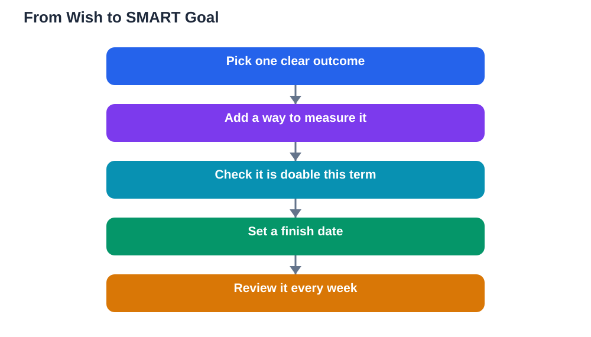

Many students work hard yet feel they are getting nowhere, and the reason is often not effort but direction. A vague aim like doing better gives you nothing to plan around and nothing to check. Setting smart goals students can actually follow changes that, because it turns a wish into a target with a clear finish line. This guide explains the SMART method in plain language and shows how to use it for real study goals.

The SMART method asks five questions about every goal you set. Is it specific enough that you know exactly what done looks like. Can you measure it, so you know whether you are making progress. Is it achievable with the time and resources you really have. Is it relevant to what matters most in your learning right now. And does it have a deadline, so it cannot drift forever. A goal that passes all five tests is far easier to plan, start and finish than one that only sounds good.

## What Each Letter of SMART Means

Specific means naming the exact outcome. Instead of improving at maths, a specific goal names the topic and the task, such as completing all the practice problems for one chapter and writing a one-page summary of the methods used. Measurable means you can count or check progress, for example the number of problems finished, pages summarised or flashcards reviewed. Achievable means honest about your week: a goal that needs hours you do not have will collapse, while a smaller goal you can actually keep builds confidence. Relevant means the goal connects to your current learning, not to a random task that feels productive but changes little. Timed means a date is attached, because a goal without a date is easy to postpone again and again.

## Setting Smart Goals Students Can Check Each Week

A good weekly check turns a goal from a poster on the wall into a habit. Pick one evening each week to sit with your goal for a few minutes and ask three questions. What did I finish this week. What got in the way. What is the next small step. Write the answers in a sentence or two, and adjust the plan rather than judging yourself. If a goal is falling behind, the check-in is the moment to shrink the next step, change the study time or ask for help, not the moment to abandon the whole goal. Over a term, these small weekly reviews matter more than any single burst of effort, because they keep the goal visible and realistic.

## Turning a Vague Wish Into a SMART Goal

Start with the vague version and rewrite it piece by piece. Take the wish to read more. Make it specific: read one chapter of the assigned textbook. Make it measurable: read for a set number of pages or finish the chapter and list its main ideas. Check achievability: choose reading slots that fit your real timetable, such as three short sessions across the week rather than one long session you keep skipping. Check relevance: pick the chapter that supports the next lesson or assignment, so the reading pays off quickly. Finally add a deadline: finish by a chosen evening. The rewritten goal is longer to write, but it tells you exactly what to do tomorrow, and that clarity is what gets work started.

## Planning the First Week of a SMART Goal

The first week decides whether a goal survives. Break the goal into daily or every-other-day actions and put them in your planner before the week begins. Keep the first actions deliberately small, because early wins build momentum and prove the plan fits your life. Prepare your materials in advance, so a study session starts with work instead of searching for notes or books. If a session is missed, move it to the next free slot instead of doubling the next session, because doubled sessions feel punishing and often get skipped too. At the end of the first week, review what worked and keep the parts that worked, even if they look unimpressive. A plan you follow beats a perfect plan you ignore.

## Common SMART Goal Mistakes to Avoid

One common mistake is setting too many goals at once. Three strong goals you can track will teach you more than ten goals you forget by the second week. Another mistake is making the measurable part too strict, such as demanding a perfect score on every practice set, which turns learning into pressure. Measure effort and completion as well as results, so a difficult topic still counts as progress when you work through it carefully. A third mistake is writing the goal once and never looking at it again. A goal needs a visible home, such as a notebook page, a planner or a chart on your wall, where you will see it every day. Finally, avoid copying someone else's goal. A goal that fits your subjects, timetable and strengths will always work better than an impressive goal borrowed from someone with a different week.

## AI Help: Muse AI

Muse AI is Meta's personal AI assistant, and it can help you shape a vague study aim into a clearer SMART goal. You can ask it to suggest ways to break a topic into measurable steps or to help you draft a simple weekly check-in list. Remember to check any plan against your own timetable and textbook, since the assistant supports your thinking but does not verify your work.

Join Muse with invite code LTGSWD — in the Muse app, go to Settings > Redeem token and enter the code.

Disclosure: LTGSWD is the author's Muse invite code.

## FAQ

### What makes a goal SMART?

A SMART goal is specific, measurable, achievable, relevant and timed. Each part has a job: specific says what you will do, measurable lets you track progress, achievable keeps it realistic, relevant keeps it useful, and timed adds a deadline. If any part is missing, the goal becomes harder to start or finish.

### How many SMART goals should a student set at once?

Start with two or three goals at most, and make sure at least one is short term. A small set is easier to review each week, and finishing one goal frees energy for the next. Adding more goals later is simple once the habit of checking in is established.

### What if my SMART goal turns out to be too hard?

Adjust the goal instead of dropping it. Shrink the scope, extend the deadline a little, or split the goal into smaller steps. Changing the plan is not failure; it is exactly what the weekly check-in is for, and a revised goal you complete beats an original goal you abandon.

### Should a SMART goal focus on grades or on learning habits?

Both can work, but habit goals are usually steadier. A goal like completing every practice set for a chapter is within your control, while a grade depends on many factors. Pair a habit goal with a learning goal, such as being able to explain a topic without notes, and progress becomes visible either way.

## Conclusion

SMART goals work because they replace guessing with a plan you can see, measure and adjust. Choose one goal that matters this week, write it in SMART form, and give it a weekly check-in. Small, clear targets repeated over a term build real progress, and that progress builds confidence for the next goal.

[Try the free AI lesson solver](/#tool)
