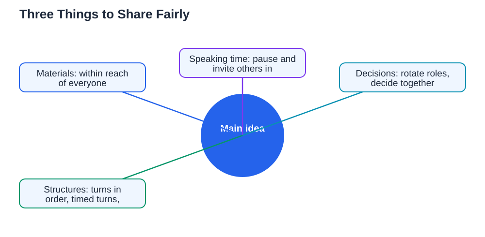

Sharing and turn-taking sound like skills for young children, but they matter just as much for older students working in groups. In any group, there are three things to share fairly: materials, speaking time, and decisions. When one person holds all the materials, talks the most, or decides everything, the rest of the group quietly stops contributing. When turns are shared well, everyone feels included, ideas improve, and the work gets better. These are practical skills you can practise in every group activity, and they make you the kind of team member others want to work with again.

## Sharing and Turn Taking: Share Materials Fairly

Materials cause more group friction than most students expect. When one person holds the book, the notes, or the equipment, others cannot contribute even if they want to. A simple fix is to place shared materials where everyone can reach them, or to rotate who holds them at set points. If there is only one copy of something important, take turns reading or using it, and summarise key points aloud so nobody is left waiting in silence. Digital materials help too, when you share a copy with the whole group rather than keeping it on one screen. Fair sharing of materials is a small habit, but it sends a clear message: this work belongs to all of us.

## Share Speaking Time, Not Just Airtime

Speaking time, sometimes called airtime, is the second thing to share. In lively groups, confident speakers can fill most of the conversation without meaning to, while quieter members hold back good ideas. A helpful habit is to notice who has not spoken yet and invite them in with a gentle question, such as "What do you think about this part?" Another is to pause after you speak, giving others space to respond instead of jumping straight to your next point. If you notice you have spoken several times in a row, step back on purpose and listen. Sharing airtime is not about counting seconds. It is about making sure every voice has a real chance to be heard before the group moves on.

## Take Turns Making Decisions

Decisions are the third thing to share, and they are often where fairness breaks down. When the same person always chooses the topic, the approach, or the final answer, other members stop feeling ownership of the work. A fairer way is to rotate decision roles: one person suggests, another checks the idea against the task, and the group decides together. For small choices, a quick vote works well. For bigger choices, hear one reason for and one reason against each option before deciding. Taking turns with decisions slows the group down slightly at first, but it produces choices everyone supports, which means far less resistance later. For more on helpful group discussion, see [How to Contribute to Class Discussions](/blog/class-discussions-how-to-contribute.html).

## Use Simple Turn Structures That Work

Simple structures make turn-taking easy, because nobody has to guess whose turn it is. Try going around the group in order for first ideas, so everyone contributes before anyone speaks twice. Try timed turns for debates, where each person gets a short, equal chance to speak. Try pairing first, where partners discuss briefly before sharing with the whole group, which helps quieter students gather their thoughts. Agree the structure at the start of the activity, and remind each other kindly when it slips. Structures feel a little formal at first, but they quickly become invisible habits that keep groups fair without anyone having to police them.

## When Sharing Feels Hard, Name It Kindly

Sometimes sharing feels hard because you care deeply about the work, or because you worry others will slow you down. Those feelings are normal, and naming them kindly helps. You might say, "I really want this to go well, so let us make sure we all get a turn," which frames fairness as care for the project, not as criticism. If someone consistently takes over, speak to them privately and kindly rather than arguing in front of the group. If you are the one who tends to take over, practise the pause: after finishing a point, count silently and wait for someone else to speak. Sharing well is a skill that grows with practice, and every group activity is a chance to get a little better at it.

## AI Help: Muse AI

Muse AI is Meta's personal AI assistant, and it can help you plan fairer group work. You can ask it to suggest simple turn-taking structures for a group activity, or to help you phrase a kind invitation for quieter members to share ideas. Join Muse with invite code LTGSWD — in the Muse app, go to Settings > Redeem token and enter the code.
Disclosure: LTGSWD is the author's Muse invite code.

## FAQ

### Why does turn-taking matter in group work?

Turn-taking matters because groups have materials, speaking time, and decisions to share. When one person dominates any of these, others stop contributing and the work gets weaker. Fair turns help every member feel included, which leads to better ideas and a stronger result.

### How can quiet students get a turn to speak?

Simple structures help, such as going around the group in order, pairing before whole-group sharing, or inviting quieter members with a gentle question. Pausing after you speak also gives others space. Quiet students often have thoughtful ideas, and a fair structure helps those ideas reach the group.

### What should I do if one person always takes over?

Speak to them kindly and privately if you can, framing fairness as care for the project. Suggest a simple structure, such as turns in order or timed turns, so the fix feels like a group agreement rather than a personal complaint. If it continues, ask a teacher for help with group roles.

### Is sharing materials really that important?

Yes, because whoever holds the materials controls who can contribute. Placing materials where everyone can reach them, rotating who holds them, and summarising key points aloud all help. When materials are shared, the whole group can think and work together instead of waiting.

## Conclusion

Sharing and turn-taking are the quiet skills that make group work fair. Share materials where everyone can reach them, share speaking time by pausing and inviting others in, and share decisions by rotating roles and listening before choosing. Practise these habits in your next group activity, and you will notice the difference: more voices, better ideas, and a team that enjoys working together.

[Try the free AI lesson solver](/#tool)
