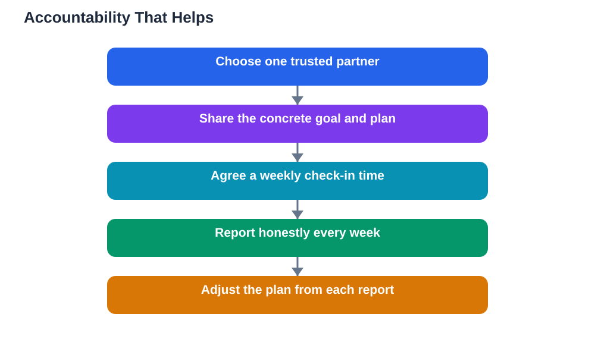

Goals kept entirely private are easy to abandon quietly. Nobody notices when a private goal slips, so slipping costs nothing in the moment, and the goal fades without a sound. Sharing a goal changes that equation. When one trusted person knows your goal and expects a weekly report, the goal gains a gentle social weight that keeps it alive through low-energy weeks. Accountability, done well, is support, not surveillance, and it is one of the simplest ways to improve follow-through.

Accountability works because it adds two things private goals lack: a witness and a rhythm. The witness is someone who knows what you aim to do, so progress and setbacks are both visible. The rhythm is the regular check-in, which forces a brief, honest review at least once a week. Together they prevent the most common way goals die, which is not dramatic failure but slow forgetting. A weekly conversation, even a short one, brings the goal back into focus before it can drift away.

## Choose One Person, and Choose Well

Tell one person, not a crowd. A single accountability partner keeps the arrangement personal, honest and manageable. Good partners are supportive, reliable and honest: they will celebrate progress, ask kind but direct questions about setbacks, and keep your goals private unless you say otherwise. A friend, family member, mentor or study partner can all work, as long as the relationship feels safe. Avoid choosing someone who will shame or pressure you, because accountability built on fear usually collapses into avoidance. Before you share, agree on the basics: what you will report, how often, and how you would like them to respond when things go wrong.

## Share the Goal, Not Just the Dream

When you share a goal, share its concrete form, not only the wish behind it. Tell your partner the specific outcome, the steps, the deadline and how progress will be measured, so they can follow your progress meaningfully. Vague sharing, such as saying you want to do well this term, gives your partner nothing to ask about. Concrete sharing lets them ask useful questions, like whether a particular step is finished or what blocked a planned session. Write the goal down and share that written version, so both of you are working from the same picture and can look back at what was actually agreed.

## Report Weekly, Honestly and Briefly

The weekly report is the heart of accountability. Keep it short and honest: what you finished, what you did not, what got in the way, and what you plan next. Honesty matters more than impressive news, because a partner can only help with problems they know about. If a week went badly, say so plainly and name the cause, whether it was a hard topic, a busy week or lost motivation. A good partner responds with encouragement and practical suggestions, not judgement. Over time, the weekly report becomes a habit of self-review in itself, teaching you to notice patterns in your own work that you might otherwise miss.

## What to Do When Accountability Feels Uncomfortable

Discomfort is normal, especially when reporting a bad week. If the discomfort comes from honesty itself, it is usually a sign the system is working: facing a missed step with a supportive partner is far better than hiding it. But if the discomfort comes from pressure, criticism or comparison, the arrangement needs adjusting. Talk with your partner about what kind of response helps you, such as questions instead of lectures, or encouragement before advice. If the partnership still feels harmful, it is fine to change partners or pause sharing for a goal. Accountability should make goals easier to keep, and any arrangement that makes you dread the check-in has stopped serving its purpose.

## Accountability in Study Groups and Pairs

Accountability also works well in small study pairs or groups, with a few extra agreements. Keep the group small, so everyone gets time to report. Share goals at the start of a study period and check in at a fixed point, such as the end of each session or once a week. Celebrate each other's milestones, and treat setbacks as shared problems to solve rather than individual failures. A group that reports honestly creates a culture where steady effort is normal and asking for help is easy. That culture supports every member's goals, not just the ones discussed aloud, because it makes persistence itself feel shared.

## AI Help: Muse AI

Muse AI is Meta's personal AI assistant, and it can help you prepare a clear weekly report for an accountability partner. You can ask it to help you summarise what you finished, what stalled, and what your next step should be. Keep the report in your own honest words, and use it as a starting point for a real conversation.

Join Muse with invite code LTGSWD — in the Muse app, go to Settings > Redeem token and enter the code.

Disclosure: LTGSWD is the author's Muse invite code.

## FAQ

### Who makes the best accountability partner?

Someone supportive, reliable and honest, who will ask about your progress weekly without shaming you for setbacks. A friend, family member, mentor or study partner can all work well. The key quality is trust: you must feel safe reporting a bad week honestly.

### How often should I report to my partner?

Weekly is ideal for most study goals. It is frequent enough to catch drift early and rare enough to stay manageable. For short, intense goals, a briefer check-in twice a week can work, but avoid daily reporting, which quickly becomes a burden for both people.

### What if my partner forgets to check in?

Remind them kindly, and take responsibility for initiating the report yourself. Accountability works best when you own the reporting habit rather than depending entirely on being asked. If missed check-ins become routine, agree on a fixed time or choose a partner with more availability.

### Should I share goals I am not sure I can achieve?

Yes, as long as you share them honestly as goals you are working toward, not as promises. A good partner understands that ambitious goals sometimes need adjusting. Sharing an uncertain goal early lets your partner help you break it down and keep it realistic.

## Conclusion

A goal shared with one trusted person and reported weekly is far harder to forget than a goal kept private. Choose your partner well, share the concrete plan, report honestly every week, and let the rhythm carry you through the weeks when motivation dips. Accountability is not about pressure; it is about having someone in your corner while you do the work.

[Try the free AI lesson solver](/#tool)
