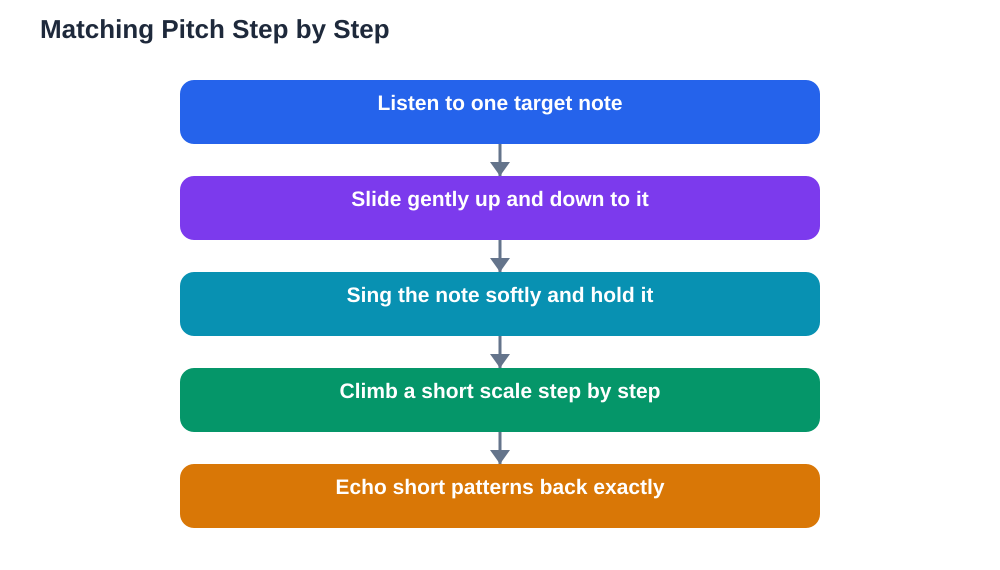

Singing in tune practice is a skill anyone can improve, even if you currently feel that you sing out of tune. Singing in tune simply means matching the pitch you hear: when a note is played, your voice produces the same note. That matching skill is learned, not born, and it improves with the same kind of patient, step-by-step practice that improves any other skill. Many people who think they cannot sing are really just people who have not yet trained their ears and voices to work together. This guide explains how pitch matching works and gives you simple exercises using slides and scales that build accuracy gently, without strain or embarrassment.

## Singing in Tune Practice: How Pitch Matching Works

Pitch matching works like a loop between your ear and your voice. First you hear a note, then your brain works out how high or low it is, then your voice adjusts until the sound you produce matches what you heard. When the loop is untrained, the voice often lands near the note but not exactly on it, which is why singing can sound out of tune even when you are trying hard. The way to train the loop is to practise with one note at a time, slowly, and to listen carefully to whether your voice matches. Singing softly helps, because a quiet voice is easier to control and easier to hear against the target note. It also helps to practise in a quiet room where you can hear yourself clearly. Do not worry about sounding beautiful at this stage; accuracy comes first, and a pleasant tone grows naturally as control improves.

## Slides: The Gentlest Way to Find a Note

Slides are the friendliest first exercise for pitch matching. Play or hum a single note, then slide your voice slowly upward from a lower pitch until you reach it, like a siren rising gently. Then slide slowly downward from a higher pitch to the same note. Sliding teaches your voice to move smoothly and helps your ear notice the moment when your voice matches the target, because the wobbling sound settles into a steady, matching sound. Try this with a few different notes, always gently and without pushing your voice. If a note feels too high or too low, choose a more comfortable one; straining never helps accuracy. Another useful slide exercise is to slide between two notes a small step apart, up and down, until the movement feels smooth and controlled. Slides remove the pressure of hitting a note instantly, which is why they work so well for beginners.

## Scales and Step-by-Step Pitch Exercises

Once slides feel comfortable, scales give your voice a ladder to climb. Sing a simple scale slowly, one note at a time, listening to each note before you sing the next. Start with a short scale of just three or four notes, and expand as you gain confidence. A helpful pattern is to play a note, sing it back, then play the next note and sing that, building the scale one step at a time. You can also practise echo singing: play a short pattern of two or three notes and sing it back exactly. Keep the speed slow and the volume comfortable, and repeat patterns that feel tricky until they feel steady. If you sing with an instrument or a pitch app, use it as a guide, not a judge: the goal is to train your ear, and every attempt, even an imperfect one, teaches your ear something. Over time, the steps of the scale will start to feel familiar, and your voice will find them more quickly.

## Listening Habits That Improve Tuning

Good tuning depends as much on listening as on singing. Spend a few minutes each day just listening: hum along quietly with a simple melody and notice whether your humming matches. Sing along softly with recordings you enjoy, keeping your voice gentle so you can hear both the recording and yourself. Practise hearing the difference between a note that matches and one that is slightly off, because recognising the difference is the first step to correcting it. It also helps to record yourself singing a short scale and listen back, because hearing yourself from outside often reveals things you cannot notice while singing. Be kind to yourself when you listen back; the recording is information, not a verdict. Every singer, even an experienced one, practises tuning regularly, and listening carefully is the habit that makes all the other exercises work.

## Confidence, Breath, and Singing Without Strain

Confidence affects tuning more than many people realise. When you are nervous, your breathing tightens and your voice wobbles, which makes matching pitch harder. Breathing calmly helps: stand or sit upright, relax your shoulders, and take a gentle breath before you sing, without gasping or forcing air. Sing at a comfortable volume, because shouting makes pitch control much harder, and whispering gives you too little sound to judge. Warm up with a few slides and a short scale before you sing a song, just as an athlete warms up before playing. If you practise with others, choose a supportive setting where mistakes are treated as normal steps in learning. Singing in tune is a practice, not a test, and a relaxed, patient approach will improve your accuracy faster than anxious, forced effort. For a daily routine that includes singing warm-ups, see [A Music Practice Routine Students Keep](/blog/music-practice-routine-students.html).

## AI Help: Muse AI

Muse AI is Meta's personal AI assistant, and it can help you practise singing in tune. You can ask it to explain pitch matching in simple words, or to suggest gentle warm-up exercises that build accuracy without straining your voice.

Join Muse with invite code LTGSWD — in the Muse app, go to Settings > Redeem token and enter the code.

Disclosure: LTGSWD is the author's Muse invite code.

## FAQ

### Can anyone learn to sing in tune?

Most people can improve a great deal with practice, because pitch matching is a learned skill linking ear and voice. Progress may be gradual, but steady practice with slides and scales helps almost everyone sing more accurately.

### Why do I sound fine alone but out of tune with others?

Singing with others adds the challenge of blending and listening at the same time. Practise matching one note at a time first, then sing along softly with a recording, and build up to group singing gradually.

### Should I sing loudly to hit notes better?

No. A comfortable, gentle volume gives you far better pitch control than shouting. Loud singing tightens the voice and makes accurate tuning harder, so keep your practice volume relaxed.

### How often should I practise pitch matching?

A few minutes most days is ideal. Short, focused exercises with slides and short scales build the ear-voice connection steadily, while long, strained sessions usually do more harm than good.

### What if I cannot tell whether I am in tune?

That listening skill develops with practice too. Try sliding slowly toward a target note and listening for the moment the sound settles and matches. Recording yourself and listening back also trains your ear to hear differences.

## Conclusion

Singing in tune grows from patient practice: listen carefully, slide gently to find notes, climb short scales step by step, and sing at a comfortable volume without strain. Trust the process, practise a little every day, and enjoy hearing your accuracy improve. For help with your school work and study questions, [Try the free AI lesson solver](/#tool).
