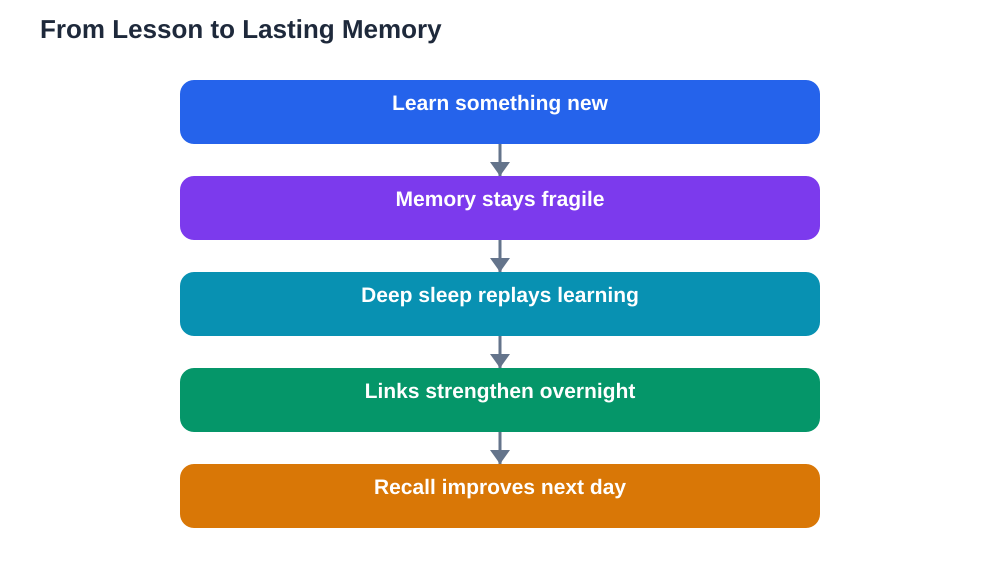

Have you ever studied something in the evening, gone to bed unsure of it, and woken up understanding it better? That is not imagination. The sleep and memory connection is one of the most useful ideas in learning science, because it explains why rest is part of studying rather than a break from it. When you sleep, your brain replays, organises, and strengthens the day's learning, turning shaky new knowledge into something you can actually recall later.

## The Sleep and Memory Connection Explained Simply

Memory formation happens in stages. First, you encounter new information in class or while studying. At that point the memory is fresh but fragile, like wet ink. Then, during sleep, the brain revisits that information and links it to what you already know. This process is called consolidation, and it is what turns a first exposure into lasting knowledge. Without enough sleep, consolidation is cut short, and the ink never quite dries.

Different stages of sleep do different jobs. Deep sleep is especially important for factual learning, such as vocabulary, dates, steps of a method, and definitions. Dream sleep, which comes later in the night, helps with skills, creativity, and emotional memories. That is why a full night matters more than a short nap before a busy day: you need the whole cycle, not just the first part, for complete consolidation.

## How Nights Cement Learning Step by Step

Think of a lesson as a set of loose threads. During the day you gather the threads, but they are not yet woven together. At night, the brain replays the day's patterns, testing connections between new threads and older, stronger ones. A new word links to a word you already know. A new method links to a problem type you solved before. Each replay strengthens the useful links and lets the irrelevant details fade.

This replay also explains why sleep helps with understanding, not just recall. While replaying, the brain can spot patterns you missed while awake. That is why a problem that defeated you at midnight sometimes yields to a fresh idea in the morning. Your brain kept working on it, quietly, while you rested. Sleeping on a problem is a real strategy, not an excuse to stop.

## Why Cramming Fails the Memory Test

Cramming feels productive because the material is fresh in your mind at midnight. But that freshness is short-term memory, which fades fast. Because cramming usually replaces sleep, it also removes the very process that would have made the learning last. The result is familiar to many students: you recognise the material during a late-night session, then blank on it when it counts.

Spaced review plus sleep beats cramming for a simple reason. Each time you revisit material on a different day, you give your brain another chance to consolidate it, and each night of sleep strengthens it further. A short review today, sleep, another short review tomorrow, and sleep again builds a far stronger memory than one long session followed by an exhausted morning.

## Using Sleep to Remember Better

You can work with your brain's nightly process instead of against it. Review the most important material in the evening, but finish early enough to wind down. Keep the review active: close the book and recall the main points aloud, or write a short summary from memory. Active recall gives the brain strong material to consolidate overnight, while passive re-reading gives it far less.

In the morning, test yourself again before opening your notes. Whatever you can recall unaided is genuinely learned; whatever you cannot is your study list for the day. This quick morning check also shows you the payoff of sleep directly, which makes the habit easier to keep. And when you use digital study tools, verify solutions against your textbook, because AI can make mistakes, and a wrong idea consolidated overnight is harder to unlearn.

## Protecting the Deep Sleep That Learning Needs

Deep sleep is easiest to reach when your routine is steady. A regular bedtime trains your body to fall asleep faster and reach deep stages sooner. A cool, dark, quiet room helps, as does avoiding heavy meals, bright screens, and exciting arguments late in the evening. Caffeine late in the day can also delay deep sleep, so keep stimulating drinks to the morning if you use them at all.

If your mind races at night, try a brain dump: write tomorrow's tasks and worries on paper, then close the notebook. Gentle stretching or slow breathing can also signal that the day is ending. Small, consistent habits matter more than dramatic one-night fixes, because memory consolidation is a nightly job, not a single event.

## AI Help: Muse AI

Muse AI is Meta's personal AI assistant, and it can help with this topic by turning a lesson into a short evening review quiz you can recall from memory before bed. Ask it to summarise your notes into five key questions, then test yourself on them the next morning.
Join Muse with invite code LTGSWD — in the Muse app, go to Settings > Redeem token and enter the code.
Disclosure: LTGSWD is the author's Muse invite code.

## FAQ

### Why do I remember things better after sleeping on them?

Because sleep consolidates memories, replaying the day's learning and linking it to older knowledge. The memory becomes stronger and easier to retrieve after a full night than it was immediately after studying.

### Is it better to revise before bed or in the morning?

Both help, but an evening review followed by sleep is especially powerful, since the brain consolidates that fresh material overnight. A quick morning recall check then confirms what actually stuck, which guides the next study session.

### Can a nap replace a night of sleep for memory?

A short nap can refresh attention and help with recent learning, but it does not replace the full cycles of a night's sleep. Deep sleep and dream sleep both play roles in consolidation, and only a proper night gives you the complete sequence.

### What should I do if I studied but still forget everything?

Check two things: whether you tested yourself by recall rather than only re-reading, and whether you slept properly afterwards. Add active recall to your routine, space your reviews across days, and protect your bedtime. If forgetting persists across many subjects, talk to a teacher or a trusted adult about study strategies.

## Conclusion

Memory is not built only while you study; it is finished while you sleep. Treat your nights as part of your revision plan, review actively in the evening, and let deep sleep cement what you learned. Your future self, recalling the answer with ease, will thank you.

[Try the free AI lesson solver](/#tool)
