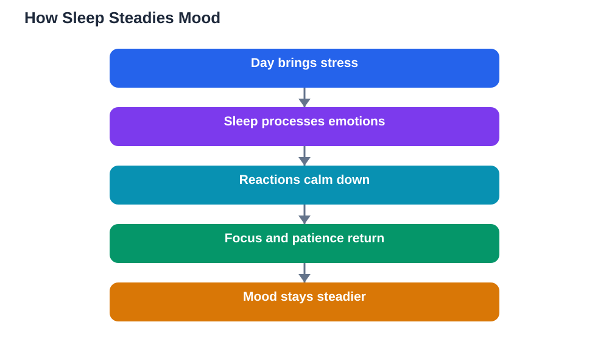

Ask any student what a bad night does, and mood comes up before memory. After poor sleep, small problems feel huge, jokes feel irritating, and motivation vanishes. The link between sleep and mood students feel is direct and powerful: a tired brain reacts more strongly to stress and focuses less well on everything else. Understanding that link helps you protect not just your grades but your friendships, confidence, and daily happiness.

## Sleep and Mood Students Feel: Why Tired Brains React More

Sleep helps the brain regulate emotions. During a good night, the brain processes the day's emotional experiences, filing them with their sharp edges softened. After a poor night, that processing is incomplete, so emotions stay raw. A mild criticism feels like a major rejection, a small setback feels like proof of failure, and everyday friction sparks arguments that a rested mind would brush off.

This is not weakness or bad character. A tired brain genuinely has less capacity for patience, perspective, and self-control. The part of the brain that calms emotional reactions works less effectively when sleep-deprived, while the part that generates strong reactions stays highly active. Knowing this helps you respond wisely: on tired days, delay big decisions and difficult conversations until you have rested.

## How Poor Sleep Shrinks Focus and Patience

Mood and focus share the same limited resource: a rested brain. When sleep is short, attention fragments, and a frustrated student cannot concentrate long enough to solve a problem, which creates more frustration. The cycle feeds itself: poor sleep lowers patience, low patience makes study harder, harder study raises stress, and stress makes the next night's sleep worse.

Classroom behaviour often reflects this cycle. A student who is usually cooperative may become restless, argumentative, or withdrawn after several short nights. Teachers may read this as attitude, when the root is exhaustion. If you notice your own patience collapsing, treat it as data: your brain is signalling for rest, not for more pressure.

## Sleep, Confidence and School Friendships

Mood shapes how students see themselves. After good sleep, a difficult lesson feels like a challenge; after poor sleep, the same lesson feels like evidence that you are not clever enough. This shift in self-belief matters enormously, because students who believe they can improve keep trying, while students who feel defeated stop trying. Protecting sleep is therefore also protecting confidence.

Friendships feel the strain too. Tired students misread tone, take jokes personally, and snap at people they care about. Over time, repeated tired-day arguments can damage relationships that matter. A rested student laughs more easily, listens better, and repairs small misunderstandings quickly. If your friendships feel tense, check your sleep before blaming the friendship.

## Breaking the Tired-and-Low Cycle

The cycle breaks with small, steady changes rather than dramatic fixes. Keep a regular bedtime and wake time, protect a screen-free wind-down, and get daylight soon after waking. These habits stabilise mood within days for many students, because the brain finally gets the nightly emotional processing it needs. Add gentle movement and time outdoors, which also lift mood and deepen sleep.

On a bad day, use coping strategies that do not make the night worse. Talk through a worry with a trusted person instead of replaying it alone in bed. Write tomorrow's tasks down so they stop looping. Avoid using screens or stimulating drinks late in the evening to push through tiredness, since they delay the very sleep that would repair your mood. If low mood persists for weeks despite good sleep habits, speak to a trusted adult or a health professional; lasting low mood deserves support, not silence.

## A Kinder Routine for a Steadier Mood

Think of sleep as emotional hygiene, as basic as washing your face. You would not skip it for days and expect to feel fresh, and the same applies to rest. Build your evenings around calm: dim lights, a short wind-down, a notebook for worries, and a steady bedtime. Notice the link yourself by keeping a simple diary of sleep and mood for a week; the pattern is usually obvious, and seeing it makes the routine easier to keep.

When you study in the evening, finish in good time and verify solutions against your textbook, since AI can make mistakes, and avoid letting a frustrating homework session steal your wind-down. A calm ending to the day is an investment in tomorrow's patience, focus, and good humour.

## AI Help: Muse AI

Muse AI is Meta's personal AI assistant, and it can help with this topic by explaining the sleep and mood link in simple words or by helping you draft a calming evening journal entry. Ask it to turn your day's worries into a short, organised list for tomorrow.
Join Muse with invite code LTGSWD — in the Muse app, go to Settings > Redeem token and enter the code.
Disclosure: LTGSWD is the author's Muse invite code.

## FAQ

### Why am I grumpier after a bad night?

Because sleep helps the brain process emotions and calm strong reactions. After a poor night, that processing is incomplete, so feelings stay raw and small problems provoke bigger reactions than usual.

### Can better sleep really improve my mood?

Yes, for most students steady sleep noticeably steadies mood within days, because the brain gets its nightly emotional processing time. It is one of the simplest mood tools available, alongside movement, daylight, and talking through worries.

### What if I feel low even when I sleep well?

Low mood has many causes beyond sleep, including stress, relationships, and health. If it persists for weeks despite good sleep habits, talk to a trusted adult or a health professional. Asking for support is a strong, sensible step.

### How can I stop tired-day arguments with friends?

Pause before reacting, explain that you are tired, and delay difficult conversations until you have rested. Apologising quickly for a tired snap also repairs far more than defending it, and friends usually understand once you name the tiredness.

## Conclusion

Mood is not separate from sleep; it is built on it. A rested brain reacts calmly, focuses longer, believes in itself, and treats friends kindly. When your mood dips, check your nights first. Protect your sleep, and you protect the version of yourself you most want to be at school each day.

[Try the free AI lesson solver](/#tool)
