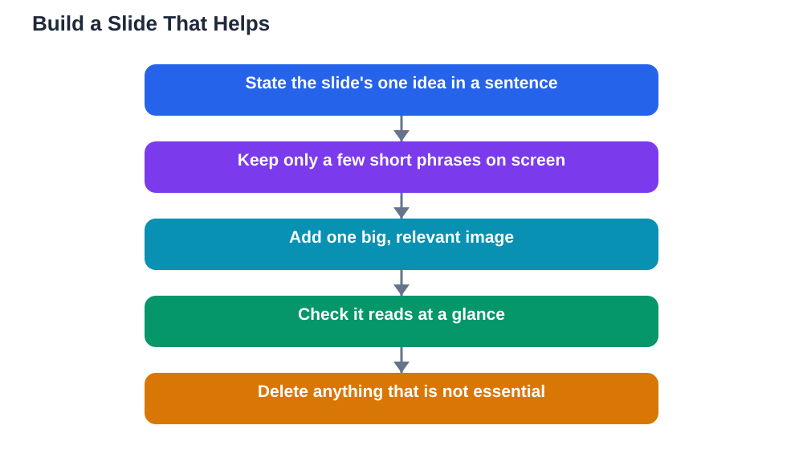

Learning to make slides that help not hurt your presentation is one of the quickest ways to improve as a speaker. Slides are meant to support what you say, not replace it. Yet many student talks are weakened by slides packed with paragraphs, tiny text, and cluttered charts, which force the audience to choose between reading the screen and listening to the speaker. They cannot do both well, so they usually do neither. The fix is simple and it works for every subject: few words, big images, and one idea per slide. When your slides are clear, your audience can glance, understand, and return their attention to you, which is exactly where it belongs.

## Slides That Help Not Hurt Start With One Idea

Every slide should carry a single idea that you can state in one sentence. Before you build a slide, write that sentence down. If you cannot, the slide is trying to do too much, and you should split it. A slide about causes gets its own slide, and a slide about solutions gets another. This discipline also improves your talk itself, because it forces you to organise your thinking into a clear sequence instead of a pile of points. When you move to a new slide, the audience should feel a small step forward, not a jump to a different subject. Number your ideas in your head as you plan, so you can check that each slide earns its place. If a slide does not add anything your words cannot say alone, delete it. Fewer, clearer slides almost always beat more slides.

## Few Words, Big Images

The most common slide mistake is copying your speech onto the screen. Your slides are not your notes, and your audience should never be reading paragraphs while you talk. Aim for a handful of short phrases per slide, each one a cue for what you will explain aloud. Big images work better than blocks of text because they are understood at a glance and they give the audience something to look at while they listen. Choose images that illustrate your point directly, not decoration that fills space. A photo, a simple diagram, or a single clear chart usually beats a busy graphic. Make sure images are large enough to see from the back of the room, and keep the layout uncluttered, with plenty of empty space around each element. Empty space is not wasted space; it is what makes the important parts stand out.

## One Idea Per Slide, in Order

Order matters as much as content. Arrange your slides so that each one follows naturally from the one before it, building your argument step by step. A useful test is to read only your slide headings in order: they should tell the story of your talk on their own. If a heading feels out of place, move that slide or rethink the section it belongs to. Use the same layout style throughout, so the audience spends no effort relearning each slide. Keep headings short and meaningful, not vague labels. A heading that states the point, rather than just naming a topic, helps the audience follow you even if they miss a sentence. And remember that transitions matter: when you change slides, say one sentence that connects the old idea to the new one, so the audience travels with you instead of being left behind.

## Design Habits That Keep Slides Readable

A few design habits make every slide easier to read. Use one clear font in a large size, and keep it consistent across the whole talk. Use strong contrast between text and background, so words stay readable even in a bright room or on a weak projector. Limit yourself to a small set of colours, and use colour to highlight the most important element, not to decorate everything. Avoid animations that distract, sounds that surprise, and effects that slow you down. Check every slide from a distance before you present, either by standing back from your screen or by previewing the talk in the room if you can. If you cannot read a slide quickly at a glance, simplify it until you can. Finally, save a backup copy of your slides, and bring them in more than one way if possible, so a technical problem does not become a disaster.

## AI Help: Muse AI

Muse AI is Meta's personal AI assistant, and it can help you plan clearer slides for your next talk. You can ask it to help you shorten a paragraph into a few short phrases, or to suggest a simple order for your slide headings. It gives general planning help, not verified facts, so always check your content against your textbook or notes before presenting.

Join Muse with invite code LTGSWD — in the Muse app, go to Settings > Redeem token and enter the code.

Disclosure: LTGSWD is the author's Muse invite code.

## FAQ

### How many words should be on one slide?

There is no strict rule, but a handful of short phrases is a good guide. If a slide looks like a paragraph, move most of those words into what you will say aloud, and keep only the cues on screen.

### Should I read my slides aloud?

No. Reading slides aloud bores the audience, because they can read faster than you can speak. Use the slide as a cue, then explain the idea in your own words while facing the audience.

### What if my teacher expects detailed slides?

You can still keep slides clear and put detail in your spoken explanation or in a separate handout. If detailed slides are required, keep each slide to one idea and use short phrases rather than full paragraphs.

### Are images better than charts on slides?

It depends on your point. A single clear chart is excellent when you need to show a comparison or a trend, but a busy chart with tiny labels hurts more than it helps. Simplify charts ruthlessly before they reach a slide.

### How do I handle a slide that looks too crowded?

Split it into two slides, enlarge the key image, and delete anything that is not essential to the point. If you are unsure what to cut, ask yourself what the audience must remember from that slide, and keep only that. For a strong start to the talk itself, see [Opening a Presentation Strong](/blog/opening-a-presentation-strong.html).

## Conclusion

Good slides are invisible in the best way: the audience barely notices them, because they are too busy understanding your talk. Few words, big images, and one idea per slide will carry you further than any fancy effect. Build your next set of slides with that rule, practise talking through them, and watch how much easier presenting feels. Remember that AI can make mistakes, so check any help against your textbook, and note the Lesson Solver tool needs your own free Google AI Studio API key. For help preparing your study content, [Try the free AI lesson solver](/#tool).
