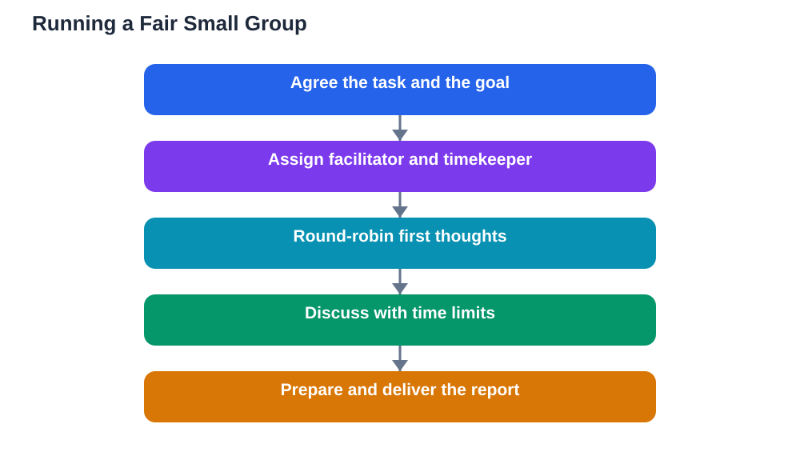

Small group discussions can be the best part of a lesson or the most frustrating. When they work, every student gets a real chance to speak, ideas bounce around quickly, and quieter students find their voice. When they fail, one person talks while the rest sit silently, the group drifts off topic, or the time runs out before anyone reaches a conclusion. The difference usually comes down to a few simple structures that keep the discussion fair.

Fairness in a small group does not happen by accident. It needs roles, time limits, and habits that share speaking time deliberately. The tips below work for groups of three to six students, which is the size where discussion is most productive and most at risk of being dominated.

## Start With a Clear Task

A group without a clear task will wander. Before discussing, make sure everyone knows exactly what the group must produce or decide by the end: an answer to a question, a list of ideas, a chosen viewpoint, or a short report for the class. Write the task down where everyone can see it, so the group can check back when the conversation drifts.

A clear task also gives quieter students an entry point. When the goal is specific, anyone can contribute a piece of it, rather than needing a grand opinion to join in. If your teacher's instructions feel vague, spend the first minute of group time agreeing on what success looks like. That minute saves many wasted ones later.

## Assign Roles That Share the Work

Roles are the simplest way to keep a small group fair. Common roles include a facilitator who keeps the discussion moving, a timekeeper who watches the clock, a note-taker who records key points, and a reporter who shares the group's conclusions with the class. Rotating roles across lessons means no student is always stuck in the same job.

Roles work best when they are agreed quickly and taken seriously. The facilitator's job is not to dominate, but to invite contributions and keep turns balanced. The note-taker's job is not to stay silent, but to record while still joining in. When everyone has a job, everyone has a reason to stay engaged, and the group stops depending on a single confident voice.

## Set Time Limits for Each Part

Time limits sound restrictive, but they actually protect fairness. Without them, the first topic eats the whole session and later points never get discussed. Agree at the start how long each part of the task should take, and let the timekeeper give gentle warnings as each limit approaches.

A useful pattern is to split the time into three parts: a short round where everyone shares an initial thought, a longer middle for open discussion, and a final few minutes for agreeing on conclusions and preparing the report. This structure guarantees that every student speaks at least once, even in a group where one voice tends to dominate.

## Share Speaking Turns Deliberately

In an unstructured group, speaking time follows confidence, not fairness. Deliberate turn-sharing fixes this. One simple method is to go around the circle for first thoughts, so everyone speaks before anyone speaks twice. Another is for the facilitator to invite specific contributions: "We have heard two views on this, who has a different angle?"

If you notice you have spoken several times while a group member has not spoken at all, pause and invite them in. A direct but gentle invitation, such as "What do you think about this point?" works better than a general "Anyone else?" which usually gets answered by the same confident voices. Fair groups are built by these small, deliberate invitations.

## Keep the Discussion On Track

Small groups drift easily, especially when the topic touches on everyday life. A short detour can be enjoyable, but it steals time from the task. The facilitator should watch for drift and steer back kindly: "That is an interesting point, but let us get back to our question so we finish on time."

The note-taker can help here too, by reading back the task or the points covered so far whenever the group loses its thread. A quick recap often refocuses everyone without any awkwardness. If the group genuinely finishes early, that is the time for broader conversation, not the middle of the task.

## Disagree Respectfully in a Small Space

Disagreement feels more personal in a small group, where there is nowhere to hide and everyone hears every word. That makes respectful disagreement even more important. Keep the same rules as whole-class discussion: disagree with ideas, not people, give reasons, and acknowledge good points even from a view you oppose.

Small groups also benefit from a quick agreement at the start: everyone gets to finish speaking, and disagreement is welcomed as long as it stays kind. When this norm is stated openly, even once, students feel safer offering views that differ from the group's majority. A group where dissent is safe produces better conclusions than one where everyone nods along.

## Report Back Clearly to the Class

The final job of a small group is reporting back, and this is where many groups waste their good work. A clear report names the group's main conclusions, mentions any disagreement within the group, and gives one or two reasons for each conclusion. The reporter should not just read a long list of everything said, but pick the points that matter most.

Prepare the report during the final minutes of group time, not in the thirty seconds before speaking. The note-taker's record makes this easy. A strong report also credits contributions fairly, using phrases like "Our group agreed that..." or "Some of us thought..., while others thought..." This honesty about disagreement shows the class that the group genuinely discussed, rather than simply following one voice.

## AI Help: Muse AI

Muse AI is Meta's personal AI assistant, and it can help you prepare for small group discussions. You can ask Muse to suggest fair roles for your group size, draft time limits for a task, or practise a clear report-back summary before you present it to the class. This preparation helps your group run smoothly from the start.

Join Muse with invite code LTGSWD — in the Muse app, go to Settings > Redeem token and enter the code.

Disclosure: LTGSWD is the author's Muse invite code.

## FAQ

### What if one person dominates our small group?

Use roles and turn-sharing deliberately. The facilitator can thank the dominant speaker and invite others in, and a round-robin for first thoughts guarantees everyone speaks once before anyone speaks twice. If the pattern persists, raise it with your teacher privately.

### How big should a discussion group be?

Three to six students usually works best. Smaller groups can run out of ideas, while larger groups make it easy for quieter students to hide. If your class forms larger groups, split into pairs for first thoughts before coming together as a whole.

### What should the note-taker actually write down?

Main points, key reasons, points of disagreement, and the group's final conclusions. Short phrases are enough. The notes exist to support the report-back and to help the group track its own thinking, not to record every word.

### What if our group cannot agree?

Disagreement is a valid outcome. Report it honestly to the class, naming both views and their reasons. A group that reports a genuine disagreement has done better discussion work than one that forced a false agreement just to finish quickly.

## Conclusion

Fair small group discussions rest on clear tasks, shared roles, time limits, deliberate turn-sharing, and a clear report-back. These structures do not stifle conversation. They protect it, by making sure every voice has room and every minute counts. Try assigning roles and time limits in your next group discussion and notice how much fairer and more productive it becomes.

[Try the free AI lesson solver](/#tool)
