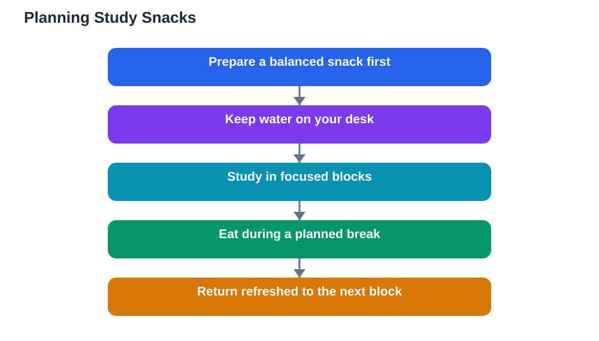

Snacks for study sessions can help or harm your revision, depending on what you choose and when you eat it. The right snack keeps hunger quiet, energy steady, and attention on the work. The wrong snack brings a quick lift followed by restlessness, thirst, and a craving for more. Learning to choose well is a small skill with a large payoff, because revision sessions stretch over hours, and steady fuel protects every one of those hours.

The core principle is simple: study snacks should combine foods, not rely on a single sweet or salty item. Protein and fruit, for example, work far better together than crisps and cola. Protein helps you feel full, fruit adds freshness and natural sweetness, and water keeps thirst from disguising itself as hunger. That combination supports calm, sustained focus instead of a rollercoaster afternoon.

## Why crisps and cola fail as study fuel

Crisps and cola are designed to be instantly enjoyable, and that is exactly why they fail during revision. Crisps are salty and easy to eat without thinking, so a large amount disappears before you notice. They leave you thirsty, and thirst often leads to more fizzy drink, which adds sugar and restlessness. Cola brings a sweet rush followed by a fall, which scatters attention just when you need it most.

The deeper problem is grazing. A bag of crisps and a bottle of cola invite continuous snacking while you work, which splits attention between the page and the food. Revision needs undivided attention, and every handful is a small interruption. Planned snacks, eaten during breaks, protect focus far better than food that sits beside you all session.

## Protein and fruit: a steadier pair

Protein foods help you feel satisfied for longer, which is why they suit study sessions so well. Yoghurt, cheese, eggs, beans, or a small portion of nuts where suitable all provide staying power in a modest portion. Paired with fruit, they make a snack that is both satisfying and fresh. An apple with yoghurt, a banana with a small portion of nuts, or bread with a protein filling are all easy examples.

Fruit deserves its place because it offers natural sweetness without the sharp swing of sweets. It is also quick to eat, easy to carry, and available in many varieties, so you can rotate choices through the week. Together, protein and fruit cover two needs at once: lasting fullness and pleasant flavour. That combination keeps hunger quiet without demanding a large meal in the middle of revision.

## Timing your study snacks

When you eat matters almost as much as what you eat. A snack eaten before a session sets a steady base, while a snack eaten during a planned break restores energy for the next block of work. Snacking continuously during work, by contrast, turns food into a distraction and makes it hard to judge how much you have eaten.

A practical rhythm is to study in blocks, with a short break between each block. Use the break to stretch, drink water, and eat a planned snack if you need one. Then return to the desk with the food finished and attention restored. This structure gives your brain natural pauses, which help memory settle, and it keeps snacking deliberate rather than automatic.

## Preparing snacks before you sit down

Decide your snack before the session starts, and prepare it in advance. A prepared snack removes the temptation to grab the nearest sweet or salty item when hunger strikes mid-revision. Keep study snacks simple: fruit washed and ready, yoghurt in the fridge, bread and a filling at hand. Preparation takes a few minutes and saves many distracted minutes later.

Keep the snack away from the desk until break time. A plate beside your notes invites nibbling, while a snack kept in the kitchen waits for its proper moment. That small separation is a useful self-management habit. It teaches you to plan breaks, respect your own schedule, and return to work with a clear mind.

## Drinks during revision

Water is the best companion for a study session. Keep a bottle on your desk and take small drinks regularly, rather than waiting until you feel very thirsty. Thirst can easily be mistaken for hunger, and it can push you toward sweet drinks that disturb focus. A bottle of water removes that confusion at a glance.

Sweet drinks and strong caffeinated drinks are poor study partners. Sweet drinks repeat the rise-and-fall pattern of sweets, while caffeinated drinks can disturb sleep, which harms the next day's learning. If you want flavour, add fruit slices to water at home. The goal is a drink habit you can repeat every day without side effects.

## Snacks for different study lengths

Short sessions need little more than water and perhaps a piece of fruit. A long session, with several blocks of work, benefits from a planned snack during a longer break. Match the snack to the session: light for short work, more substantial for a long afternoon. Over-snacking during short sessions can leave you feeling heavy and sleepy, which defeats the purpose.

Group study brings its own snack questions. Shared snacks can be enjoyable, but they can also become the main event. Agree on a break time for snacks, and keep food away from notes and books. When the break ends, food is put away and work resumes. That boundary protects both the study and the friendship, because nobody's revision is derailed by endless grazing.

## AI Help: Muse AI

Muse AI is Meta's personal AI assistant, and it can help you plan revision sessions with well-timed breaks. You could ask it to suggest steady snack combinations for study, or to help you build a revision timetable with snack breaks built in. Join Muse with invite code LTGSWD — in the Muse app, go to Settings > Redeem token and enter the code.
Disclosure: LTGSWD is the author's Muse invite code.

## FAQ

### What is the best snack for studying?

A snack that combines food groups works best, such as fruit with yoghurt, bread with a protein filling, or a small portion of nuts with fruit. Keep water nearby, eat during a planned break, and avoid grazing continuously at your desk. Steady combinations support calm focus for longer.

### Why are crisps and cola bad for revision?

Crisps encourage mindless eating and leave you thirsty, while cola brings a sweet rush followed by a fall in energy. Together they split attention, increase restlessness, and often lead to more snacking without real satisfaction. They are occasional treats, not study fuel.

### Should I snack while I study or during breaks?

During breaks is better. Eating during work divides attention and makes portions hard to track. A planned break for stretching, water, and a snack restores energy and gives your brain a pause, so you return to the next block refreshed and focused.

### How much should I eat during a long study session?

Match the snack to the session length. Short sessions need little more than water and fruit, while long sessions benefit from a more substantial snack during a longer break. Avoid overeating, which can leave you heavy and sleepy. Small, planned snacks beat large, unplanned ones.

### What should I drink while revising?

Water is the best choice. Keep a bottle on your desk and drink small amounts regularly. Sweet drinks can disturb steady focus, and strong caffeinated drinks can harm sleep. If you want flavour, add fruit slices to water at home.

## Conclusion

Snacks for study sessions work best when they are planned, balanced, and eaten during breaks. Choose protein and fruit over crisps and cola, keep water on your desk, and prepare your snack before you sit down. Match the snack to the length of the session, and keep food away from your notes until break time. These small habits protect your focus across the whole session, and they turn snacking from a distraction into a genuine support for learning.

[Try the free AI lesson solver](/#tool)
