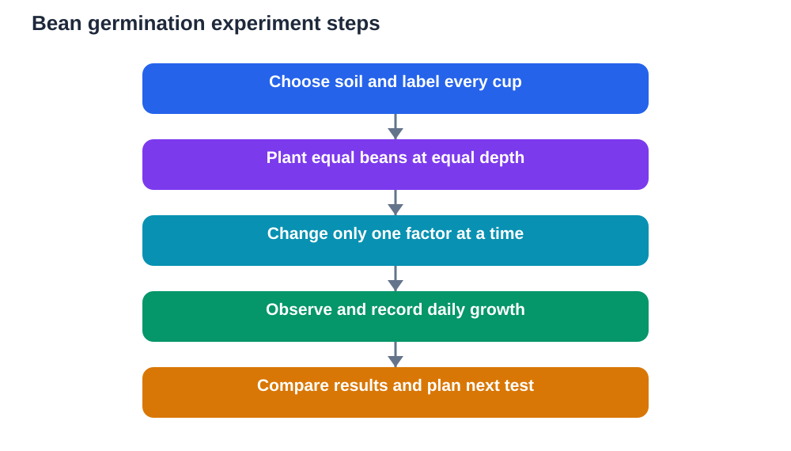

A seed looks quiet and still, yet inside it sits a tiny plant waiting for the right conditions. Add soil, water, air and warmth, and that quiet seed can push out a root, lift a shoot and begin to grow. Soil and seeds offer one of the best hands-on studies for students because the experiment is simple, the changes are visible, and the results raise excellent questions.

Growing curiosity matters as much as growing plants. A good seed experiment teaches fair testing, daily observation, honest recording and patient thinking. It also connects classroom ideas about living things to something you can watch with your own eyes.

## What a Seed Needs to Begin Growing

Germination is the process by which a seed starts to grow. Most seeds need water, air and suitable warmth to begin. Water softens the seed coat and wakes the embryo inside. Air provides oxygen for the energy the young plant needs before it can make its own food. Warmth speeds the process, while cold conditions often slow it down.

Light is a common point of confusion. Many seeds do not need light to germinate, although seedlings need light soon after they emerge so they can make food by photosynthesis. That distinction is worth testing and remembering: germination and later growth have different needs. A seed also contains stored food that feeds the young plant at first, which is why a seedling can grow for a while even before its leaves are fully working.

When you study seeds, always verify explanations against your textbook, and remember that AI tools can make mistakes. Your own experiment, carefully recorded, is strong evidence for what happened in your conditions.

## Meet the Soil Beneath the Seed

Soil is not one single material. It is a mixture of mineral particles, organic matter, air and water, and the balance of those parts changes how it behaves. Sandy soil feels gritty and drains quickly. Clay-rich soil feels smooth and sticky when wet and holds water longer. Loamy soil, a mixture with a good balance of particles and organic matter, often feels crumbly and holds both water and air reasonably well.

You can explore soil simply and safely. Take a small sample, rub it gently between your fingers, and describe the texture in plain words. Add a little water and notice whether it forms a ball, crumbles, or feels slippery. Observe colour too, because darker soil often contains more organic matter, though colour alone never tells the whole story.

Soil also contains tiny spaces, called pores, that hold air and water. Roots need both. Soil that is constantly waterlogged leaves little room for air, while soil that dries out completely leaves little water for the plant. Good growing conditions usually mean a balance, not an extreme.

## Set Up a Fair Bean Experiment

Dried beans make an excellent experiment subject because they are large, easy to handle and quick to show change. You will need a few clear cups or pots, some soil, dried beans, water and labels. Plant the same number of beans in each cup at the same depth, and label every cup clearly so you never mix them up.

A fair test changes only one factor at a time. For example, to test water, keep light, soil type, bean number and temperature the same, and give one cup regular water, one cup very little water, and one cup no water after the first soaking. To test light, keep watering the same and place one cup in light and one in shade after germination. Changing several factors at once makes results impossible to interpret, so resist that temptation.

Soak beans briefly before planting if your method calls for it, and handle them gently. Record the planting date, the number of beans in each cup, the soil used, the watering plan and the position of each cup. That setup note is the foundation of the whole experiment.

## Observe Germination Day by Day

Germination often begins below the surface, so early changes may be invisible in soil. A clear cup lets you see roots forming against the side, and a damp paper method lets you watch the whole process closely. In a paper method, place beans between damp paper layers inside a clear bag or container, keep the paper damp but not dripping, and observe daily.

Record what you see each day in short, honest notes. Note the date, the length of the root or shoot in general terms or with a ruler, the colour of the shoot, and whether leaves have appeared. Draw the seedling at intervals, even roughly. Drawings reveal changes that words sometimes miss, such as the direction of root growth or the curl of a shoot.

Roots usually grow downward and shoots grow upward, a pattern worth noticing and discussing. Roots anchor the plant and absorb water, while shoots carry leaves toward light. Watching that division of labour appear from a single seed is one of the most satisfying moments in plant study.

## Compare Soils and Record the Difference

Once you understand the basic setup, try comparing soil types. Plant the same beans in sandy soil, clay-rich soil and a balanced loamy mix, keeping water, light and temperature as similar as possible. Observe which cups germinate first, which seedlings look strongest, and which soil dries out or stays wet longest.

Record drainage as well as growth. After watering, note how quickly water disappears from the surface and whether water collects at the bottom. Those observations help explain growth differences. A seedling struggling in waterlogged soil may be short of air, while one in very fast-draining soil may be short of water. Linking cause and observation is the heart of scientific thinking.

Present your results in a simple table with columns for soil type, germination date, shoot height over time and general health notes. A table makes comparison easy and helps you explain your findings to others without exaggeration.

## When Things Go Wrong, Learn From It

Not every seed germinates, and not every seedling thrives. That is normal and useful. If a cup shows mould, the conditions may have been too wet or air may have been poor. If seedlings grow tall, pale and weak, they may have needed more light. If growth stops after a strong start, water, air or temperature may have changed.

Treat problems as data, not failure. Write down what went wrong, what you think caused it, and what you would change next time. A second run with one improvement often teaches more than a perfect first run, because it shows that science improves through revision. Never hide a failed cup or invent a better result. Honest records, including disappointments, are what make an experiment trustworthy.

Also consider the limits of one small experiment. Results from a few cups in one place do not prove a universal rule. They suggest a pattern worth testing again, ideally with more cups and the same careful method. That caution is a sign of strong thinking, not weak results.

## Grow the Study Beyond the Cup

Soil and seed study can grow in many directions. You can test seed size, planting depth, or temperature by moving cups to warmer and cooler spots while keeping other factors steady. You can observe how seedlings respond when a cup is turned on its side, or how roots behave when water comes from below rather than above. Each new question needs its own fair test and its own record.

Outdoor observation adds another layer. Look at where seedlings and young plants grow well outdoors, and where they struggle. Notice shade, shelter, drainage and foot traffic. Connecting your cup experiment to real outdoor conditions helps you understand why gardeners and farmers pay such close attention to soil and water.

Finally, share your findings simply. A short summary with your question, method, results and conclusion is excellent study practice. Explain what you did, what you observed, and what you would test next. Clear, modest conclusions impress far more than grand claims.

## AI Help: Muse AI

Muse AI is Meta's personal AI assistant, and it can help you organise experiment notes into clear study material. For this topic, you can ask it to help you turn daily germination notes into a tidy summary of what changed and when.

Join Muse with invite code LTGSWD — in the Muse app, go to Settings > Redeem token and enter the code.

Disclosure: LTGSWD is the author's Muse invite code.

## FAQ

### What do seeds need to germinate?

Most seeds need water, air and suitable warmth to begin growing. Water softens the seed coat, air supplies oxygen for early energy needs, and warmth supports the process. Many seeds do not need light to germinate, though seedlings need light soon after emerging to make their own food.

### Why use beans for a germination experiment?

Beans are large, easy to handle, inexpensive and quick to show visible change. Their size makes roots and shoots easy to observe and measure, which is ideal for beginners. They also germinate reliably under suitable conditions, so students can focus on observation and fair testing.

### What makes a seed experiment fair?

A fair test changes only one factor at a time while keeping everything else the same. Use the same number of seeds, the same planting depth, the same soil for a single comparison, and similar light and temperature. Label every cup clearly and record the setup before results appear.

### Why did some of my seeds not germinate?

Seeds vary naturally, and some may be old, damaged or kept in unsuitable conditions. Too much water, too little air, cold conditions or deep planting can also slow or prevent germination. Record which seeds failed and under what conditions, and treat that pattern as useful data for your next run.

### How is soil type linked to plant growth?

Soil texture affects how water drains and how much air reaches roots. Fast-draining soil may dry out quickly, while heavy, sticky soil may hold water and leave little room for air. Balanced, crumbly soil often supports steadier growth because it holds a better mix of water and air.

## Conclusion

Soil and seeds teach patience, fairness and careful observation in a form you can watch day by day. Plant simply, change one factor at a time, record honestly, and let the seedlings show you what they need. A small cup experiment, done well, builds study skills that serve every science topic that follows.

[Try the free AI lesson solver](/#tool)
