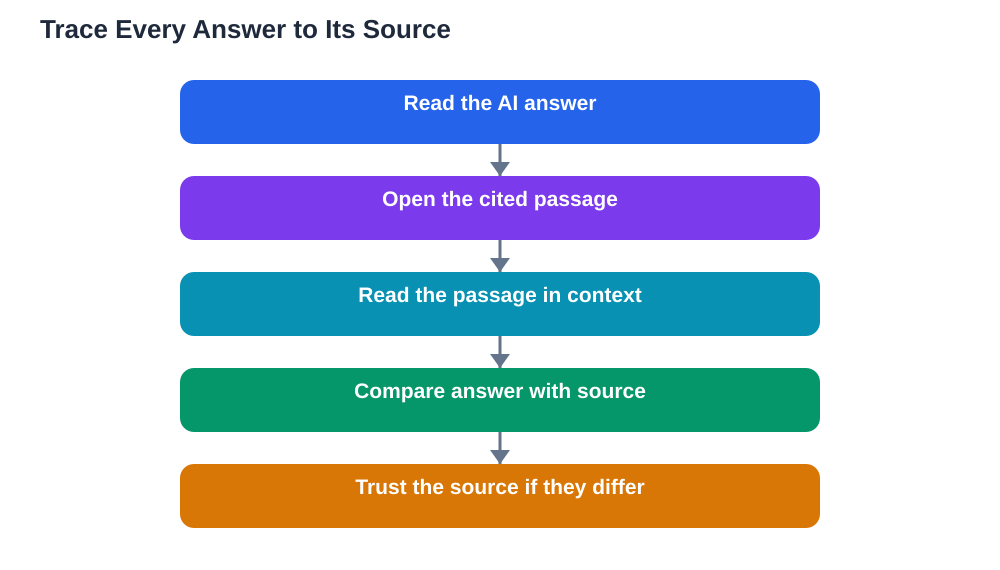

A popular AI notebook tool recently added a library of free textbooks that students can bring directly into their study workspace, then turn into study guides, quizzes, and flashcards. What makes this development worth noticing is not the size of the library but one design choice: answers carry citations back to the textbook passage they came from. That single feature changes the relationship between student and tool. Instead of asking you to trust an answer, it shows you where to check it. For students learning in an age of fluent, confident AI output, that is exactly the right habit to build: never accept an answer you cannot trace.

## Why Citations Change Everything

An answer without a source is a claim you must take on faith. An answer with a citation is a claim you can test. That difference matters because AI systems are fluent even when they are wrong: they can invent facts, blend chapters, and present guesses in the same confident tone as solid answers. A citation does not guarantee correctness — a tool can cite the wrong passage, or misread the right one — but it gives you a place to start checking. It turns verification from a vague intention into a concrete action: open the passage, read it, compare. Over time, that action becomes a habit, and the habit becomes a skill you carry into every subject, every assignment, and every source you meet online, not just AI tools.

## From Study Guide to Source Check

The most useful way to use a source-grounded tool is to treat its outputs as drafts, not verdicts. When it produces a study guide, read the guide alongside the chapter, not instead of it. When it makes a quiz, answer from memory first, then use the citations to find the passages behind the questions you missed. When it makes flashcards, check the card against its source before you memorise it, because memorising a wrong card is worse than having no card at all. This sounds slower than simply accepting the output, and it is — slightly. But the extra minutes are the learning itself. Each check forces you to reread the real material, compare wordings, and notice distinctions you would otherwise have missed. For citation basics, see [Citations Basics for Students](/blog/citations-basics-students.html).

## How to Verify a Citation Properly

Verifying a citation means more than confirming that a passage exists. Open the cited passage and read it in full, including the sentences around it, because meaning often depends on context. Ask whether the passage actually supports the answer, or whether it merely mentions a similar idea. Watch for the common failure modes: a passage cited for a claim it never makes, a definition quoted from a different topic, or a passage that supports only half of a two-part answer. If the citation does not support the answer, trust the source, not the tool, and note the error so you do not repeat it. If you cannot find the passage at all, treat the answer as unverified and ask your teacher. A citation you have not checked is only a decoration.

## Build Your Own Citation Habit

You do not need a special tool to practise source-grounded study; you can build the habit with any notes you make. Whenever you write a summary, add the chapter or section it came from. Whenever you copy a definition, keep its exact wording and its location. When you revise, quiz yourself from your notes, then trace one or two answers back to the book to confirm them. In written work, cite the sources you actually used, in the style your teacher expects, and never cite a source you have not read. This habit pays off far beyond school: in further study and in work, the people who can show their sources are the people others trust. Tools that show their sources are simply making visible a standard you should hold yourself to as well.

## When Sources Disagree or Run Out

Sometimes a tool cites a passage that seems to disagree with another passage, or with what your teacher taught. That is not a reason to panic; it is a reason to slow down. Check whether the two passages are about different cases, different conditions, or different levels of detail. Check whether one is a general rule and the other an exception. If the disagreement survives that check, ask your teacher, and show both passages. Teachers respect a student who arrives with evidence and a clear question far more than one who arrives with a copied answer. And when a tool cannot cite a source for something you need, that gap is information: the topic may need a different book, a class discussion, or a teacher's explanation. Guessing is not a substitute for a source.

## AI Help: Muse AI

Muse AI is Meta's personal AI assistant, and it can help you practise source-grounded study. You can ask it to explain how to check whether a passage really supports a claim, or to help you draft a short summary that keeps its source note attached. Join Muse with invite code LTGSWD — in the Muse app, go to Settings > Redeem token and enter the code.
Disclosure: LTGSWD is the author's Muse invite code.

## FAQ

### Does a citation prove an AI answer is correct?

No, but it makes the answer checkable, which is the next best thing. A citation can point to the wrong passage, or to a passage that is misread. Always open the cited passage, read it in context, and judge whether it truly supports the answer before you trust it.

### How should I use AI-generated quizzes and flashcards safely?

Answer from memory first, then use the citations to check the questions you missed. Before memorising any flashcard, verify it against its source passage. A wrong card memorised well is a lasting error, so the check is worth the extra minute.

### What should I do when a citation does not support the answer?

Trust the source, not the tool. Note the error, restudy the passage, and ask your teacher if the point matters for your course. Reporting the mismatch calmly, with the passage in hand, shows exactly the critical thinking teachers want to see.

### Can I build a citation habit without a special tool?

Yes, easily. Add the chapter or section to every summary you write, keep exact wordings of definitions with their locations, and trace a few revision answers back to the book each session. The habit matters far more than the tool that prompted it.

## Conclusion

Study tools that show their sources point in the right direction: away from blind trust and toward verifiable learning. Use them as drafting partners, check their citations in context, and build the same habit in your own notes. The goal is not to collect answers faster but to know, for each important idea, where it came from and why you believe it. If you use the Lesson Solver tool for textbook exercises, remember to verify its solutions against your textbook, keep in mind that AI can make mistakes, and note that the tool needs your own free Google AI Studio API key.

[Try the free AI lesson solver](/#tool)
