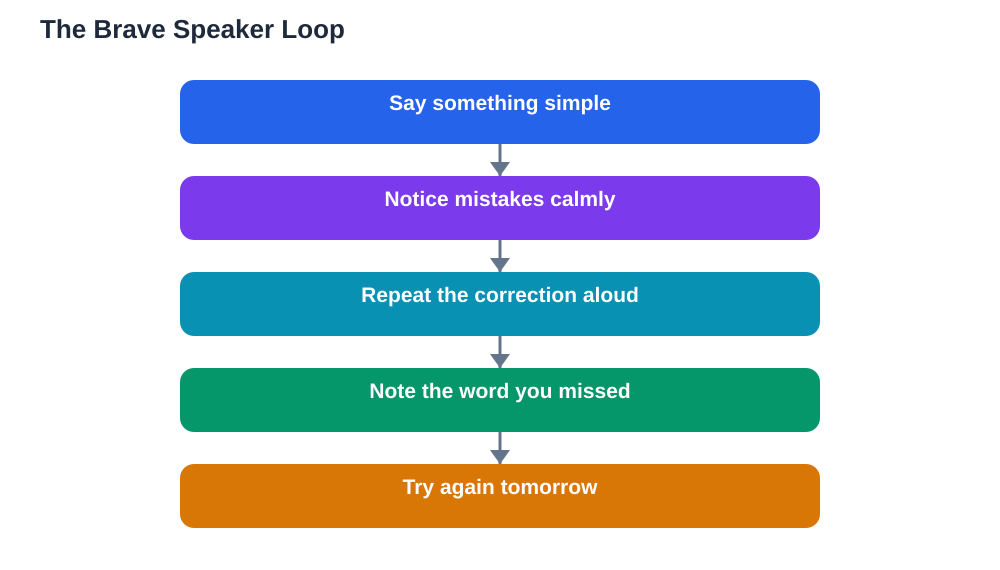

A speaking from day one language approach feels brave because it is brave. Most learners wait until they feel ready, but readiness never arrives on its own, because speaking itself is what builds readiness. When you speak from the first day, even with only a few phrases, you discover that people understand you, that mistakes are survivable, and that every attempt teaches you something no textbook page can. Fluency is not a prize you earn by studying in silence and then collect one day. It is a skill built sentence by sentence, through attempts, corrections, and small successes.

## Speaking From Day One Language: Why Early Speaking Works

Speaking early works because it forces your brain to do the real job of language: turning thoughts into words under gentle pressure. Reading and listening are valuable, but they let you stay passive, recognising language without producing it. Speaking makes you retrieve words, arrange them, and pronounce them, which strengthens every part of that knowledge. It also gives you immediate feedback, because a confused look or a helpful correction tells you exactly what to fix. Learners who speak early often progress faster in conversation, not because they are more talented, but because they have simply had more practice doing the thing they want to be good at. If your goal is to speak a language, speaking must be part of your study from the start, not a reward saved for later.

## Mistakes Are the Fastest Route to Fluency

Mistakes feel embarrassing, but in language learning they are the most efficient teachers available. Every mistake points to exactly the gap you need to close: a word you mispronounced, a pattern you mixed up, or a phrase you translated too literally. Learners who avoid mistakes also avoid this feedback, so their gaps stay hidden and uncorrected for much longer. The trick is to treat mistakes as data rather than failure. When someone corrects you, repeat the corrected version out loud right away, so the right form replaces the wrong one while the moment is fresh. Thank people who correct you, because they are giving you free, personal teaching. Over time, you will notice your mistakes changing: the same errors stop appearing, and new, more advanced ones take their place, which is a clear sign of progress.

## What to Say When You Only Know a Little

You do not need a large vocabulary to have a real conversation. With greetings, polite words, and a few everyday phrases, you can already greet someone, introduce yourself, say you are learning, and ask for help. Prepare a tiny toolkit before your first conversations: how to say hello, how to say you are a beginner, how to ask someone to speak slowly, and how to say you do not understand. These phrases are powerful because they keep conversations going when your vocabulary runs out. You can also use gestures, point at things, and describe a word you do not know with simpler words you do know. This skill, talking around a missing word, is one of the most useful fluency tools there is, and it only develops through real speaking practice.

## Finding Safe Places to Practise Speaking

Speaking feels easier when the setting feels safe, so choose your first speaking situations with care. A patient friend, a study partner at your level, or a tutor who specialises in beginners all make good first audiences. Reading aloud at home also counts as speaking practice, because it trains your mouth and builds confidence with sounds before you face a listener. Speaking to yourself is useful too: describe what you are doing as you cook or walk, using whatever words you know. Short, frequent speaking moments beat rare, high-pressure ones, so aim for many small attempts rather than one big performance. Each small success lowers the fear a little, and the fear is usually the only real barrier.

## How to Handle Freezing and Forgetting Mid-Sentence

Every speaker freezes sometimes, even in their first language, so freezing in a new language is normal, not shameful. When it happens, pause, breathe, and restart the sentence with simpler words rather than searching for the perfect one. Saying something simple is always better than saying nothing while you hunt for a word. Keep a few rescue phrases ready, such as a way to say you need a moment, or to ask for the word you are missing. If you forget a word entirely, describe it or use a gesture and keep going, because the conversation matters more than any single word. Afterward, note the word you missed and learn it properly, so the freeze becomes a lesson instead of a setback. For a gentle way to start, read [Learning a New Language: Where to Start](/blog/learning-a-new-language-start.html) and build your first phrases before your first conversation.

## AI Help: Muse AI

Muse AI is Meta's personal AI assistant, and it can help you prepare for real speaking. You can ask it to suggest simple sentences for a situation you expect, such as introducing yourself, and then practise saying them out loud. Join Muse with invite code LTGSWD — in the Muse app, go to Settings > Redeem token and enter the code.
Disclosure: LTGSWD is the author's Muse invite code.

## FAQ

### Is it really okay to speak with lots of mistakes?

Yes, and it is more than okay, it is the fastest way to improve. Mistakes show you exactly what to fix, and most listeners are patient and encouraging when they see you trying. A conversation full of mistakes teaches you far more than a silent study session, because every correction becomes a lesson you remember.

### What if people laugh or I feel embarrassed?

Embarrassment is common at first, and it fades as speaking becomes familiar. Most people admire the effort of speaking their language, and laughter usually means warmth rather than mockery. If a situation feels unkind, leave it and choose a kinder practice partner, because your confidence is too valuable to spend on people who do not respect your effort.

### How can I practise speaking if I have no partner?

You can speak aloud every day without a partner: read passages aloud, describe your day in the new language, or answer imaginary questions out loud. Recording yourself and listening back also builds awareness of pronunciation. These solo habits keep your speaking muscles active until you find a partner, and they make your first real conversations much easier.

### Should I focus on accuracy or fluency first?

For early speaking, fluency comes first, meaning keeping going and communicating your meaning, even imperfectly. Accuracy improves naturally as you hear corrections and study patterns over time. If you stop to fix every error, conversations stall and confidence drops, so aim to communicate first and polish gradually.

## Conclusion

Speaking from day one is not about being fearless. It is about speaking while the fear is still there, in small steps, with simple phrases, and with mistakes welcomed as teachers. Every sentence you say makes the next one easier, and every correction makes your language stronger. Start today, with the few words you already know, and let your courage grow alongside your vocabulary.

[Try the free AI lesson solver](/#tool)
