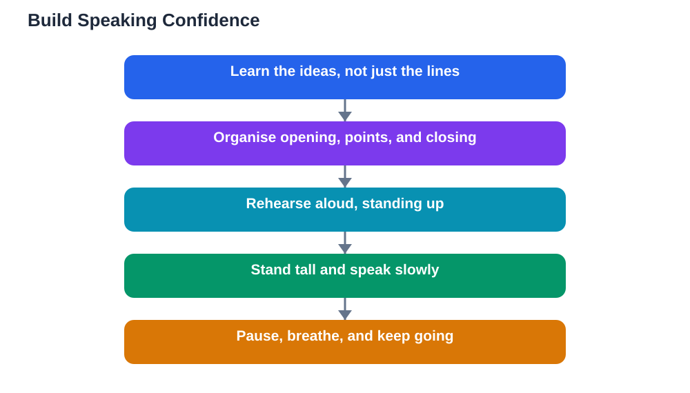

Speaking to class confidently is a skill that grows with practice, not a talent you either have or lack. Almost every student feels nervous before speaking in front of classmates, including the students who look relaxed. The difference between a nervous speaker and a confident one is rarely the absence of nerves; it is preparation, posture, and practice. When you know your material, stand in a steady way, and have spoken your words aloud beforehand, your nerves have less room to take over. This guide breaks confidence down into habits you can build one at a time, starting with your very next talk.

## Speaking to Class Confidently Begins Before You Stand Up

Confidence starts long before you walk to the front of the room. It starts when you understand your topic well enough to explain it without reading every word. If you only memorised sentences, a single forgotten word can derail you. If you understand the ideas, you can recover, rephrase, and keep going. Spend your preparation time learning the ideas first, then organising them into a simple order: an opening, two or three main points, and a closing. Write short notes, not a full script, so you practise thinking through the ideas rather than reciting lines. Know your first sentence cold, because a smooth start settles your nerves for the rest of the talk. Arrive early if you can, check your materials, and take a few slow breaths before you begin.

## Preparation That Calms Your Nerves

Nerves come largely from uncertainty, so preparation is the most reliable way to calm them. Rehearse your talk aloud, on your feet, at least a few times before the day. Time yourself, so there are no surprises about length. Practise the tricky parts more than the easy ones, especially transitions between points, which are where speakers most often stall. Prepare for likely questions too, by thinking about what a classmate might ask and how you would answer in two or three sentences. It also helps to visit the front of the room beforehand, even briefly, so the space feels less unfamiliar. On the day, bring water, keep your notes tidy, and remind yourself that your classmates are not waiting for you to fail. Most of them are relieved it is not their turn, and they want you to do well.

## Posture, Voice and Pace

Your body sends signals to both the audience and yourself. Stand tall with your feet steady, shoulders relaxed, and hands free rather than clenched or hidden in pockets. Avoid swaying, pacing without purpose, or fiddling with a pen, because these habits distract the audience and feed your own restlessness. Your voice should be a little louder and slower than feels natural, because nerves tend to make speakers quiet and fast. Project to the back of the room, pause between points, and breathe at those pauses instead of rushing to fill every silence. Pauses feel long to the speaker but sound thoughtful to the audience, and they give listeners time to absorb your point. If your voice shakes, that is normal, and it usually steadies after the first minute. Keep going, and the audience will barely notice.

## Practise Out Loud, Then Practise Again

Silent reading is not rehearsal. Speaking aloud is what builds the muscle memory that carries you through nerves. Practise in a real voice, standing up, with your notes in hand. If you can, practise in front of someone you trust, and ask them to listen for clarity rather than perfection. Notice where you stumble, and smooth those spots with simpler wording rather than more memorisation. Record yourself once if you are willing, because hearing your own pace and filler words teaches you more than guessing does. Practise your opening and your closing the most, since those are the moments the audience remembers best. Each rehearsal makes the talk feel more familiar, and familiarity is the quiet foundation of confidence. Even one extra rehearsal the evening before can change how the talk feels.

## AI Help: Muse AI

Muse AI is Meta's personal AI assistant, and it can help you prepare to speak with confidence. You can ask it to help you organise your talk into a simple order, or to suggest simpler wording for a tricky explanation. It gives general planning help, not verified answers, so always check your content against your textbook before presenting.

Join Muse with invite code LTGSWD — in the Muse app, go to Settings > Redeem token and enter the code.

Disclosure: LTGSWD is the author's Muse invite code.

## FAQ

### Is it normal to feel nervous before speaking in class?

Yes, completely normal. Even experienced speakers feel nerves. The goal is not to eliminate nerves but to keep them from taking over, and preparation is the best way to do that.

### What should I do if I forget what I was going to say?

Pause, glance at your notes, and pick up from the next point you remember. The audience does not know your planned order, so a short pause looks thoughtful, not lost. Avoid apologising or drawing attention to the slip.

### How can I stop speaking too fast?

Practise at a deliberately slow pace, and build pauses into your notes at the end of each point. Breathing at those pauses naturally slows you down, and glancing at the audience reminds you to pace yourself for listeners.

### Should I memorise my whole talk word for word?

Usually not. Memorised talks sound stiff and collapse when one word is forgotten. Learn the ideas and the order, keep short notes for key points, and speak in your own words.

### What if classmates laugh or I feel embarrassed?

Most laughter in class is not cruel, but if you feel embarrassed, pause, breathe, and continue. Finishing your talk calmly is the strongest response, and it builds confidence for the next time. For a structured way to rehearse, see [Rehearsing a Presentation: How Pros Practise](/blog/rehearsing-a-presentation.html).

## Conclusion

Confidence in front of a class is built, not born. Prepare until you understand your ideas, stand steady, speak a little slower than feels natural, and practise aloud until the talk feels familiar. Your nerves will not vanish, but they will stop running the show. Start with your next talk, and let each one make the next easier. Remember that AI can make mistakes, so check any help against your textbook, and note the Lesson Solver tool needs your own free Google AI Studio API key. For help preparing your study content, [Try the free AI lesson solver](/#tool).
