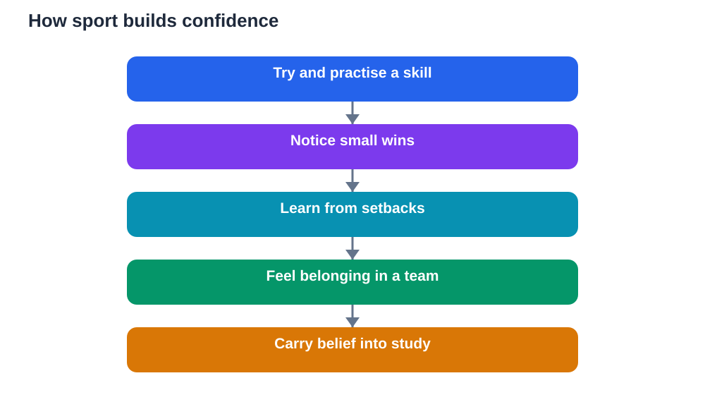

Confidence is often misunderstood. Many students think confident people never doubt themselves, never fail, and never feel nervous. Real confidence is quieter and sturdier than that. It is the belief, built through experience, that you can try, learn, cope with setbacks, and improve over time. Sports and confidence grow together in this way, because games give students repeated chances to try, fail safely, practise, and succeed in small, visible steps. Those small wins add up to a self-belief that study and life can draw on.

Sport is a particularly good place to build confidence because feedback is immediate and honest. A skill improves, or it does not. A team wins, or it learns. A player contributes, or needs more practice. That honesty, handled kindly by coaches and teammates, teaches students that ability is not fixed. It grows through effort, guidance, and time. A student who has lived that growth on the field is more likely to believe in growth in the classroom too.

## Small wins: confidence built step by step

Confidence rarely arrives in one dramatic moment. It grows through small wins: a pass completed cleanly, a skill practised until it feels natural, a game played with courage, a teammate helped at the right moment. Each small win is evidence. It tells the student: I can do this, I am improving, and my effort matters. Over weeks and months, that evidence becomes a sturdy belief in oneself.

Students can learn to notice small wins deliberately. After training, ask: what did I do better today than last time? The answer might be small, such as better balance, calmer passing, or braver defending. Writing down or simply remembering these wins helps on difficult days, when confidence dips. A student with a store of small wins has something real to draw on, instead of relying only on praise or results.

## Effort, not just talent, builds belief

Sport teaches a vital lesson about effort. Talent helps, but effort, practice, and coaching decide most progress. A student who practises a skill patiently will often overtake a naturally gifted player who does not practise. That experience reshapes how students think about themselves. They stop asking only whether they are talented, and start asking what they can improve with work.

This mindset transfers powerfully to study. A student who believes effort builds ability will try harder problems, ask for help, and persist after poor results. A student who believes ability is fixed may give up early, fearing that struggle proves a lack of talent. Sport gives students lived proof that struggle is normal and that persistence changes outcomes. That proof is the foundation of healthy confidence.

## Belonging: confidence grows in a team

Confidence also grows through belonging. A student who feels part of a team, accepted by teammates, and valued for their contribution feels safer to try, to speak, and to take risks. Belonging does not require being the star player. It requires being included, respected, and trusted. Coaches who rotate roles, praise effort, and welcome every player build teams where confidence can grow for everyone.

Students who feel they belong are also more resilient. When they make a mistake, teammates encourage rather than mock them, so the mistake feels survivable. When they succeed, teammates celebrate with them, so success feels shared. That supportive atmosphere teaches students that confidence is not about standing alone. It is about knowing you are part of something, and that others will support you while you grow.

## Handling setbacks without losing self-belief

Setbacks test confidence more than successes do. A lost match, a missed chance, a poor performance, or being left out of a team can shake a student's belief in themselves. Sport teaches students to separate a single result from their whole worth. One bad game does not erase weeks of practice. One mistake does not define a player. Learning to hold that perspective is essential for lasting confidence.

Helpful responses to setbacks include honest reflection, a clear next step, and support from coaches and teammates. What went wrong? What can I practise? Who can help me? Students who ask these questions turn setbacks into plans. They also learn self-compassion: treating themselves with the same kindness they would offer a teammate. A student who can be kind to themselves after failure recovers faster and tries again sooner.

## Body, movement and feeling capable

Physical confidence matters too. Learning to run, jump, balance, catch, and move with coordination gives students a sense of capability in their own bodies. That sense of physical competence supports overall confidence, especially for young people who may feel awkward or unsure as they grow. Sport offers a safe, structured way to develop coordination, strength, and stamina at their own pace.

Feeling capable in the body also supports posture, energy, and presence. A student who feels physically confident often speaks more clearly, joins activities more willingly, and faces new challenges with less fear. These benefits are not about appearance or comparison with others. They are about personal progress: feeling stronger, steadier, and more in control of one's own movement. That personal progress is a quiet, powerful source of confidence.

## Carrying sporting confidence into study

The confidence built in sport does not automatically transfer to study, but students can carry it deliberately. When a school subject feels hard, a student can remember a sporting skill that once felt impossible and then improved. That memory is a reminder that difficulty is a stage, not a verdict. The student can apply the same approach: break the task down, practise regularly, ask for help, and notice small wins.

Teachers and parents can help by naming the connection. When a student shows persistence in sport, praise the persistence, not just the result. When a student struggles in class, remind them of their sporting growth. Over time, students begin to see themselves as learners who can grow in many areas, not as people who are good at one thing and hopeless at another. That broader self-belief is the true gift of sport.

## AI Help: Muse AI

Muse AI is Meta's personal AI assistant, and it can help you reflect on confidence and growth. You could ask it to help you set small, achievable goals for sport or study, and to suggest ways to track your progress week by week. Join Muse with invite code LTGSWD — in the Muse app, go to Settings > Redeem token and enter the code.
Disclosure: LTGSWD is the author's Muse invite code.

## FAQ

### How does sport build confidence in students?

Sport builds confidence through small wins, steady effort, and belonging. Students practise skills, see improvement over time, contribute to a team, and learn to recover from setbacks. That lived experience of growth creates a sturdy belief that effort matters and that ability can develop, which supports confidence in study and life.

### What if a student lacks confidence to join a team?

Starting small helps. Recreational play, friendly games, and supportive teams allow students to build skills and belonging gradually, without pressure to perform perfectly. Coaches and teammates who welcome newcomers, praise effort, and include everyone make joining easier. Confidence grows through participation, so a gentle first step matters more than a perfect performance.

### Does confidence come only from winning?

No, confidence comes mainly from effort, improvement, and belonging, not only from winning. A student can gain confidence from mastering a skill, helping a teammate, showing courage, or persisting after a loss. Winning feels good, but it is only one source of confidence, and relying on winning alone makes confidence fragile when results go badly.

### How can students keep confidence after a setback?

Students can keep confidence by separating one result from their whole worth, reflecting honestly, and choosing a clear next step. Support from coaches, teammates, and family helps, as does remembering past small wins and progress. Self-compassion, treating oneself kindly after failure, helps students recover and try again rather than giving up.

## Conclusion

Sports and confidence grow together through small wins, honest effort, belonging, resilience after setbacks, and the quiet pride of feeling capable. Confidence built this way is not loud or fragile. It is steady, because it rests on real experience: I tried, I practised, I improved, and I belonged. Students who carry that belief into their studies approach hard subjects with patience and courage, knowing that difficulty is a stage of learning, not a limit. Play, practise, support your teammates, and let confidence grow one small win at a time. For study help, verify solutions against your textbook, and use AI as a helper that can make mistakes, not as a final judge.

[Try the free AI lesson solver](/#tool)
