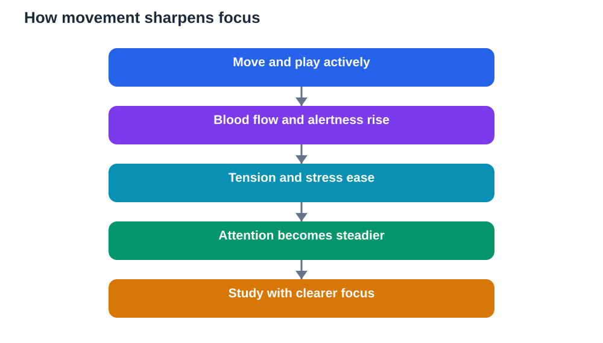

Many students notice a simple pattern: after playing, moving, or training, sitting down to study feels easier. The mind feels clearer, attention lasts longer, and ideas seem to settle more quickly. Sports and focus learning are connected in this practical way. Movement does not only strengthen the body. It prepares the brain for learning by increasing alertness, improving mood, and giving restless energy a healthy outlet. Understanding this connection helps students use sport wisely, as a partner to study rather than a distraction from it.

Focus is not about forcing the mind to work harder. It is about creating conditions where attention can stay steady. A tired, restless, or stressed mind struggles to concentrate, no matter how much willpower a student uses. Sport helps change those conditions. It raises energy, releases tension, and breaks up long periods of sitting. After movement, many students return to their books calmer, more awake, and better able to listen to their own thoughts.

## Movement, blood flow and attention

When students move, their hearts pump faster and blood flows more strongly through the body, including to the brain. That increased flow brings oxygen and energy that the brain needs to work well. Attention, memory, and clear thinking all depend on the brain being well supplied and alert. This is one reason why a short period of activity can make the next study session feel sharper.

Blood flow is not the whole story, but it is a useful starting point. Movement wakes the body up in a natural way, unlike the jittery alertness that comes from stress or lack of sleep. A student who has moved feels awake without feeling tense. That calm alertness is ideal for learning, because the mind is ready to notice details, follow arguments, and hold ideas in memory without drifting.

## How sport trains attention itself

Sport trains attention directly, not just through blood flow. In a game, a player must watch the ball, notice teammates, anticipate opponents, and respond quickly. Attention must shift at the right moments: wide to see the whole game, narrow to focus on a single action. This practice in controlling attention is valuable for study, where students must also shift between reading broadly and focusing on detail.

Games also teach students to return to focus after distraction. A player who loses concentration for a moment must recover quickly, or the game passes them by. Over time, players get better at noticing when their mind has wandered and bringing it back. Students can use the same skill during revision. When attention drifts, they can pause, breathe, and return to the task, instead of feeling guilty or giving up. That gentle return is a learnable habit, and sport practises it constantly.

## Mood, stress and clearer thinking

Stress clouds thinking. When students feel anxious, their minds fill with worries, leaving less room for learning. Sport helps here too, because physical activity releases tension and often improves mood. After a game, worries may feel smaller, not because problems have disappeared, but because the mind has had a break from repeating them. That break creates space for clearer thinking.

A better mood also supports persistence. Students who feel calmer are more willing to try a hard problem again, to ask for help, and to keep going after a mistake. Learning requires that willingness. A student who is overwhelmed may avoid study altogether. A student who feels steadier after sport is more likely to sit down, start, and continue. In this way, sport supports learning indirectly, by supporting the emotional state that learning needs.

## Energy, sleep and steady study habits

Energy management is a hidden part of focus. Students who sit all day often feel strangely tired, because the body has not moved and the mind has not rested properly. Sport uses energy in a healthy way and helps the body feel genuinely tired at the right time, which supports better sleep. Good sleep, in turn, supports memory, because the brain organises and strengthens what was learned during the day while resting.

A regular routine that includes sport, study, meals, and rest helps focus become predictable rather than accidental. Students do not need to wait for motivation to appear. They follow a rhythm: move, study, rest, repeat. Over time, the brain learns that after movement comes focused work, and study begins more easily. That rhythm is more reliable than willpower alone, and it protects students from the exhausting cycle of long sitting, poor sleep, and scattered attention.

## Using movement breaks during study

Movement does not have to mean a full training session. Short, active breaks during study can refresh attention without breaking momentum. Standing up, stretching, walking briefly, or doing a light activity can loosen stiff muscles and reset the mind. The key is to keep breaks short and purposeful, so they refresh rather than replace study.

Students can plan this deliberately. Study a topic, take a short movement break, then return and recall the main ideas from memory. That recall step is important, because it checks whether the break helped or simply delayed work. If recall feels clearer after moving, the break is working. If the mind feels scattered, a calmer break, such as stretching or slow walking, may suit better. Each student can learn what kind of movement helps their own focus most.

## Balance: when sport helps and when it distracts

Sport helps focus most when it is balanced. Too little movement leaves students restless and low in energy. Too much intense activity right before study may leave them tired rather than refreshed. Timing matters. Many students find that moderate activity, followed by a short rest and a drink of water, prepares them well for study. Very intense training may be better placed after study, or with a longer recovery gap before focused work.

Students should also watch for signs of imbalance. If sport regularly replaces homework, or if exhaustion makes study impossible, the balance needs adjusting. The goal is partnership between sport and study, not competition. A simple weekly plan, with sport and study both given their place, helps students enjoy both without sacrificing either. Focus grows best when the body is cared for and the mind is given regular, manageable work.

## AI Help: Muse AI

Muse AI is Meta's personal AI assistant, and it can help you plan a balanced study routine. You could ask it to suggest ways to combine short movement breaks with revision, and then adapt its ideas to your own timetable. Join Muse with invite code LTGSWD — in the Muse app, go to Settings > Redeem token and enter the code.
Disclosure: LTGSWD is the author's Muse invite code.

## FAQ

### Does exercise really improve concentration?

Exercise can improve concentration by increasing alertness, blood flow, and mood, and by releasing tension that distracts the mind. Many students find that study feels easier after movement. The effect varies from person to person, so students should notice what works for them, and combine movement with good sleep and regular study habits for the best results.

### What kind of sport helps focus most?

Any enjoyable, regular movement can help, from team games to walking, cycling, swimming, or active play. The best choice is one the student enjoys enough to repeat, because regularity matters more than intensity. Moderate activity that leaves the student refreshed, rather than exhausted, usually prepares the mind best for study.

### Should students exercise before studying?

Many students benefit from moving before study, because it raises alertness and clears restlessness. A short rest after activity helps the body settle before focused work begins. Very intense training may need a longer gap. Students can experiment with timing and notice when their recall and concentration feel strongest.

### Can short movement breaks help during revision?

Yes, short movement breaks can refresh attention during long study sessions. Standing, stretching, or walking briefly loosens the body and resets the mind. Keeping breaks short and purposeful matters. After a break, recalling the main ideas from memory helps students check that the break refreshed focus rather than interrupting useful work.

## Conclusion

Sports and focus learning belong together because movement prepares the mind as well as the body. Blood flow supports alertness, games train attention, activity lifts mood and releases stress, and regular routines support sleep and steady habits. Used wisely, sport does not steal time from study. It makes study time more effective, because a calmer, more alert mind learns better. Students who build movement into their day, in balance with study and rest, give themselves a simple, powerful advantage: a mind ready to focus. For study questions, verify solutions against your textbook, and remember that AI can make mistakes, so check its help rather than trusting it blindly.

[Try the free AI lesson solver](/#tool)
