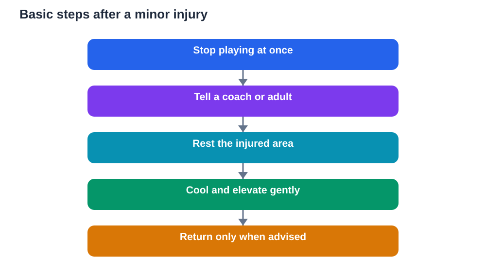

Every student who plays sport should know the basics of sports injuries, not to become fearful, but to stay safe and to act wisely when something goes wrong. Sports injuries basics include understanding common minor injuries, knowing simple first steps, recognising when to stop and get adult help, and appreciating that rest is part of recovery. With this knowledge, students can enjoy sport with confidence, look after teammates, and avoid turning a small problem into a larger one.

Injuries in sport are usually minor: a bruise, a sprain, a muscle strain, or a graze. More serious injuries are less common, but they do happen, which is why knowing warning signs matters. The most important rule is simple: pain is a message. It tells a player to stop, assess, and seek help. Playing through significant pain rarely helps the team and often harms the player. Brave play means knowing when to stop as well as when to try hard.

## Common minor injuries and what they mean

A bruise happens when small blood vessels under the skin are damaged by a bump, leaving a tender, discoloured mark. A sprain affects ligaments, the tissues that support joints, often after a twist or awkward landing. A strain affects muscles or tendons, often after overstretching or sudden effort. Grazes and blisters affect the skin surface. These injuries are usually painful and inconvenient, but they often improve with rest and simple care.

Understanding these terms helps students describe what happened clearly to an adult. Instead of saying only that something hurts, a student can say where it hurts, how it happened, and whether they can move it comfortably. Clear information helps adults decide what care is needed. Students should never try to diagnose a serious injury themselves. Their job is to notice, report, and rest, and to let responsible adults decide the next steps.

## The simple care steps: rest, cool, compress, elevate

For many minor soft-tissue injuries, a simple set of steps can help in the early stage. Rest means stopping play and avoiding putting weight or strain on the injured area. Cooling means applying a wrapped cold pack or cold cloth for a short period, never placing ice directly on bare skin. Compression means a gentle, snug bandage if an adult shows how, not a tight binding that cuts off circulation. Elevation means raising the injured area, supported comfortably, to reduce swelling.

These steps are often remembered by the short name RICE: rest, ice, compression, and elevation. They are first aid, not a cure, and they do not replace adult help. If pain is severe, swelling grows quickly, the area looks deformed, or movement is very limited, stop and get adult help immediately. Simple care is for minor injuries. Serious signs always need a responsible adult and, where needed, professional medical attention.

## When to stop playing and get help

Knowing when to stop is one of the most important sports skills. Students should stop and tell an adult if pain is sharp or severe, if a joint looks out of shape, if they cannot move or bear weight, if swelling or bruising grows rapidly, or if they feel dizzy, confused, or unwell after a knock. Head injuries need particular care: any blow to the head, confusion, headache, dizziness, or unusual behaviour after a knock should be reported immediately, and the student should not return to play until an adult decides it is safe.

Teammates also have a role. If a teammate is hurt, do not crowd around, move them unnecessarily, or urge them to continue. Fetch an adult, stay calm, and offer reassurance. Encouraging an injured player to play on is not loyalty. It is dangerous. A team that looks after injured players builds trust and safety, and that care matters far more than any single game.

## Warm-up, technique and prevention

Prevention is better than treatment, and much of it is simple. Warming up prepares muscles and joints for effort. Learning correct technique reduces strain on the body. Wearing suitable footwear and protective equipment where required helps guard against common injuries. Playing on safe surfaces, following rules, and avoiding reckless challenges all reduce risk.

Students should also respect fatigue. Tired players make more mistakes, react more slowly, and are more likely to get hurt. Coaches can manage this by rotating players, including rest breaks, and watching for signs of exhaustion. Students can help by speaking up when they feel very tired or unwell, rather than hiding it to stay in the game. Prevention is a shared responsibility, and honest communication is a central part of it.

## Recovery: patience, gradual return and honesty

Recovery takes patience. A student who returns too soon, at full intensity, risks re-injury and a longer absence. A gradual return is wiser: rest first, then gentle movement when an adult advises it, then light practice, then full play, with each stage feeling comfortable before moving on. If pain returns, step back and tell an adult. That is not weakness. It is sensible recovery.

Honesty matters during recovery. Students sometimes hide pain because they fear missing matches or disappointing teammates. Coaches and parents can help by making it clear that reporting pain is responsible, not disappointing. A team that supports injured players through recovery, keeping them involved in other ways, such as helping with equipment or learning tactics, helps them return stronger and happier. Recovery is part of sport, not a failure within it.

## Building a culture of safe play

Safe play is a culture, not a single rule. It grows when coaches teach technique carefully, when players respect rules and opponents, when adults supervise properly, and when students look out for each other. Safe play includes drinking water, resting in heat, stopping when unwell, and reporting hazards such as uneven surfaces or broken equipment. Each small habit reduces risk for everyone.

Students can contribute to this culture every day. Warm up properly, follow instructions, play fairly, tell an adult about pain or hazards, and support injured teammates. These habits protect the whole team. Sport should be challenging and enjoyable, but never at the cost of health. A student who understands injury basics plays with greater confidence, because they know what to do if something goes wrong, and they know that asking for help is always the right choice.

## AI Help: Muse AI

Muse AI is Meta's personal AI assistant, and it can help you learn sports safety basics in simple language. You could ask it to explain rest, cooling, compression, and elevation, and then check its explanation with your coach or teacher. Join Muse with invite code LTGSWD — in the Muse app, go to Settings > Redeem token and enter the code.
Disclosure: LTGSWD is the author's Muse invite code.

## FAQ

### What should a student do first after a minor sports injury?

Stop playing, tell a coach or responsible adult, and rest the injured area. For minor soft-tissue injuries, adults may use rest, a wrapped cold pack, gentle compression, and elevation. Students should not try to treat serious injuries themselves. Clear reporting, rest, and adult guidance are the safest first steps.

### What does RICE mean in sports first aid?

RICE stands for rest, ice, compression, and elevation. Rest avoids further strain, ice through a cloth cools the area, gentle compression supports it, and elevation reduces swelling. These steps are simple first aid for minor injuries. They do not replace adult help, especially when pain is severe or warning signs appear.

### When must a student get adult help immediately?

Get adult help immediately for severe pain, a joint that looks out of shape, inability to move or bear weight, rapidly growing swelling, or any head injury with confusion, headache, or dizziness. The student should not return to play until an adult decides it is safe. Quick reporting protects health and prevents a minor problem from becoming serious.

### How can sports injuries be prevented?

Injuries can be reduced by warming up, learning correct technique, wearing suitable footwear and protective equipment, playing on safe surfaces, following rules, and resting when tired or unwell. Coaches, players, and parents share this responsibility. Honest communication about tiredness, pain, or hazards is one of the strongest prevention habits.

## Conclusion

Sports injuries basics give every student a practical safety toolkit: recognise common minor injuries, use simple care steps for minor problems, stop and get adult help for serious signs, prevent injuries through warm-up and fair play, and recover patiently with a gradual return. These basics do not make sport scary. They make it safer and more enjoyable, because students know they can act wisely and ask for help. Play hard, play fairly, look after yourself and your teammates, and remember that health always comes before any game. This article offers general information only, not medical advice, and serious injuries always need adult and professional care.

[Try the free AI lesson solver](/#tool)
