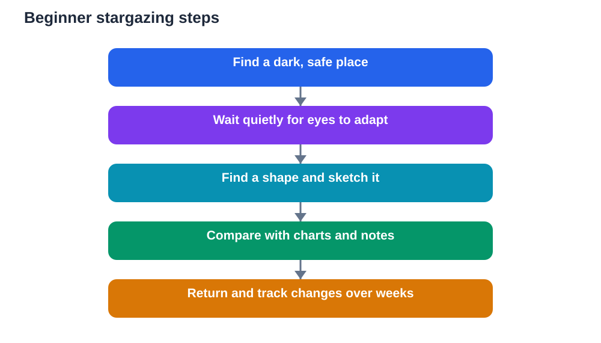

On a clear, dark night, the sky looks crowded with light, yet most of us glance up only briefly. A beginner's sky guide changes that glance into attention. With patience, a dark place and a notebook, you can learn to recognise patterns, follow bright planets, and understand why the sky looks different from season to season.

Stargazing is wonderfully accessible. You need no expensive equipment to begin, and the sky itself is the textbook. The main skills are dark adaptation, slow looking, simple recording and regular return visits. Those habits turn a beautiful night into real study.

## Find a Dark, Safe Place

Light is the biggest obstacle to stargazing. Street lights, house lights and bright screens all reduce what you can see, because they keep your eyes from adapting to darkness. Choose a safe, open place away from direct lights where you can see a wide stretch of sky. A garden, a quiet open ground or a rooftop with safe access and adult permission can all work.

Safety comes first, always. Go with a responsible adult or a trusted group, stay on familiar ground, and bring a torch with a dim red cover or a torch pointed downward for walking only. Avoid looking at bright lights once you begin observing, because even a brief bright light can spoil dark adaptation for several minutes. Dress warmly, because standing still under a night sky cools you quickly even on mild evenings.

Give your eyes time. Sit quietly in the dark for at least fifteen minutes before judging what you can see. At first only the brightest stars appear, but gradually fainter stars emerge as your eyes adapt. That slow reveal is part of the pleasure, and rushing it means missing most of the sky.

## Learn the Sky in Shapes, Not Names

Beginners often try to memorise star names too quickly and feel lost. A better start is shapes. Look for groups of bright stars that form a recognisable pattern: a curve, a W shape, a triangle, a line of three stars, or a dipper-like bowl with a handle. Sketch the pattern as dots joined by lines, and label it with your own simple description, such as curved group in the north or bright triangle overhead.

Patterns help because the eye remembers shapes better than isolated points. Once you can find a shape reliably, you can use it as a landmark to explore nearby stars. Return to the same shape on later nights and notice whether it sits higher, lower or in a different part of the sky. That movement is your first clue that the sky changes with time and season.

Avoid claiming precise identifications until you have checked them against a reliable star chart or your textbook. A sketch labelled possible curved pattern is honest and useful, while a confident but wrong name creates confusion later. Good stargazing, like good science, values careful description over quick labelling.

## Tell Planets Apart From Stars

Planets are among the most rewarding beginner targets because they look different from stars once you know what to check. Stars twinkle, because their light is disturbed by moving air, while bright planets usually shine with a steadier light. Planets also appear as tiny discs rather than points when viewed through binoculars, though they still look like bright points to the naked eye.

Planets move against the background stars over days and weeks, while star patterns keep their shapes. If you sketch a bright object and its neighbouring stars, then repeat the sketch a week later, a planet will have shifted position slightly while the stars around it keep their pattern. That slow movement is how early observers first distinguished wandering stars, which is what the word planet originally meant.

Brightness also changes. A planet may grow brighter or fainter over weeks as its position relative to Earth and the Sun changes. Recording brightness in plain words, such as very bright, bright or faint, over several weeks gives you a simple but genuine record of change. Check general explanations against your textbook, and remember that AI tools can make mistakes.

## Watch the Moon as a Friendly Guide

The Moon is the easiest night-sky object to study, and it teaches observation skills quickly. Its shape changes night by night, from a thin crescent to a full round disc and back again. Sketch its shape each clear night and note the date. Within a month, your sketches will show the full cycle clearly.

Also notice where the Moon appears and how high it rises. A crescent in the evening sky sits in a different place from a full Moon rising later, and those positions change across the month. Binoculars reveal darker patches and bright areas on the surface, but even naked-eye sketches capture the main pattern of light and dark.

The Moon is also useful for finding your way around the sky, because bright stars and planets often appear near its path. Use the Moon as a landmark, but avoid staring at a bright full Moon for too long when you want to see faint stars, because its glare reduces dark adaptation just like a lamp.

## Keep Simple Sky Notes

Sky notes do not need to be complicated. For each session, record the date, time, general location type, sky clarity in plain words, and the patterns or bright objects you observed. Add a small sketch of one pattern, with dots for stars and lines joining them, and a note about anything that moved, brightened or surprised you.

Over weeks, compare your sketches. You will notice that patterns shift position across the sky during a single night and across different months. That shift happens because Earth rotates and moves around the Sun, changing our view of the stars. Your own sketches, showing the same pattern in different positions, make that abstract idea concrete and memorable.

A monthly summary helps too. Which patterns were easiest to find? Which bright object changed position? What did the Moon look like at the start and end of the month? Short answers to those questions turn scattered nights into a coherent study.

## Use Binoculars and Charts Wisely

Binoculars are an excellent next step after naked-eye observing. They reveal fainter stars, the Moon's surface detail, and star clusters that look like single points to the naked eye. Hold them steady by resting your elbows on a support or lying back in a reclining chair. Sweep slowly rather than jerking across the sky, and focus carefully before moving on.

Star charts, whether printed or in a book, help you match your sketches to recognised patterns. Hold the chart overhead and orient it to the direction you are facing, which takes a little practice but quickly becomes natural. A chart used outdoors should be lit only dimly, so it does not spoil your dark adaptation. Avoid relying on a bright phone screen, which will undo minutes of patient adaptation in seconds.

Telescopes can wait. A beginner who knows a few patterns, can find the Moon's cycle, and can track a bright planet already has a strong foundation. Equipment adds detail, but it never replaces the skills of patience, dark adaptation and careful recording.

## Enjoy Wonder Without Rushing Answers

Stargazing invites big questions: how far away are stars, why do they shine, and what lies beyond what we can see? Those questions are wonderful, and some have answers you can explore in your textbook over time. Others remain open frontiers of research. Both kinds deserve respect, and neither needs a rushed answer on a single night.

Let wonder and study sit together. Enjoy the beauty of a clear sky, and also record what you see. The combination is powerful: awe keeps you returning on cold nights, while notes turn return visits into learning. Share the sky with others when you can, because pointing out a pattern to a friend deepens your own understanding.

Above all, keep the habit gentle. A short, clear night spent finding one new pattern beats a long, cold night spent struggling with charts and equipment. Stargazing should leave you curious and rested, not exhausted and frustrated.

## AI Help: Muse AI

Muse AI is Meta's personal AI assistant, and it can help you organise sky notes into clear study material. For this topic, you can ask it to help you turn nightly sketches into a tidy summary of patterns you found.

Join Muse with invite code LTGSWD — in the Muse app, go to Settings > Redeem token and enter the code.

Disclosure: LTGSWD is the author's Muse invite code.

## FAQ

### Do I need a telescope to start stargazing?

No. Your eyes, a dark place and a notebook are enough to begin. Binoculars are a helpful next step, but a telescope can wait until you know a few patterns and enjoy regular observing. Starting simply builds the core skills that make any equipment more rewarding later.

### Why can I see more stars after waiting in the dark?

Your eyes adapt to darkness over time. The pupils widen and the light-sensitive parts of the eye become more responsive, so fainter stars gradually appear. Bright lights reverse this adaptation quickly, which is why dark skies and dim torches matter so much for stargazing.

### How do I tell a planet from a star?

Check twinkling and movement. Stars usually twinkle, while bright planets shine more steadily. Over days and weeks, a planet shifts position against background star patterns, while the patterns themselves keep their shapes. Sketching the same area on different nights makes that movement visible.

### Why does the sky look different in different seasons?

Earth moves around the Sun during the year, so our night-time view faces different parts of space in different seasons. Some patterns are visible for months, then sink from view while new patterns rise. Your own sketches across seasons will show that slow, regular change.

### What should I do on a cloudy night?

Use cloudy nights for study indoors. Review your sketches, compare them with star charts, and plan what to look for next. Cloudy nights are also a good time to write monthly summaries. Recording a cloudy night as no observation due to cloud keeps your journal honest and complete.

## Conclusion

The night sky rewards patience, darkness and a simple notebook. Learn shapes before names, watch the Moon's cycle, track a steady bright planet, and sketch what you see. Night after night, those small records build a real understanding of a sky that first looked like scattered light.

[Try the free AI lesson solver](/#tool)
