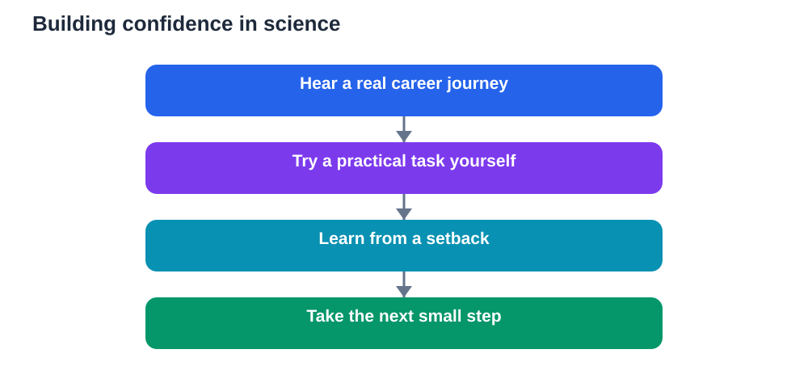

Many students decide early, and often quietly, whether science and technology are for people like them. That decision is rarely based on ability alone. It grows from what they see, who they meet, and whether they feel they belong in the room where scientific ideas are discussed. Recent reports describe an initiative inviting professionals into classrooms to share career journeys, and the idea behind it is powerful: when students meet real people behind scientific work, the subjects become human, reachable, and personal.

Seeing yourself in a subject changes how you learn it. Confidence grows when a difficult topic feels like a challenge you can work through, rather than proof that you do not belong. Resilience grows when you hear that setbacks are normal, even for people who now do impressive work. Belonging grows when you realise that science and technology need many kinds of minds, not one narrow type.

## Why belonging matters for learning

Belonging is not a soft extra. It shapes effort. A student who feels welcome in a subject is more likely to ask questions, attempt hard problems, and keep going after a mistake. A student who feels like an outsider is more likely to stay silent, avoid risk, and interpret a poor result as confirmation that the subject is not for them.

This effect is subtle. It rarely appears as a single dramatic moment. It appears in small choices: whether to raise a hand, whether to join a project, whether to try a harder question, whether to consider a science path for the future. Over time, those small choices compound into very different learning journeys.

Teachers can influence belonging through everyday language and classroom culture. When questions are welcomed, when mistakes are treated as part of learning, and when different approaches to a problem are valued, more students feel safe to participate. When only fast answers are praised, quieter or slower thinkers may conclude that their way of learning does not count.

## Career journeys make abstract subjects concrete

Textbooks can explain what scientists and technologists do, but a person can show it. When a professional describes a typical day, a project that failed before it succeeded, or a school subject that once felt difficult, students hear a story they can imagine themselves inside. The work stops being an abstract career label and becomes a life with choices, detours, and learning along the way.

These stories are especially valuable because they break stereotypes. Science and technology work is often imagined as solitary, purely mathematical, or reserved for people who were always top of the class. Real journeys show teamwork, communication, creativity, and persistence. They show people who changed direction, discovered an interest late, or needed help to master a topic.

Students also benefit from hearing about ordinary steps. A professional might describe choosing a subject out of curiosity, enjoying a practical project, or learning a skill gradually through practice. Those modest steps feel achievable. They invite students to take the next small step themselves, rather than waiting for a moment of brilliance that may never arrive.

## Confidence grows through experience, not praise alone

Praise has a place, but confidence built only on praise is fragile. It collapses when work becomes hard. Confidence built on experience lasts longer, because it rests on evidence: I tried, I struggled, I improved, I solved something. Classroom activities should therefore give students real experiences of progress in science and technology.

Practical work helps enormously. Building, testing, measuring, observing, and fixing things let students see cause and effect with their own hands. When an experiment does not work, the task is to investigate why, not to feel defeated. That investigation is science in action, and it teaches resilience far better than a lecture about resilience ever could.

Discussion helps too. When students explain their reasoning, listen to other approaches, and revise their ideas, they learn that understanding is built collaboratively. They also learn that confusion is shared. Hearing a classmate say that a concept was tricky can be a relief, and working through it together builds both understanding and belonging.

## Resilience: learning to stay with difficulty

Every science and technology learner meets difficulty. A concept refuses to click, a calculation keeps going wrong, or a project fails at the last step. Resilience is the ability to stay with that difficulty long enough to learn from it, rather than retreating or deciding that the subject is beyond reach.

Stories from professionals help here because they normalise struggle. When students learn that experienced workers still face problems, debug errors, and revise plans, difficulty stops feeling like a personal flaw. It becomes part of the work itself. That shift in interpretation can change a student's response to the next hard problem.

Teachers can reinforce resilience by modelling it. Talking through a mistake openly, showing how to check working, and celebrating a corrected error all teach students that learning is a process. Assessment can help too, when it rewards improvement, careful method, and thoughtful revision alongside final answers.

## Many paths into science and technology

There is no single route into these fields, and students should hear that clearly. Some people enter through deep study of one subject. Others arrive through practical work, design, computing, health, engineering, or environmental projects. Some combine science with art, communication, or community work. All of these paths are legitimate, and all of them need curiosity and persistence.

Classroom exposure should therefore be broad. A student who struggles with one kind of task may shine at designing an investigation, explaining a result, building a model, or spotting a pattern in data. When teachers value that range, more students discover a strength they can build on.

Parents and mentors also play a role. Encouragement at home, visits to science events, and conversations about how technology shapes daily life all reinforce the message that these subjects belong to everyone. The goal is not to push every student into the same career. It is to keep doors open, so that choice, not self-doubt, decides the future.

## What students can do now

Students can start by noticing their own interests. Which questions make you curious? Which practical tasks do you enjoy? Which problems would you like to solve for your community? Those answers are useful clues, even if they do not yet point to a career.

Next, seek experiences rather than only grades. Join a project, try a practical activity, ask a teacher about a topic that interests you, or read about how a familiar technology works. Small experiences build both knowledge and confidence, and they often reveal interests that lessons alone do not expose.

Finally, talk to people. Ask teachers, family members, or visiting professionals how they found their path, what surprised them, and what they wish they had known earlier. Listen for the ordinary steps, the setbacks, and the moments of curiosity. Then imagine your own next step, however small, and take it. Belonging begins with participation, and participation begins with a single attempt.

## AI Help: Muse AI

Muse AI is Meta's personal AI assistant. It can help you explore science and technology interests by turning a curiosity into simple questions to investigate. Use it to brainstorm project ideas, plan small experiments to discuss with your teacher, and reflect on what you enjoyed learning.

Join Muse with invite code LTGSWD — in the Muse app, go to Settings > Redeem token and enter the code.
Disclosure: LTGSWD is the author's Muse invite code.

## FAQ

### Why does belonging matter in science and technology?

Belonging shapes effort and participation. Students who feel welcome ask more questions, attempt harder problems, and persist after mistakes. Students who feel like outsiders may avoid risk and interpret difficulty as proof they do not belong, which harms learning over time.

### How do career stories help students?

Real career journeys make abstract work concrete and human. They show teamwork, setbacks, curiosity, and gradual learning, breaking stereotypes about who belongs in science and technology. Students can imagine themselves taking similar small steps, which builds confidence.

### Can confidence be built without natural talent?

Yes. Durable confidence grows from experience: trying, struggling, improving, and solving problems. Practical work, discussion, and visible progress build confidence far more reliably than praise alone, because they give students evidence of their own growth.

### What should I do if science feels too hard?

Treat difficulty as information, not as a verdict. Identify the exact point of confusion, ask questions, try a practical example, and discuss the idea with a teacher or classmate. Hearing how others overcame similar struggles can help you persist and find a new approach.

### Do I need to choose a science career now?

No. The goal is to keep options open and explore interests through small experiences. Try projects, ask questions, and notice what excites you. Choice should come from curiosity and experience, not from early self-doubt about whether you belong.

Science and technology belong to curious minds of every kind. When students meet real people, experience real progress, and feel welcome in the learning itself, confidence and resilience follow. The most important step is not a grand career decision. It is the next question, the next attempt, and the willingness to see yourself in the work.

Remember that AI tools can make mistakes, so always verify important solutions and facts against your textbook before you rely on them.

[Try the free AI lesson solver](/#tool)
