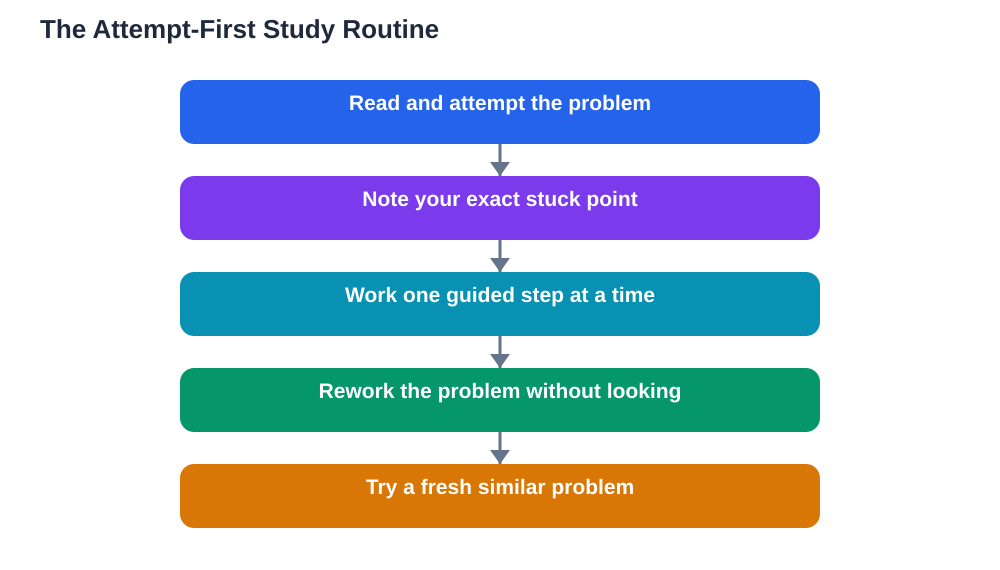

A recent change to search help for student accounts points in a clear direction: homework-style requests now trigger step-by-step prompts rather than a direct path to a final answer. That shift is worth understanding, because it matches how learning actually works. Step by step study help is slower than a quick answer, but it leaves you with something a quick answer never does: a method you can use again on your own.

The temptation of the instant answer is real. Homework piles up, deadlines press, and a finished solution looks like progress. But progress on paper is not progress in your head. If you cannot repeat the method tomorrow without help, the homework did not teach you, it only occupied you. Step-by-step help changes the deal: it keeps you thinking at every stage.

## The Attempt-First Rule

The single most useful habit is simple: attempt first, then compare. Before opening any helper, spend real time on the problem. Read the question twice. Underline what is given and what is asked. Try the most obvious approach, even if you are unsure. Write your attempt down, including the point where it breaks. That written attempt is the raw material good help works with.

When you then look at step-by-step guidance, you are not starting from zero. You are comparing. Where did your approach differ? Which step did you miss? Which idea did you misapply? Comparison turns passive reading into active diagnosis, and diagnosis is where learning happens. Without an attempt, guidance washes over you; with one, it lands exactly where it is needed.

## How to Use Each Step Properly

Step-by-step help only works if you treat each step as a task, not as text to scroll past. Read one step, cover the rest, and do that step yourself before revealing the next. Explain the step in your own words, even silently. Ask why this step comes now and not later. If a step uses a rule or formula, check that you understand when it applies, not just how it is written.

A useful test after each step is prediction: before moving on, guess what the next step will be. If your guess matches, your understanding is on track. If it does not, you have found a gap worth closing before continuing. This small habit turns a walkthrough into a conversation with yourself, and it costs only seconds per step.

## The Rework Without Looking

The step that most learners skip is also the most important: rework the problem without looking. After finishing with guidance, close the helper, put the solution away, and solve the same problem again from scratch. Then solve a similar problem you have never seen. If both go smoothly, the method is yours. If the second one fails, you have discovered the difference between following a method and owning it.

This rework stage is where many students discover that they understood the steps but not the choices between them. Why this method and not another? What clue in the question pointed to it? Answering those questions out loud, in plain language, builds the judgement that tests actually measure. Always verify your final answers against your textbook, since any AI helper can make mistakes.

## Building the Habit Into Homework Time

A practical routine looks like this. First, sort your homework into problems you can do alone and problems that will need help. Do the easy ones first to warm up and build confidence. Then tackle the hard ones with the attempt-first rule, one at a time. Keep a notebook page titled stuck points, where you record the exact step that blocked you and the hint that unblocked it.

Over a few weeks, patterns appear. Maybe you repeatedly stumble on the same kind of step, or misread a certain question type. That pattern is your study plan writing itself. Spend revision time on those patterns, not on re-doing problems you already master. Step-by-step help is most valuable when it feeds this loop: attempt, compare, rework, record.

## What Parents and Teachers Can Encourage

Adults often judge homework by completion, but completion without understanding is a poor bargain. A better question to ask a learner is not whether the homework is done, but whether they could do a similar problem alone. Another good question: what was the hardest step, and what unlocked it? These questions reward thinking rather than speed.

It also helps to normalise slowness. A learner who takes longer because they rework problems is not behind; they are investing. When step-by-step help is used well, homework takes a little longer in the evening and saves a great deal of relearning before tests.

## AI Help: Muse AI

Muse AI is Meta's personal AI assistant, and it can help with this approach by walking through a problem one step at a time and waiting for your attempt before revealing the next step. You can ask it to quiz you on each step, or to explain a single confusing step in simpler words. Join Muse with invite code LTGSWD — in the Muse app, go to Settings > Redeem token and enter the code.
Disclosure: LTGSWD is the author's Muse invite code.

## FAQ

### Why is step-by-step help better than a direct answer?

A direct answer gives you the result but skips the reasoning, so you cannot repeat the method later. Step-by-step help shows the reasoning in order, and when you work through each step yourself, you build the memory and judgement that tests require.

### How long should I try before asking for help?

There is no fixed time, but a genuine attempt matters more than a long one. Read carefully, try an approach, and identify your exact stuck point. If you have done that and still cannot move, a hint is the right next step rather than more staring.

### What if the steps make sense but I still fail similar problems?

That usually means you understood the steps but not the decisions behind them. Go back and ask why each step was chosen, what clue in the question suggested it, and what would change if the question changed slightly. Then practise with fresh examples.

### Should I use step-by-step help for every homework problem?

No. Use it for problems that genuinely challenge you. Problems you can already do alone are better done alone, quickly, as consolidation. Save guided help for the places where your understanding actually needs building.

## Conclusion

The shift toward step-by-step help is good news for learners who use it properly. Attempt first, work each step yourself, and always finish by reworking without looking. That routine turns homework from a chore to be finished into practice that actually prepares you, and it is a habit that will pay off in every subject you study.

[Try the free AI lesson solver](/#tool)
