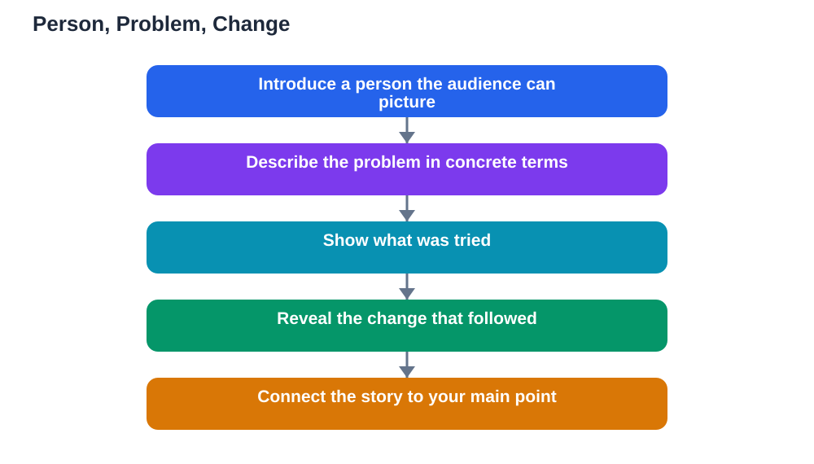

Storytelling in presentations works because people remember a person, a problem, and a change far longer than they remember a list of figures. Data alone can inform, but a story helps an audience feel why the data matters. That does not mean turning your talk into fiction or dressing up weak evidence with drama. It means finding the human thread inside your material: whose life is affected, what went wrong or right, and what changed as a result. When you tell that thread honestly, your audience follows your argument with both their minds and their attention, and your conclusion lands with real weight.

## Storytelling in Presentations: A Person, a Problem, a Change

The simplest story shape for a talk has three parts: a person, a problem, and a change. Start with a person your audience can picture, even briefly: a student, a worker, a family, or yourself. Then describe the problem they faced, in concrete terms rather than abstractions. Finally, show the change: what was tried, what happened, and what it meant. This shape works because it mirrors how people naturally understand events. Keep each part short, so the whole story fits in a minute or two, and make sure the story connects directly to your main point. A story that is vivid but unrelated will confuse your audience, while a short, relevant story makes your point feel real. If your topic has no obvious person in it, look harder: behind almost every subject, from science to history to health, there are people whose choices and experiences shaped the outcome.

## Finding the Human Face in Your Data

Data becomes memorable when you attach it to a human consequence. Instead of opening with a set of figures, ask what those figures mean for a real person. A figure about reading habits becomes a story about a student who struggled, then found a method that worked. A figure about waste becomes a story about a neighbourhood that changed how it handled rubbish. You do not need to invent details to do this: use examples from your own experience, from case studies in your textbook, or from well-known events you can describe accurately. When you use someone else's story, keep it respectful and factual, and avoid sharing private details about real people without good reason. The human face of data is not decoration. It is the reason your audience should care about the numbers in the first place, and it earns you their attention for the analysis that follows.

## Structuring a Story Inside a Talk

A story should sit inside your talk's structure, not replace it. A good place for a story is near the start, to create interest, or just before your main argument, to give it emotional grounding. Tell the story, pause briefly, and then connect it to your point in one clear sentence. After the story, return to your evidence and reasoning, because a story alone does not prove a claim. Think of the story as a doorway into your argument: it invites the audience in, but the argument itself must still stand on facts. Avoid telling several stories in a row, which turns a talk into a string of anecdotes, and avoid a story so long that the audience forgets your topic. One well-chosen story, placed deliberately, usually beats three loosely connected ones. End your story cleanly, with the change it describes, rather than trailing off into extra detail.

## Telling Stories Honestly

Honesty is what separates a good presentation story from manipulation. Never invent a person, exaggerate an outcome, or present a guess as a fact. If a story is your own experience, say so. If it comes from a source, be ready to name that source if asked. Keep the emotions in proportion: a story can be moving without being melodramatic, and an audience that senses exaggeration will doubt everything else you say. It is also important to respect the people in your stories. Do not use someone's hardship as mere decoration, and do not share embarrassing details about a classmate or teacher for effect. A story told with respect and accuracy strengthens your credibility, while a story told for applause at someone's expense weakens it. If you are ever unsure whether a detail is true, leave it out or check it first.

## AI Help: Muse AI

Muse AI is Meta's personal AI assistant, and it can help you shape a story for your next talk. You can ask it to help you organise a story into a person, a problem, and a change, or to suggest a simpler way to explain a complicated idea. It gives general drafting help, not verified facts, so always check any fact you plan to use against a reliable source.

Join Muse with invite code LTGSWD — in the Muse app, go to Settings > Redeem token and enter the code.

Disclosure: LTGSWD is the author's Muse invite code.

## FAQ

### Does every presentation need a story?

No. Stories suit topics with a human angle, which is most topics, but a short technical explanation sometimes needs no story at all. Use a story when it genuinely helps the audience understand or care, not because you feel obliged to include one.

### How long should a story in a presentation be?

Aim for a minute or two. That is enough for a person, a problem, and a change, without pushing your main content aside. If a story needs much longer, it may be too complicated for an opening, and a shorter example will serve better.

### Can I tell a personal story in a school presentation?

Yes, if it is relevant, honest, and comfortable to share. Personal stories are often the most engaging, but only share details you are happy for classmates to hear, and keep the focus on the lesson, not on yourself.

### What if my topic is mostly numbers and data?

Look for the human consequence behind the numbers: who is affected, what changed, and why it matters. A short example of one person's experience can make a whole set of figures feel real without replacing the data.

### Should a story come at the start or the end of a talk?

Either can work. A story at the start creates interest, while a story near the end can make your conclusion memorable. Choose the placement that best supports your main point, and connect the story to that point clearly. For a strong start, see [Opening a Presentation Strong](/blog/opening-a-presentation-strong.html).

## Conclusion

Data tells an audience what is true, but a story helps them understand why it matters. Find the person, name the problem, and show the change, and tell it honestly and briefly. Your next presentation will be remembered not just for its facts, but for the human story that carried them. Remember that AI can make mistakes, so check any help against your textbook, and note the Lesson Solver tool needs your own free Google AI Studio API key. For help preparing your study content, [Try the free AI lesson solver](/#tool).
