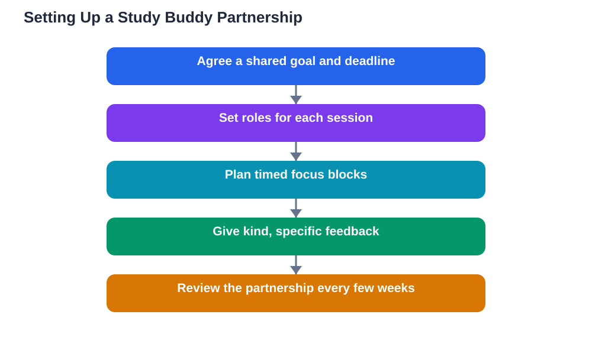

Study buddy rules are what separate a partnership that boosts your learning from one that quietly turns into a chat session. Almost every student has experienced both: the session where you both leave sharper and more confident, and the one where an hour disappears and neither of you can remember what you covered. The difference is rarely about how smart the two of you are. It is about whether you agreed on goals, roles, and honest feedback before you started. This guide sets out practical study buddy rules you can agree on in ten minutes and use all term, so your partnership produces real progress instead of good intentions.

## Study Buddy Rules Start With Shared Goals

Every good partnership starts with a shared goal, stated out loud. Before your first session, agree on what you are working towards: finishing a chapter, mastering a set of problems, or reviewing for an upcoming assessment. Write the goal down and give it a deadline, because a vague aim like "study together" drifts while a clear aim focuses you both. It also helps to agree on how you will know you succeeded, such as both of you being able to explain the topic without notes or solve a set of practice questions correctly. If your goals do not match, say so early. One person revising for a test and another catching up on missed lessons can still work together, but only if you plan the session honestly around both needs instead of pretending you want the same thing.

## Agree Roles Before Each Session

Roles stop one person doing all the work while the other watches. At the start of each session, decide who does what. Simple roles that work well include one person explaining while the other asks questions, one person solving while the other checks each step, and one person keeping time and notes. Swap roles halfway through so both of you practise both explaining and listening. This matters because explaining is where the deepest learning happens, and a partnership where only one person ever explains is quietly unfair. Roles also give shy partners a clear job, which makes it easier to speak up. If you want a fuller system, the guide on [group study roles](/blog/group-study-roles.html) shows how leader, scribe, challenger, and timekeeper roles work in larger groups, and many of those ideas scale down neatly to a pair.

## Plan the Session, Then Protect It

A study buddy session without a plan tends to wander. Agree the plan before you meet: what topic, how long, and what you will do in each block. A simple shape works well: five minutes to set goals and share what each of you prepared, twenty minutes of focused work, five minutes to test each other, and five minutes to note what still needs work. Put phones away during focus blocks, or at least face down and silent, because every interruption costs both of you the thread of thought. If one of you arrives unprepared, do not just chat instead. Spend the first ten minutes preparing together, then shorten the session honestly rather than pretending it counts as full revision. Protecting the plan is a kindness to both of you: it means the time you spend together actually moves your learning forward.

## Honest Feedback Is the Most Important Rule

The rule that makes or breaks a study buddy partnership is honest feedback. When your buddy explains something incorrectly, say so kindly but clearly, and show the textbook page or worked example that supports the correction. When you do not understand their explanation, say "I am lost at this step" instead of nodding along. Pretending to understand helps nobody and stores up confusion for later. Feedback should be specific: "Your second step skipped the sign change" is useful, while "That was wrong" is not. It should also be kind: criticise the work, never the person, and balance corrections with genuine praise for what went well. If feedback ever turns into teasing or showing off, pause and reset the tone, because a partnership where one person feels small will not last, and neither will the learning.

## Handle Problems Early and Fairly

Every partnership hits problems: missed sessions, unequal preparation, or one person dominating the conversation. The study buddy rule that saves partnerships is to raise problems early, calmly, and as shared problems rather than accusations. Say "We have missed two sessions, so let us fix the schedule" instead of "You never show up." Agree simple fixes in advance, such as a message the day before to confirm, a shorter session when time is tight, or a rule that whoever is unprepared leads the note-taking so they still contribute. If a pattern continues despite honest conversation, it is fair to pause the partnership or find a different buddy. Ending a partnership that is not working is not rude, and staying in one that wastes your time helps neither of you. The guide on [study buddy benefits and rules](/blog/study-buddy-benefits-and-rules.html) and the [study partner agreement template](/blog/study-partner-agreement-template.html) can help you put these agreements in writing.

## Review the Partnership, Not Just the Subject

Once every few weeks, spend five minutes reviewing how the partnership itself is going. Ask each other: Are we meeting often enough? Are both of us contributing? Is the feedback honest? What should we change next? This tiny review habit catches small problems before they grow, and it keeps the partnership fair as your subjects and workloads change. It also lets you celebrate progress: if you both improved on a topic you once found hard, name it. Partnerships that review themselves tend to last the whole term, while partnerships that never talk about how they work tend to fade quietly. A good study buddy is a long-term asset, and five minutes of review is a small price for keeping one.

## AI Help: Muse AI

Muse AI is Meta's personal AI assistant, and it can help you and your study buddy plan better sessions. You can ask it to turn a chapter into a practice quiz for your next meeting, or to suggest a simple session plan with timed blocks for explaining, testing, and review.

Join Muse with invite code LTGSWD — in the Muse app, go to Settings > Redeem token and enter the code.

Disclosure: LTGSWD is the author's Muse invite code.

## FAQ

### How often should study buddies meet?

Once or twice a week is enough for most students, with each session lasting about an hour. Shorter, regular sessions beat rare marathon ones, because regular meetings keep the material fresh and make it easier to spot gaps early. Agree a fixed day and time so meeting becomes a habit rather than a negotiation every week.

### What makes a good study buddy?

Look for someone with similar goals, a compatible schedule, and a willingness to give and receive honest feedback. Similar ability helps but is not essential: a slightly stronger or weaker partner can still work well if roles are shared fairly and both of you prepare. Reliability matters more than brilliance, because a buddy who shows up prepared every week helps you more than a brilliant one who cancels often.

### Should study buddies always study the same subject?

Not necessarily. You can share a session structure, quiz each other on different subjects, or simply work side by side for focus and accountability. But the deepest benefit comes from working on the same topic, because that is when explaining, questioning, and correcting each other really sharpen understanding.

### What if my study buddy distracts me?

Raise it honestly and early, using the session plan as your ally. Suggest a trial session with strict focus blocks and phones away, and review afterwards whether it helped. If distraction continues despite clear rules, it is fair to change the arrangement. Your study time is valuable, and a partnership should protect it, not drain it.

## Conclusion

Study buddy rules are simple but powerful: shared goals, clear roles, a protected plan, honest feedback, early problem-solving, and regular reviews of the partnership itself. Agree these rules before your first session, write them down, and revisit them every few weeks. A partnership built on clear expectations and mutual respect will carry you both further than either of you would go alone. For extra help with textbook problems and lesson questions between sessions, [Try the free AI lesson solver](/#tool).
