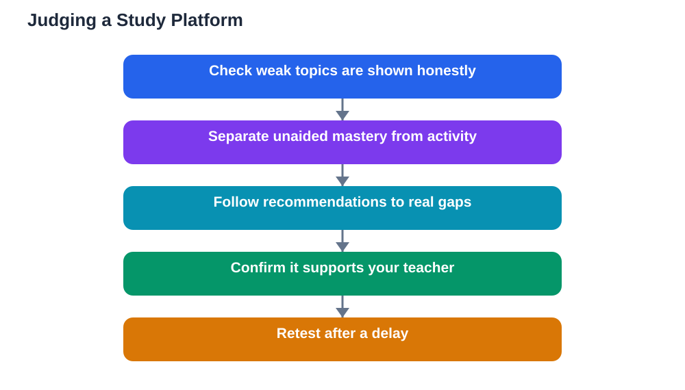

A new AI-enabled learning platform announced this week combines video lessons, study materials, chapter assessments, mock tests, performance analytics and a dashboard for families to follow progress. The package sounds complete, but the feature list is not the test. Study platform progress tracking is the real test: does the platform show your weak topics honestly, and does it replace or support your teacher? Those two questions separate genuinely useful platforms from polished distractions.

Platforms are easy to judge badly. A slick dashboard, a streak counter and a library of videos can feel like progress while teaching very little. The right way to judge a platform is to ignore the marketing and interrogate its tracking: what it measures, what it hides, and what it encourages you to do next. A platform that tells you the truth about your learning is worth your time. One that flatters you is not.

## Honest Weaknesses: The First Test

The most important feature of any progress tracker is also the rarest: honest bad news. A good tracker names your weak topics plainly, shows which kinds of questions you miss repeatedly, and distinguishes between topics you have merely covered and topics you have actually mastered. It should make your gaps impossible to ignore, because gaps you cannot see are gaps you cannot fix.

Watch out for trackers that inflate success. If every session ends with a high score, a badge or a congratulatory message, ask whether the tasks were too easy or the scoring too generous. A tracker that reports completion rather than mastery, minutes watched rather than questions answered unaided, or overall averages that hide weak topics behind strong ones, is decorating your progress rather than measuring it. Real tracking is sometimes uncomfortable, and that discomfort is useful.

## Mastery Versus Activity

A second test is whether the platform measures mastery or activity. Watching a video is not learning a topic. Reading a solution is not solving a problem. A serious tracker records unaided performance: questions answered correctly without hints, on fresh problems, after a gap of days. It tracks retention over time, not just immediate scores, and it notices when a previously mastered topic starts slipping.

Ask how the platform handles hints and retries. If hinted answers count the same as unaided ones, its scores are inflated. If unlimited retries without penalty push every score toward perfect, its mastery claims are meaningless. The best platforms score hinted and unaided work separately, space out retests, and treat a topic as mastered only when it survives delay and variation.

## What the Platform Tells You to Do Next

Tracking is only useful if it drives action. After showing your weak topics, a good platform recommends specific next steps: targeted practice on the weakest idea first, a short explanation pitched at your level, and a retest after a delay. It sequences work sensibly, revisiting foundations before advanced material, and it adapts when a recommendation fails rather than repeating it endlessly.

Be wary of recommendations driven by engagement rather than learning. A platform that always suggests the easiest next task, the most entertaining video, or whatever keeps you clicking is optimising for your attention, not your attainment. Learning recommendations should sometimes be hard, sometimes repetitive, and sometimes boring, because that is what closing real gaps feels like.

## Does It Support or Replace Your Teacher?

The snapshot's theme question is the right one: does the platform replace or support your teacher? A platform that supports your teacher aligns with your class material, reports progress in a form your teacher can use, and leaves room for classroom discussion, group work and teacher feedback. It treats the teacher as the authority on what matters and the platform as a practice space.

A platform that tries to replace the teacher is a different proposition, and usually a weaker one. No dashboard can read a learner's confusion, motivation or home circumstances the way a teacher can. No automated path can lead the class discussion that turns individual practice into shared understanding. Platforms work best as one component of a learning life that still centres on teachers, textbooks and classmates, and any platform that implies otherwise deserves scepticism.

## Family Dashboards: Helpful or Pressuring?

Many platforms now offer dashboards for families, and these need care. A good family dashboard shows trends and topics, not just scores, and helps families support learning: which topics need encouragement, where a tutor or teacher conversation would help, and how effort is trending over weeks. It should inform support, not fuel pressure.

A dashboard that ranks learners, emphasises daily streaks, or reduces a child to a single number can do real harm, turning study into performance anxiety. Families should ask what the dashboard is for: understanding or surveillance. The best answer is understanding, shared with the learner rather than inspected behind their back. Progress tracking should build a learner's self-knowledge, not just a family's oversight.

## AI Help: Muse AI

Muse AI is Meta's personal AI assistant, and it can help you judge a study platform by listing the questions to ask about its tracking, or by helping you summarise your own weak topics from your textbook work. It offers general planning help, not a verdict on any particular platform. Join Muse with invite code LTGSWD — in the Muse app, go to Settings > Redeem token and enter the code.
Disclosure: LTGSWD is the author's Muse invite code.

## FAQ

### What is the single most important thing a progress tracker should show?

Your weak topics, honestly and specifically. A tracker that names what you miss, which question types trip you, and what you have truly mastered versus merely covered is useful. One that only celebrates completion is not.

### How can I tell if a platform's scores are inflated?

Check whether hinted answers and unlimited retries count the same as unaided first attempts. If they do, scores will look better than your real ability. Serious platforms score unaided work separately and retest after delays.

### Should a study platform replace my teacher?

No. The best platforms support teachers by aligning with class material and reporting useful patterns, while teachers provide judgement, discussion and context no system can replicate. A platform that claims to replace teaching should be treated with scepticism.

### Are family dashboards a good idea?

They can be, when they show trends and topics that help families support learning. They become harmful when they reduce a learner to a single score, emphasise streaks and rankings, or create pressure instead of understanding.

## Conclusion

Judge a study platform by its progress tracking, not its feature list. Demand honest weak topics, unaided mastery over activity, recommendations that target real gaps, and a design that supports your teacher rather than sidelining them. A platform that tells you the truth about your learning, even when the truth is uncomfortable, is a tool worth keeping. One that only tells you what you want to hear is not.

[Try the free AI lesson solver](/#tool)
