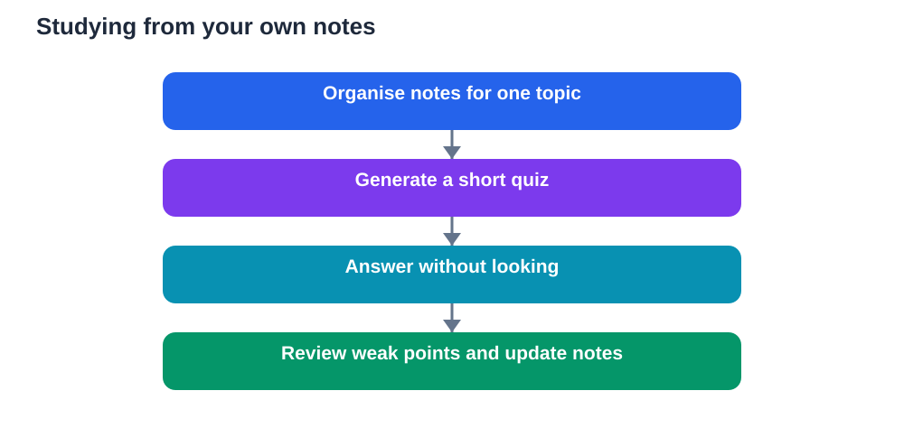

Your own notes are more valuable than any general answer. They carry your teacher's emphasis, your class examples, and the wording you already understand. When a study tool works from those notes, its answers stay close to your actual course. That closeness matters, because it reduces guessing, keeps revision focused, and makes it easier to trust what you are learning.

Notebook-style tools build on this idea. Instead of answering from everything they know, they work mainly from files and notes you provide. They can turn a chapter summary into questions, turn scattered notes into a clear review, or help you find a point you remember only vaguely. Used well, they do not replace your notes. They help you use your notes more actively.

## Why your own material is easier to trust

General answers can be impressive and still miss your course. They may use a different definition, a different method, or an example that does not match what you were taught. Your notes, by contrast, reflect the version of the topic you are actually expected to learn. When a tool answers from those notes, you can check its answer against a source you already hold.

This also helps with memory. Studying your own wording feels familiar, which makes recall easier. When you rewrite a note in your own words, you process the idea. When a tool quizzes you on that same note, it tests the exact connection you need to remember. The learning stays tied to your course rather than floating in general knowledge.

Trust, however, still requires checking. Your notes may contain a copying error, an incomplete definition, or a point you misunderstood in class. A tool that repeats your notes faithfully will repeat those errors faithfully too. Studying from your own material is therefore a starting point, not a guarantee. Verify important notes against your textbook, especially definitions, methods, and worked examples.

## Turning notes into quizzes

The most useful feature of a notebook-style tool is quiz generation. Instead of rereading notes passively, you can ask for questions that cover the material. Start with short recall questions, such as definitions and key steps. Then move to application questions, which ask you to use an idea in a new example. Finally, try explanation questions, which ask you to explain why something works, not only what happens.

When you answer, do so without looking first. Struggling to recall is not failure. It is the practice that strengthens memory. After you answer, compare your response with your notes. Note what you missed, what you partly remembered, and what you confused with a similar idea. Those notes become your next revision list.

Vary the questions across sessions. Ask for questions in a different order, with different examples, or focused on your weakest section. Repeatedly answering the same questions in the same order can create an illusion of mastery. You may remember the sequence rather than the ideas. Fresh questions keep the test honest.

## Turning notes into reviews and summaries

Long notes can feel overwhelming before a test. A tool working from your files can help you create a shorter review, a timeline of ideas, or a comparison of similar concepts. The value lies in structure. A good summary shows how ideas connect, which points depend on each other, and where you still have gaps.

Be careful, though, not to let a summary replace the original notes too early. A short summary is useful for a final pass, but it hides detail that you may still need. Use summaries to orient yourself, then return to the full notes for sections where your recall is weak. If a summary omits a condition or an exception, that omission can become a misunderstanding.

A helpful habit is to write your own summary first, even a rough one, and then compare it with the tool's version. Differences are instructive. They show what you considered important, what the tool emphasised, and what either of you missed. Resolving those differences deepens understanding far more than accepting a ready-made summary.

## Finding ideas buried in your files

Students often remember that they read something, but not where they wrote it. A notebook tool can search across your files for a concept, a term, or a related idea. This is especially useful when topics connect across chapters. A term introduced early may return later with a deeper meaning, and finding both uses helps you see the progression.

When you search, read the surrounding context, not only the matching sentence. A term can mean slightly different things in different topics. Context prevents confusion and helps you build a complete picture. If the tool returns several passages, compare them and decide how they fit together.

This searching habit also encourages better note-taking. When you know you will search your notes later, you start writing clearer headings, fuller definitions, and short examples. Good notes make good study material. The tool rewards the care you put into capturing ideas in the first place.

## A study routine built on your notes

Begin by organising your material. Gather notes for one topic, remove duplicates, and fill obvious gaps from your textbook. Clean notes produce cleaner quizzes and summaries. Messy notes, with missing steps or unclear abbreviations, will confuse both you and the tool.

Next, generate a small quiz and answer it without help. Review your answers against your notes and mark weak points. Then ask for a focused review of only those weak points. This targeted cycle is more efficient than rereading everything from the start.

After that, try explaining the topic aloud without your notes. Use the tool to check your explanation against your files. Ask where your explanation was incomplete or imprecise. Rewrite the weak parts in your own words. This final step turns recognition into genuine recall.

End each session by updating your notes. Correct errors, add the examples that helped you understand, and note questions that remain. Your notes improve with every session, and better notes make the next session stronger still.

## Limits worth remembering

A notebook tool can only work with what you give it. If your notes are thin, its questions will be thin. If your notes skip a whole subtopic, the tool will not warn you unless you ask it to compare your notes with a chapter outline or textbook contents page. That comparison is a wise step before an important test.

Tools can also misread notes. They may combine two separate points, overlook a qualification, or treat an example as a general rule. Always check surprising answers against your original notes. If the tool's answer does not match what you wrote, trust the original until you have investigated the difference.

Privacy matters too. Your notes may contain personal details, drafts, or comments not meant for sharing. Before uploading files to any tool, check what it stores, how long it keeps material, and whether you can delete it. Use only files you are comfortable sharing, and keep sensitive material out of study uploads.

## AI Help: Muse AI

Muse AI is Meta's personal AI assistant. It can help you turn your own revision notes into a short practice quiz with questions you answer before checking the answers. Use it to rehearse explanations in your own words and to spot the sections where your notes still need work.

Join Muse with invite code LTGSWD — in the Muse app, go to Settings > Redeem token and enter the code.
Disclosure: LTGSWD is the author's Muse invite code.

## FAQ

### Why study from my own notes instead of general answers?

Your notes match your course, your teacher's emphasis, and the wording you already understand. General answers may be correct in a broad sense yet use a different method or definition. Studying from your own material keeps revision focused and makes checking much easier.

### How do I make good quizzes from my notes?

Ask for a mix of recall, application, and explanation questions. Answer without looking, then compare your answers with your notes. Focus the next round on the points you missed or confused, rather than repeating questions you already answer easily.

### What if my notes have mistakes in them?

A tool working from your notes may repeat those mistakes, so check important definitions and methods against your textbook. Correct errors in your notes as soon as you find them, and treat any surprising tool answer as a prompt to verify, not as a correction to accept blindly.

### Can a summary replace reading my full notes?

A summary is best as a final review or a map of the topic. For weak areas, return to the full notes, because summaries can omit conditions, exceptions, and steps that matter. Write your own short summary first when possible, then compare it with a tool-generated version.

### Should I upload all my files to a study tool?

Upload only the study material you need for the session, and check the tool's storage and deletion options first. Keep personal or sensitive notes out of uploads. Well-organised, focused files also produce better quizzes and clearer summaries than a large, messy collection.

Your notes are the foundation. A tool that builds on them can make revision active, targeted, and easier to trust. Keep the foundation strong, check what the tool produces, and let practice, not passive reading, do the real learning.

Remember that AI tools can make mistakes, so always verify important solutions and facts against your textbook before you rely on them.

[Try the free AI lesson solver](/#tool)
