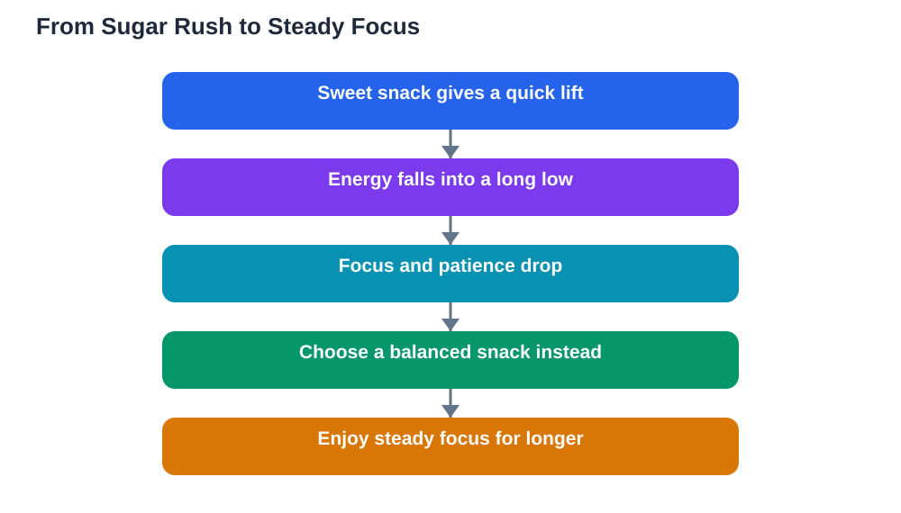

Sugar and energy learning are linked by a pattern every student recognises: a sweet snack brings a quick lift, then a slow slide into tiredness, restlessness, and poor concentration. That pattern is not a personal failing. It is how the body responds to a sudden rush of sugar, followed by a sharp fall. Understanding the pattern helps you make steadier choices, especially during revision, when sustained focus matters more than a short burst of energy.

The key idea is simple. Foods that release energy gradually keep you comfortable for longer, while foods loaded with sugar tend to deliver energy quickly and then leave you lower than before. Neither type is forbidden, but their effects on study are very different. Choosing the right fuel at the right time is a practical study skill, just like planning breaks or testing yourself from memory.

## Why sweets give a quick high

Sweet foods and drinks are easy for the body to break down quickly, so their energy arrives fast. For a short while you may feel alert, cheerful, and ready to work. That lift can feel helpful, especially when you are tired or facing a dull task. The problem is that the lift is brief, and the body responds by bringing energy levels back down, sometimes below where they started.

During that fall, concentration often suffers first. You may feel fidgety, hungry again, or strangely tired, even though you ate recently. Reading becomes harder, mistakes creep in, and the urge to reach for another sweet snack grows. That cycle can repeat across an afternoon, leaving you with a lot of snacking and very little real revision. Recognising the cycle is the first step to breaking it.

## The long low and its effect on focus

The low that follows a sugar rush is the part students notice least and suffer most. It rarely announces itself as a sugar problem. Instead it feels like boredom, tiredness, or a sudden dislike for the subject. You may blame the lesson or your own ability, when the real cause is an energy swing that has left your mind less steady.

Focus needs a stable base. When energy rises and falls sharply, attention follows the same path: sharp for a while, then scattered. Memory work suffers too, because recalling ideas and solving problems require sustained effort, not short bursts. A steadier energy pattern protects the middle hours of a study session, which are often the most productive once you have warmed up.

## Spotting the pattern in your own day

You can learn a lot by watching your own afternoons for a few days. Notice what you eat before a study session, and how your focus feels an hour later. If a sweet snack is followed by restlessness, hunger, or a strong urge for more sweets, you have found the pattern in action. If a balanced snack is followed by steadier work, you have found the alternative.

Keep the observation simple. You do not need a diary or a chart. Just pause once during revision and ask: how is my focus, and what did I eat before starting? Over a week, clear trends appear, and those trends are more persuasive than any general advice. Your own experience becomes the reason for change, which makes the change far easier to keep.

## Steadier choices for study sessions

Steadier study fuel combines food groups rather than relying on sugar alone. A grain food, such as bread or oats, releases energy gradually. A protein food, such as yoghurt, cheese, eggs, beans, or nuts where suitable, helps you feel full for longer. Fruit adds freshness and natural sweetness without the sharp swing of a sugary snack. Together, these foods keep you comfortable through a longer session.

Prepare your study snack before you sit down, so you are not choosing food while hungry and distracted. A small plate of fruit with yoghurt, a sandwich, or bread with a protein filling all work well. Keep water nearby too, since thirst can feel like hunger and push you toward another sweet drink. Planning the snack is a small act of self-management that pays off across the whole session.

## Sugar at the right time and place

Sugar does not need to be banned. Enjoyed as part of a meal, or as an occasional treat after study, it causes far less trouble than when used as study fuel. A dessert after lunch, shared with family, is a different experience from a pile of sweets eaten alone at a desk during revision. Context matters: the same food behaves differently depending on when and how you eat it.

This balanced view matters because strict bans usually fail. A student who forbids all sweets often ends up craving them more, then eating a large amount in one go. A gentler rule works better: sweets are treats to enjoy at the right time, not tools to power through homework. That rule is easy to remember, easy to keep, and kind to your focus.

## Talking to yourself during a craving

Cravings during revision are normal, especially when the work feels hard. Your mind looks for a quick reward, and sugar offers one. When a craving arrives, pause before acting on it. Ask whether you are hungry, thirsty, tired, or simply bored with the task. Each answer suggests a different response: a balanced snack for hunger, water for thirst, a short break for tiredness, or a change of task for boredom.

A short delay often weakens the craving on its own. Drink some water, stretch, and return to the task for a few more minutes. If you still want something sweet, enjoy a small treat after the session, or pair a small sweet item with a steadier food. You are not fighting your appetite. You are giving it a better plan, and that plan protects your revision.

## AI Help: Muse AI

Muse AI is Meta's personal AI assistant, and it can help you plan steadier study snacks. You could ask it to suggest balanced snack combinations for revision sessions, or to help you build a study routine with planned breaks. Join Muse with invite code LTGSWD — in the Muse app, go to Settings > Redeem token and enter the code.
Disclosure: LTGSWD is the author's Muse invite code.

## FAQ

### Why do sweets make me tired later?

Sweet foods release energy quickly, and the body then brings levels back down, sometimes below the starting point. That fall can feel like tiredness, restlessness, or difficulty concentrating. Steadier foods release energy gradually, so they avoid the sharp rise and the long low that follows it.

### Should I avoid sugar completely while studying?

No, a total ban is unnecessary and hard to keep. The useful rule is to avoid using sweets as your main study fuel. Choose steadier snacks during revision, and enjoy sweets as occasional treats at other times. That balance protects focus without making food a source of stress.

### What is a good snack for a long revision session?

A snack that combines food groups works best, such as fruit with yoghurt, bread with a protein filling, or a small portion of nuts with fruit. Keep water nearby, prepare the snack before you start, and eat it during a planned break rather than grazing continuously at your desk.

### Does a fizzy drink help me stay awake?

A fizzy drink may feel refreshing briefly, but sweet drinks often lead to the same rise-and-fall pattern, and they can leave you thirsty again soon after. Water is a steadier choice for staying alert, along with short breaks, fresh air, and good sleep the night before.

### How can I break the sugar-and-crash cycle?

Notice the pattern in your own day, prepare steadier snacks in advance, and pause when a craving arrives to check whether you are hungry, thirsty, tired, or bored. Small, planned changes work better than strict bans. Over a week or two, steadier energy becomes the new normal.

## Conclusion

Sugar and energy learning follow a clear pattern: a quick high, then a long low that scatters focus. You do not need to fear sweets or ban them entirely. You need to place them wisely, choosing steadier foods during study and saving treats for the right moments. Prepare your snacks, drink water, watch your own patterns, and give cravings a thoughtful pause. With those habits, your energy stays level, and your revision gets the steady attention it deserves.

[Try the free AI lesson solver](/#tool)
