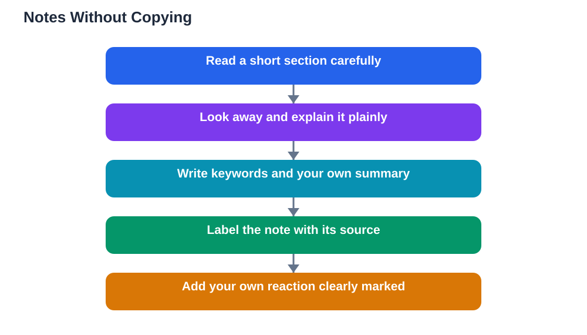

Taking notes for research without copying is one of the most valuable habits a student can build. Good notes do two jobs at once: they capture what you learned, and they keep your own thinking separate from other people's words. When notes blur that line, writing later becomes stressful, because you cannot tell which sentences are safe to use and which ones belong to a source. The fix is simple and practical: read a passage, close it or look away, and write down the idea in your own words using short keywords. That small pause forces your brain to understand the idea instead of merely moving words from one page to another, and the notes you produce are far easier to turn into honest writing.

## Taking Notes for Research: Read First, Then Write

The most common note-taking mistake is writing while staring at the source, because your hand tends to follow the author's sentences word by word. A better rhythm is to read a short section carefully until you can explain its main point in plain language, then look away and write that point down. If you cannot explain it yet, read it again more slowly and ask what the author is really saying, what evidence they offer, and why it matters for your question. Only then write your note. This method feels slower at first, but it produces notes you actually understand, which means revision and writing later go much faster. It also protects you from accidental copying, because notes written from understanding naturally sound like you. For more note methods, see [How to Take Good Class Notes](/blog/how-to-take-good-class-notes.html).

## Keywords Beat Long Sentences in Research Notes

Long, copied sentences make poor notes because they hide the main idea inside someone else's wording. Keywords do the opposite: they strip a passage down to the few words that carry its meaning, leaving room for your own thinking. For each source section, note the key terms, the main claim, and one piece of supporting evidence, each in a few words. Then add a short line in your own words explaining why that point matters for your research question. This keyword approach has another advantage: when you return to your notes days later, the short form is quicker to scan, and the gaps in your understanding stand out clearly. If a keyword note makes no sense on a second reading, that is useful feedback telling you to revisit the source and rewrite the note more clearly.

## Label Every Note With Its Source Immediately

A note without a source label is a problem waiting to happen. You may remember the idea perfectly and still have no way to credit it or check it later, which can lead to missing references or accidental claims that are not yours. The habit that prevents this is delightfully simple: every time you start notes from a new source, write the source name, author, and page or link at the top of that section before you write anything else. Then, if you switch sources, start a fresh labelled section rather than mixing notes together. Some students use a simple code, such as a letter for each source, plus a page number, written beside each note. Whatever system you choose, the rule is the same: no note without a label. When writing time comes, this habit turns the dreaded bibliography into a quick tidy-up of labels you already kept.

## Your Own Words, Your Own Reactions

Strong research notes contain more than other people's ideas; they contain your reactions to those ideas. After noting a source's point in your own words, add a brief comment of your own: does this agree with another source, does it surprise you, does it answer part of your question, or does it raise a new question? Mark your comments clearly, perhaps with a different colour or a symbol, so they never get confused with source material. These reactions are the seeds of your own argument, because a research project is not a pile of borrowed facts but a piece of thinking built from them. Students who only copy source ideas often struggle to write, while students who recorded their reactions find they already have opinions, comparisons, and questions ready to shape into paragraphs. Keep your comments short and honest, and do not worry if they change as you read more.

## When You Do Copy Words, Mark Them Clearly

There are times when copying exact words is the right choice, such as when a definition or a striking phrase matters in its original form. The rule for those moments is to mark the copied words unmistakably as a quotation, with quotation marks around them and the source label beside them. Never leave copied words unmarked in your notes, even if you plan to rewrite them later, because plans change and unmarked copies have a way of slipping into finished work. Keep quotations short and rare: most of your notes should be in your own words, with quotations saved for lines that truly deserve exact wording. If you use the Lesson Solver tool for textbook exercises, the same care applies: verify its solutions against your textbook, remember that AI can make mistakes, and note that the tool needs your own free Google AI Studio API key.

## AI Help: Muse AI

Muse AI is Meta's personal AI assistant, and it can help you practise writing notes in your own words. You can ask it to explain a difficult passage simply, then try restating that explanation in your own note and compare the two versions.
Join Muse with invite code LTGSWD — in the Muse app, go to Settings > Redeem token and enter the code.
Disclosure: LTGSWD is the author's Muse invite code.

## FAQ

### Why should I write notes in my own words?

Writing in your own words forces you to understand an idea rather than just move it from one page to another. Notes written from understanding are easier to remember, easier to turn into writing, and safe from accidental copying. If you can restate an idea plainly, you have probably understood it well enough to use it.

### What if I cannot restate a passage in my own words?

That usually means the passage needs another careful reading, not that you lack ability. Read it again slowly, ask what its main point is and what evidence supports it, and try explaining it aloud as if to a friend. If it still resists restating, note the key terms and your confusion honestly, and return to it after reading related material that may clarify it.

### How do I keep track of which notes came from which source?

Label every note section with its source before you write, using the author, title, and page or link. Use a simple code for each source if that is faster, and keep a matching source list. The key habit is labelling at the moment of note-taking, because reconstructing sources later is slow and unreliable.

### Is it ever acceptable to copy exact words into my notes?

Yes, when a definition or a phrase matters in its original wording, but only if you mark it clearly as a quotation with quotation marks and a source label. Keep such quotations short and rare. Most notes should be in your own words, with exact wording reserved for lines that genuinely deserve it.

## Conclusion

Research notes work best when they are short, honest, and clearly labelled. Read first, then write in your own words; favour keywords over copied sentences; label every note with its source; add your own reactions; and mark any exact wording as a quotation. These five habits keep your research honest and make writing far easier, because your notes will already contain understanding, not just borrowed text. Build them now, and every future project will benefit.

[Try the free AI lesson solver](/#tool)
