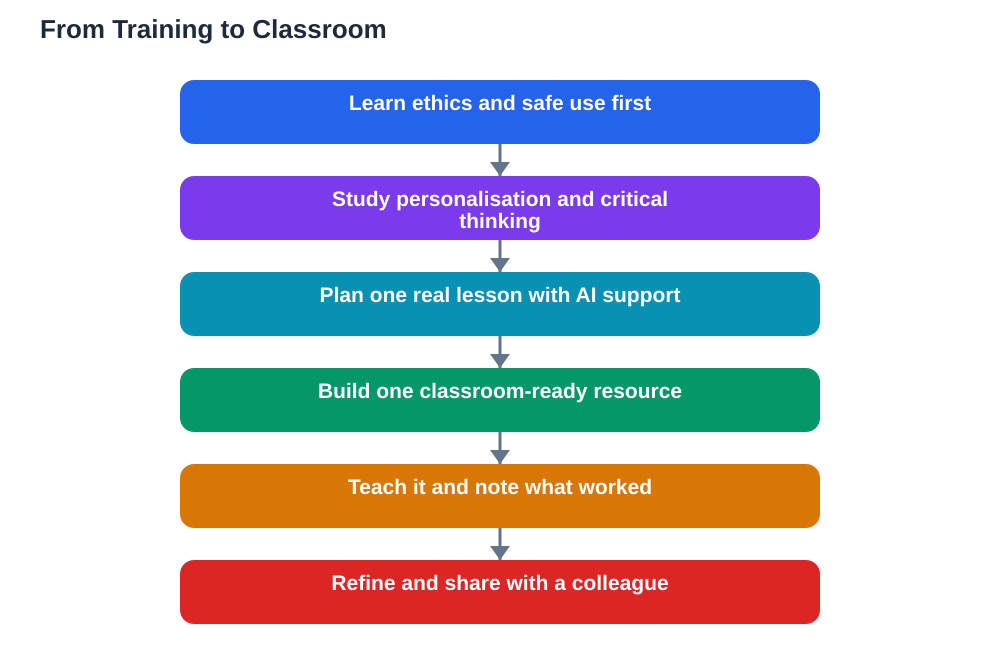

Free, self-paced AI courses for teachers have multiplied recently, and teacher ai training classroom quality varies far more than the course descriptions suggest. Some courses genuinely prepare a teacher for Monday morning, while others offer little more than a tour of flashy features. Knowing what good training actually covers helps teachers choose wisely, spend their limited time well, and turn a certificate into a real classroom resource. This guide looks at the ingredients that matter, and at how to convert a finished course into one lesson you can actually teach.

## Ethical Classroom Use Comes First

The strongest teacher AI courses begin with ethics, not features. They ask when AI use is fair, what counts as honest student work, how to protect learners' private information, and how to avoid bias in AI-generated material. These questions matter because teachers set the rules their students will follow, and a teacher who has thought them through can explain them clearly instead of improvising under pressure. Good training uses realistic scenarios: a student submits AI-written work, a tool produces a biased example, or a parent asks what data a tool collects. Working through such cases builds judgement, not just knowledge. A course that skips ethics and jumps straight to tricks may feel fun, but it leaves teachers unprepared for the very decisions they will face first.

## Personalising Instruction and Building Critical Thinking

Good training also shows how AI can personalise instruction without replacing the teacher's judgement. That means learning to adapt explanations to different reading levels, to generate varied practice questions on one topic, and to offer extra support for learners who are stuck while giving extension tasks to those who are ready. Crucially, the training should show the limits too: AI-generated differentiation still needs a teacher's eye, because the tool does not know your students, their gaps, or their confidence. The same applies to critical thinking. Strong courses teach teachers to use AI as a sparring partner for students, asking learners to check AI output, find its errors, and argue against its claims, rather than simply accepting its answers. When training models this approach, teachers can pass it on directly.

## Teacher AI Training Classroom: Lesson Planning and Safe Use

Practical training earns its keep in lesson planning and safe use. A useful course walks teachers through planning a real lesson with AI support: drafting objectives, sequencing activities, creating practice material, and building in time for students to check and discuss AI output. It also covers safe use in plain language: what not to paste into a tool, how to handle student data, and how to choose tools with sensible privacy practices. Certificates and badges are a nice bonus, and they can evidence professional learning, but they are not proof of quality on their own. Judge a course by what you can do after it, not by the badge it awards. If you finish a course and cannot name one lesson you would change, the course taught you about AI, not how to teach with it.

## Turning Training Into One Classroom-Ready Resource

The best way to make training stick is to convert it into a single, finished resource before the course fades from memory. Pick one lesson you already teach, and rebuild one part of it using what you learned: a clearer explanation, a set of practice questions at two levels, or a short activity where students check an AI answer against their textbook. Teach it, watch what happens, and note what to keep and what to fix. That one tested resource is worth more than a folder of unfinished course notes, because it proves the training in your own classroom and gives you something to refine and reuse. Share it with a colleague if you can, since a short conversation about what worked often teaches more than another hour of video. Training becomes valuable the moment it changes one real lesson for the better.

## AI Help: Muse AI

Muse AI is Meta's personal AI assistant, and it can help teachers turn training into classroom material. You can ask it to draft practice questions at different levels for a lesson you already teach, or to suggest ways to phrase an activity where students check AI output.

Join Muse with invite code LTGSWD — in the Muse app, go to Settings > Redeem token and enter the code.

Disclosure: LTGSWD is the author's Muse invite code.

## FAQ

### How do I choose a good free AI course for teachers?

Look for ethics, personalisation, critical thinking, lesson planning, and safe use in the syllabus, plus practical tasks rather than only videos. A course that asks you to build something you can teach is usually a better use of time than one that only demonstrates features.

### Do certificates from free AI courses matter?

They can evidence professional learning, but they are not proof of quality. What matters is whether you can use what you learned in a real lesson, so judge a course by its classroom payoff, not its badge.

### How much time should AI training take?

Self-paced courses fit around teaching, so work in short, regular sessions rather than one long block. More important than total hours is finishing with one classroom-ready resource you have actually tried with students.

### Should teachers use AI to plan every lesson?

No. AI is a planning helper, not a replacement for professional judgement. Use it where it saves time or adds variety, keep your own objectives and knowledge of your students in charge, and always check generated material before teaching it.

### What is the safest way to start using AI in class?

Start small and transparent: one activity, with clear rules about honest use and data privacy, and a built-in step where students check AI output against their textbook. Review how it went before expanding to more lessons.

## Conclusion

Good teacher AI training is measured not by its certificate but by its classroom effect: clearer ethics, smarter personalisation, stronger critical thinking, safer habits, and at least one lesson genuinely improved. Choose courses with those ingredients, and finish each one by building and teaching a single resource. That is how training becomes teaching. For help with your school work and study questions, [Try the free AI lesson solver](/#tool).
