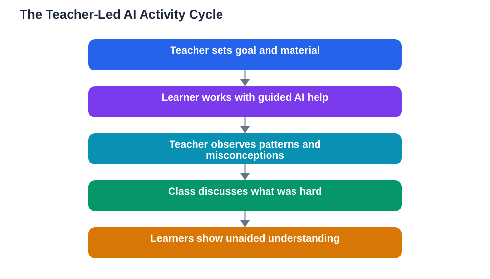

A widely used classroom platform recently made guided learning available in a form that puts the teacher first: the teacher assigns the activity, and the AI acts as a one-to-one study tool anchored in class material, with a focus mode keeping learners on the teacher's objectives. The idea is simple but important. Teacher-assigned AI activities work best when the AI follows the lesson plan instead of improvising its own.

This matters because an AI tutor left to itself has no sense of what your class is actually learning this week. It may explain a topic brilliantly and still miss the point: the wrong level, the wrong examples, the wrong emphasis, or a method your teacher deliberately has not introduced yet. A teacher-assigned activity solves that problem at the source. The teacher decides the goal, the material and the boundaries, and the AI works inside them.

## Why Teacher Intent Is the Deciding Factor

Every lesson has intentions that go beyond its topic. A teacher may want learners to practise a particular method, to struggle with a certain kind of problem, or to build toward next week's topic. Those intentions are invisible to a general AI tool. When the teacher assigns the activity, those intentions become the instructions: which chapter, which skills, which level of challenge, and what success looks like.

This also protects sequence. Subjects are taught in an order for a reason. A concept introduced early is often simplified on purpose, with complications added later. An unguided AI may jump ahead to the advanced version, which feels impressive but confuses learners who have not yet built the foundations. Teacher assignment keeps the AI inside the current stage of the journey.

## What Good Teacher Assignment Looks Like

A well-assigned AI activity has a clear, narrow brief. It names the topic and the source material, states the skill being practised, and sets the level of help: hints and questions rather than finished answers, for example. It also tells learners what to do when stuck, and what counts as finished. Vague assignments produce vague AI behaviour; precise assignments produce focused practice.

Focus features help here. When an activity keeps learners on the teacher's objectives, distractions shrink. Learners are less likely to drift into unrelated topics, however interesting, and more likely to spend their time on the skill the lesson is actually about. Focus is not about control for its own sake; it is about protecting limited class time for the learning that matters most.

## The Teacher's Role During the Activity

Assigning the activity is not the end of the teacher's job; it is the beginning of a different one. While learners work, the teacher can watch for patterns: which questions stall the most learners, which misconceptions keep appearing, which learners finish too fast and need extension. Those observations are worth more than any automated report, because the teacher knows the class and can read the pattern in context.

After the activity, a short class discussion multiplies its value. Ask learners what was hard, what hint unlocked progress, and where the AI's explanation disagreed with the textbook. That last question is essential. AI helpers can make mistakes, and a class that learns to spot and correct them is learning critical thinking, not just content. Always verify AI-assisted work against the textbook.

## What Learners Should Do Differently

For learners, a teacher-assigned activity changes the task. You are not exploring freely; you are practising something specific. Start by reading the assignment brief carefully, not just opening the tool. Know the goal before you begin, so you can judge whether your work is on track. If the AI drifts off-topic or offers a method your teacher has not taught, note it and ask your teacher rather than following it blindly.

Also, treat the activity as preparation for unaided work. After finishing with the AI, try a similar problem alone. If you cannot, tell your teacher exactly where you got stuck. That feedback helps the teacher adjust the next assignment, and it helps you far more than silently finishing with help.

## Designing Assignments That Actually Teach

For teachers designing these activities, a few principles help. Keep each activity to one clear goal rather than a bundle of topics. Choose material the class has already met, so the AI is consolidating rather than introducing. Set the help level deliberately: more guidance early in a topic, less as confidence grows. And always include a no-AI check at the end, where learners show what they can do alone.

It is also worth rotating the kind of activity: sometimes guided problem-solving, sometimes explanation in the learner's own words, sometimes generating practice questions on the assigned material. Variety keeps the tool fresh while the teacher's intent stays constant.

## AI Help: Muse AI

Muse AI is Meta's personal AI assistant, and it can support teacher-assigned work by helping a learner restate an assignment goal in their own words or summarise the class material they are meant to practise. It is a general study helper, not a substitute for the teacher's assigned activity. Join Muse with invite code LTGSWD — in the Muse app, go to Settings > Redeem token and enter the code.
Disclosure: LTGSWD is the author's Muse invite code.

## FAQ

### Why should the teacher assign AI activities instead of letting learners explore freely?

Free exploration is enjoyable, but it often misses the lesson's specific goals, level and sequence. A teacher-assigned activity anchors the AI in the class material and the skills the lesson is actually building, so practice time serves the curriculum.

### Does teacher assignment make AI less useful?

No, it makes it more useful. An AI working inside a clear brief gives relevant, level-appropriate help, while an unguided AI may teach the wrong method or jump ahead. Constraints focus the tool on what the learner needs right now.

### What should a learner do if the AI contradicts the textbook?

Trust the textbook and raise the contradiction with the teacher. AI helpers can make mistakes, and spotting a disagreement is a valuable learning moment. Note exactly what the AI said so the teacher can address it with the class.

### How can teachers check whether an assigned activity worked?

End every activity with unaided work on a similar problem, and follow up with a short class discussion about what was hard and what helped. If learners can perform without the AI, the activity succeeded.

## Conclusion

AI in the classroom is at its best when it serves a teacher's plan rather than replacing it. Clear assignment, focused practice, teacher observation, and an unaided check at the end turn a clever tool into genuine teaching support. The technology is new, but the principle is timeless: the lesson plan leads, and every tool follows.

[Try the free AI lesson solver](/#tool)
