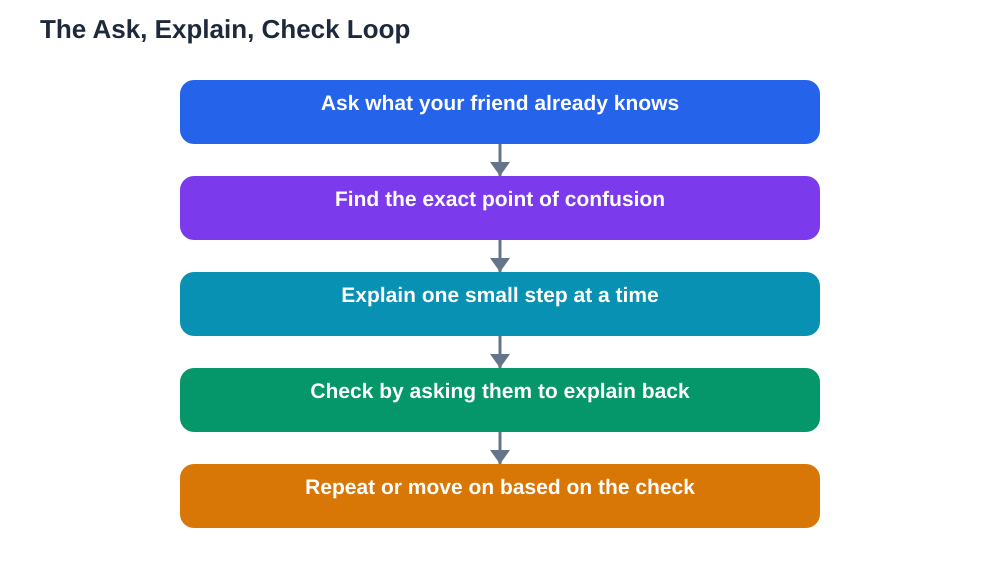

Teaching a friend effectively is one of the most useful study skills you can build, because explaining something to someone else forces you to organise your own understanding. If you can explain an idea clearly, in simple words, and answer your friend's questions without confusing them further, you probably understand it well yourself. If you cannot, the gaps in your explanation show you exactly what to review. The trick is that good teaching is not talking more or showing off what you know. It is listening first, explaining in small steps, and checking understanding as you go. This guide walks through that loop so your next study session helps your friend and strengthens your own learning at the same time.

## Teaching a Friend Effectively: The Ask, Explain, Check Loop

The simplest way to think about teaching a friend effectively is a three-step loop: ask, explain, check. First, ask what your friend already knows and where they got stuck. A question like "Where did it stop making sense?" is far more useful than "Do you understand?" because it points to the exact spot where help is needed. Second, explain just that part, in small steps, using plain words and one example. Third, check by asking your friend to explain it back in their own words or to try a similar problem on their own. If they can do that, you both move on. If they cannot, you loop back, explain differently, and check again. This loop keeps the session focused on real understanding instead of turning into a long lecture that your friend quietly stops following halfway through.

## Start With What They Already Know

Before you explain anything, find out where your friend stands. Ask them to show you the problem, the page, or the notes they are working from, and ask what they have already tried. This saves you from explaining things they already understand and from skipping over the step that is actually confusing them. It also shows respect: your friend is not a blank slate, and starting from their knowledge makes the session feel like teamwork rather than a lecture. Listen to their answer fully before jumping in, and watch for the moment their explanation wobbles or stops. That wobble is the real starting point. When you begin exactly there, your explanation feels relevant instead of random, and your friend stays engaged because you are solving their actual problem, not the problem you assumed they had.

## Explain in Small Steps, Not One Big Speech

Long explanations are the most common way friends confuse each other. When you explain everything at once, your friend has to hold too many new ideas in their head at the same time, and the first idea is forgotten by the time you reach the last one. Break the idea into the smallest steps you can, and pause after each one. Use everyday language before introducing technical words, and give one concrete example for each step rather than three abstract ones. Draw a quick sketch, write the steps down, or point to the worked example in the textbook. If your friend nods quickly without saying anything, that is not proof they understood. Ask a small question about that step before moving on, such as "So what would happen next here?" Short steps with frequent checks beat long speeches every time, and they also make it easy to spot exactly which step needs another try.

## Use Questions Instead of Answers

When your friend gets stuck, resist the urge to hand them the answer straight away. A quick answer ends the thinking, and your friend may copy it without understanding it. Instead, ask a guiding question: "What do we know so far?", "What did the last step give us?", or "What would happen if we tried it this way?" Questions like these keep your friend doing the thinking while you steer. If they are truly stuck, give a hint rather than the full solution, such as pointing to the rule or the example they need. Then let them take the next step themselves. This is slower in the moment, but it builds real understanding that lasts until the next test, while a copied answer fades by the next day. If you want more ideas on this approach, see the guide on [explaining without giving away answers](/blog/explaining-without-giving-answers.html) and the peer tutoring guide at [peer tutoring how to do it](/blog/peer-tutoring-how-to-do-it.html).

## Watch for Confusion and Change Your Approach

Good teachers notice confusion early. If your friend goes quiet, starts guessing wildly, or repeats your words without adding anything of their own, they are probably lost. That is not a failure, it is information. Try a different angle: a new example, a drawing, a comparison with something familiar, or a simpler version of the same problem. Sometimes the best move is to go back one step and rebuild from solid ground. Avoid repeating the same explanation louder or faster, because if it did not work the first time, volume will not fix it. Also avoid blaming your friend for not getting it. Phrases like "It is easy" or "I just told you" shut down learning fast. Keep the tone patient and normal: confusion is a normal part of learning, and working through it together is exactly what the session is for.

## End by Checking and Celebrating Progress

Finish every teaching session with a check, not a goodbye. Ask your friend to explain the idea back to you, solve a fresh example without help, or write down the steps in their own words. This final check tells both of you whether the session worked, and it gives your friend a small win to remember. If something is still shaky, agree on what to practise next and when to meet again, rather than pretending it is sorted. End on a positive note: point out what improved during the session, even if it is small. A friend who leaves feeling capable is far more likely to keep studying, and a friend who leaves feeling stupid will avoid the topic altogether. Teaching well is as much about confidence as it is about content, and the last two minutes of your session shape how your friend feels about the subject all week.

## AI Help: Muse AI

Muse AI is Meta's personal AI assistant, and it can help you prepare before you teach a friend. You can ask it to explain a concept in simpler words, suggest an everyday example, or turn a tricky topic into a short checklist you can walk through together.

Join Muse with invite code LTGSWD — in the Muse app, go to Settings > Redeem token and enter the code.

Disclosure: LTGSWD is the author's Muse invite code.

## FAQ

### How do I teach a friend without sounding bossy?

Treat the session as teamwork, not a performance. Ask questions, listen to their answers, and use "we" language such as "Let us try this step together." When your friend contributes ideas, build on them instead of correcting every word. A friendly, equal tone keeps the session comfortable and makes your friend willing to admit confusion, which is exactly what you need to help them.

### What if my friend understands faster than I can explain?

That is a good sign, so let them take the lead. Ask them to explain the next part back to you, or give them a harder example to try. Teaching works both ways, and a friend who races ahead can teach you something too. The goal is understanding for both of you, not sticking to a fixed script.

### Should I teach a friend the night before a test?

A short, focused session can help, but it is not the best time to learn a whole new topic. Keep it to reviewing what you both already mostly know, testing each other, and clearing up small confusions. For new material, an earlier session with time to practise afterwards works much better than a last-minute rush.

### What if I explain something wrong?

It happens to everyone, and honesty fixes it fast. If you realise later that your explanation was wrong, tell your friend straight away and work out the correct version together. Always verify solutions against your textbook, and remember that AI tools can make mistakes too. Correcting a mistake together is itself a valuable lesson in careful learning.

## Conclusion

Teaching a friend effectively comes down to a simple loop: ask what they know, explain in small steps, and check understanding before moving on. Listen more than you lecture, use questions instead of quick answers, change your approach when confusion appears, and end with a check that leaves your friend feeling capable. The more you practise this loop, the stronger your own understanding becomes, because every clear explanation you give is proof of what you truly know. For help with your own study questions and textbook problems, [Try the free AI lesson solver](/#tool).
