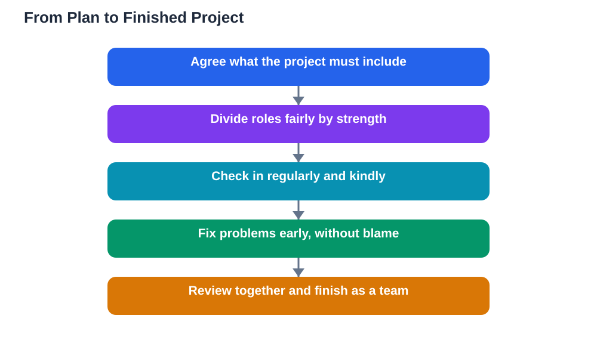

Teamwork in class projects can be one of the most enjoyable parts of school, or one of the most frustrating, and the difference usually comes down to planning. Good teams do not just start working and hope for the best. They agree on what needs doing, who does what, and when each part will be ready. They also talk honestly when something goes wrong, instead of letting small problems grow into arguments. Learning to work well in a team is a skill you will use far beyond school, in every job and community you join. With a few clear habits, your next project can feel fair, calm, and even fun.

## Teamwork in Class Projects: Agree the Plan First

Before anyone starts working, spend a few minutes agreeing on the plan together. What is the project asking for? What will the finished work look like? Which parts need to be done, and in what order? Write these answers down where everyone can see them, so nobody has to guess. Agree on a deadline for each part that leaves time for putting everything together at the end. This short planning conversation saves far more time than it costs, because it prevents duplicated work, missing parts, and last-minute panic. If your team disagrees about the plan, listen to each idea, then choose together and record the decision so everyone remembers it.

## Share Roles Fairly, Not Equally in Every Detail

Fair shares do not always mean identical tasks, because team members have different strengths. One person may write clearly, another may draw well, and another may be good at organising. A fair split uses those strengths while keeping the workload balanced overall. Give every person a clear role with a clear outcome, such as "research this part and bring three key points" rather than a vague "help with research." Rotate less popular jobs where you can, so the same person is not always stuck with the boring part. If someone finishes early, they can help another member rather than sitting back. Fairness is about everyone contributing meaningfully, not about counting identical minutes.

## Communicate Clearly and Kindly

Most team problems are really communication problems. Keep each other updated with short, regular check-ins: what you finished, what you are working on, and what you need help with. If you are stuck, say so early, while there is still time to fix it. When you disagree, focus on the work rather than the person, using phrases such as "I think this part would be clearer if..." instead of blame. Listen fully before replying, and check that you understood by repeating the idea in your own words. Kind, clear communication keeps small issues small, and it makes the whole project feel safer for everyone. For more on speaking up helpfully, see [How to Contribute to Class Discussions](/blog/class-discussions-how-to-contribute.html).

## Handle Problems Before They Grow

Every team hits a problem sooner or later: a missed deadline, a disagreement about quality, or a member who has gone quiet. The best time to handle it is early, calmly, and privately where possible. Start by asking what happened, because there may be a simple reason, such as confusion about the task or trouble at home. Restate the agreement kindly, offer a smaller next step, and agree a new deadline together. If the problem continues, involve your teacher early rather than waiting until the project is due. Teachers would much rather help a team fix a problem than mark a project that fell apart. Solving problems together, without blame, is itself one of the most valuable lessons a project can teach.

## Finish Together and Learn From the Project

A strong finish needs time, so plan a final session where the team reviews the whole project together. Read it through as a reader would, check that every part is present, and tidy anything that looks rushed. Thank each team member for something specific they contributed, because recognition makes people want to work together again. After the project, spend a few minutes asking what worked and what you would change next time. Did the plan help? Were roles fair? Did communication stay kind? These reflections turn one project into lasting skill. If you used the Lesson Solver tool for textbook parts of the project, remember to verify its solutions against your textbook, keep in mind that AI can make mistakes, and note that the tool needs your own free Google AI Studio API key.

## AI Help: Muse AI

Muse AI is Meta's personal AI assistant, and it can help your team plan a project more smoothly. You can ask it to suggest a simple task list for your project, or to help you draft a fair plan for dividing the work. Join Muse with invite code LTGSWD — in the Muse app, go to Settings > Redeem token and enter the code.
Disclosure: LTGSWD is the author's Muse invite code.

## FAQ

### What should a team do first on a class project?

Agree the plan first: what the project must include, what the finished work should look like, and which parts need doing in what order. Write the plan down where everyone can see it, and set a deadline for each part. This short conversation prevents most common team problems later.

### How do we divide work fairly?

Match tasks to strengths while keeping the overall workload balanced, and give everyone a clear role with a clear outcome. Rotate less popular jobs where possible, and let members who finish early help others. Fair means everyone contributes meaningfully, not that every task is identical.

### What if one team member does not do their part?

Ask kindly what happened first, since there may be a simple reason such as confusion about the task. Restate the agreement, offer a smaller next step, and agree a new deadline. If the problem continues, involve your teacher early while there is still time to fix it.

### How can a team disagree without arguing?

Focus on the work, not the person, and use phrases such as "I think this part would be clearer if..." Listen fully before replying, and check understanding by repeating the idea in your own words. Disagreements handled this way often improve the project instead of damaging the team.

## Conclusion

Good teamwork is built on a clear plan, fair roles, kind communication, and early problem-solving. When every member knows their part, updates the team honestly, and helps finish the work together, projects become less stressful and more rewarding. Take these habits into your next project, and your team will feel the difference from the very first meeting.

[Try the free AI lesson solver](/#tool)
