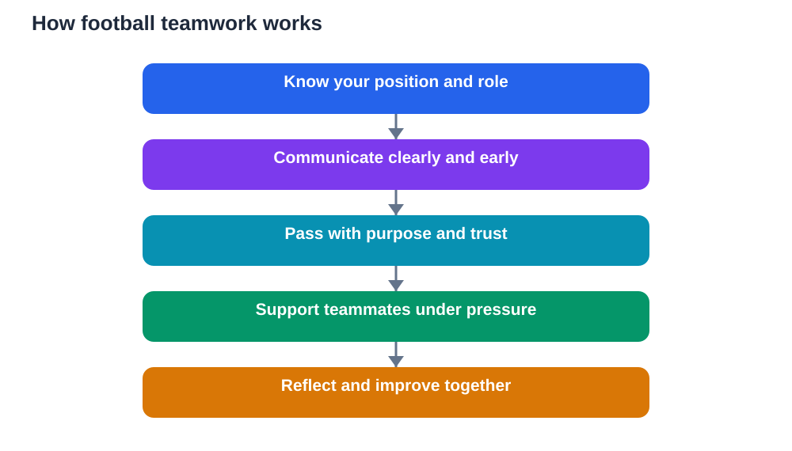

Football is often described as a team game, but that phrase hides how much teamwork really involves. It is not simply playing at the same time as other people. Teamwork in football means understanding your position, trusting teammates to do their jobs, passing at the right moment, communicating clearly, and staying together when the game gets hard. A team that does these things well can beat a group of more talented individuals who do not. That is why coaches spend as much time building teamwork as they spend building fitness or skill.

For students, football teamwork is a practical lesson in cooperation. Every player has a role, every role matters, and every action affects others. A careless pass puts a teammate under pressure. A well-timed run creates space for someone else. A word of encouragement lifts a teammate who has just made a mistake. These small actions add up to the difference between a collection of players and a genuine team.

## Positions: every role matters

A football team works because players take different roles. Defenders protect their own goal and start attacks. Midfield players link defence and attack, moving the ball and supporting both sides. Attackers create and finish chances. The goalkeeper guards the goal and organises the defence. No role is more important than the others, because each role depends on the rest.

Students can learn an important lesson here: contribution does not have to be loud to be valuable. A defender who wins the ball quietly, a midfielder who keeps possession calmly, and a forward who creates space without touching the ball all help the team. In group work at school, the same truth applies. The student who organises, checks details, or keeps the group calm is just as valuable as the student who presents the final work.

## Passing: the language of teamwork

Passing is how a football team thinks together. A pass is not just moving the ball. It is a message: I trust you with this, I see your run, and I believe we can build something together. Good passing requires awareness of teammates, opponents, space, and timing. A pass that is too slow, too hard, or poorly aimed puts the receiver in trouble. A well-judged pass gives the receiver time and options.

The best teams pass with purpose. They move the ball to draw opponents out of position, create space, and then attack that space. This requires patience and unselfishness. A player who always tries to do everything alone slows the team down. A player who passes and moves, trusting teammates to return the ball, keeps the team flowing. Students can apply the same idea to group study: sharing ideas, listening, and building on each other's work produces better results than working alone in silence.

## Communication: talking, listening and signals

Football teams communicate constantly, through words, gestures, and movement. Players call for the ball, warn teammates about opponents, and point to space. Good communication is clear, early, and calm. Shouting after a mistake is not communication. It is blame, and it usually makes the next mistake more likely. Useful communication helps a teammate before the problem arrives, not after it.

Listening matters just as much as talking. A player who hears a warning and adjusts position helps the whole team. A player who ignores teammates creates gaps that opponents exploit. In school life, the same habits matter. Clear instructions, honest feedback, and careful listening make group work smoother and friendships stronger. Football gives students daily practice in both sides of communication, speaking helpfully and listening willingly.

## Trust: the foundation of a team

Trust is the quiet foundation of football teamwork. A defender must trust that midfielders will support them. An attacker must trust that teammates will pass at the right time. A goalkeeper must trust that defenders will protect them. Without trust, players hesitate, try to do too much, and leave gaps. With trust, players take up good positions, make brave runs, and accept that teammates will cover for them.

Trust is built slowly, through reliability. A player who turns up, tries hard, passes sensibly, and supports others earns trust over time. A player who blames others, gives up early, or plays selfishly loses trust quickly. Students can build trust the same way in any group: by doing what they promised, by helping without being asked, and by staying steady when things go wrong. Trust is not given because someone demands it. It is earned through consistent actions.

## Staying together under pressure

Teamwork is easiest when a team is winning. It is tested when the team concedes a goal, misses chances, or faces a stronger opponent. Some teams fall apart at that moment, blaming each other and playing as individuals. Strong teams do the opposite. They encourage each other, tighten their shape, keep passing, and focus on the next action rather than the last mistake.

This resilience is a skill students can practise. After a setback, a team can pause, regroup, and agree on a simple plan: keep shape, communicate, support the player on the ball, and work for each other. That shared response turns pressure into unity. In school, the same approach helps groups recover from a poor result or a difficult project. Blame divides a group. Encouragement and a clear next step hold it together.

## Learning from the team, not just the game

After a match, good teams reflect together. What worked well? Where did communication break down? Which passes created chances? Which decisions cost the team? This reflection is where teamwork grows, because players learn from shared experience rather than from one person's opinion. Coaches guide this process, but players must be honest and open to feedback.

Students can use the same habit after group work. A short, honest review helps everyone improve: what helped the group, what slowed it down, and what to try next time. Reflection turns experience into learning. Without it, teams repeat the same mistakes. With it, even a lost match becomes useful, because the team leaves with a clearer idea of how to play better together next time.

## AI Help: Muse AI

Muse AI is Meta's personal AI assistant, and it can help you think about teamwork in football. You could ask it to suggest ways to improve communication or trust in a team, and then discuss its ideas with your coach or teammates. Join Muse with invite code LTGSWD — in the Muse app, go to Settings > Redeem token and enter the code.
Disclosure: LTGSWD is the author's Muse invite code.

## FAQ

### Why is teamwork more important than individual skill in football?

Individual skill matters, but football is won by coordinated action. Positions, passing, and movement must fit together, or skilled players will work against each other. A team that trusts, communicates, and supports each other creates chances and defends as a unit, which is far more effective than isolated moments of skill.

### What makes a good pass in football?

A good pass is well timed, well weighted, and aimed so the receiver has time and options. It shows awareness of teammates, opponents, and space. Good passing also requires movement after the pass, so the passer becomes available again. Passing with purpose, rather than just clearing the ball, helps the whole team build attacks.

### How can players build trust on a team?

Trust grows through reliability: turning up, trying hard, passing sensibly, supporting teammates, and staying calm after mistakes. Players earn trust by doing their job consistently and helping others without being asked. Blame and selfish play damage trust quickly, while encouragement and steady effort rebuild it over time.

### How should a team react after conceding a goal?

A strong team stays together, encourages each other, and focuses on the next action. Players tighten their shape, communicate clearly, and follow a simple plan instead of blaming each other. This calm, shared response prevents one setback from becoming a collapse, and it keeps the team working as a unit.

## Conclusion

Teamwork in football is built from positions understood, passes shared, communication practised, trust earned, and unity kept under pressure. None of these skills appears overnight. Each grows through practice, reflection, and care for teammates. Students who learn these lessons on the pitch carry them into classrooms, friendships, and future work, where cooperation matters just as much. A great team is not a group of stars. It is a group of people who understand each other, trust each other, and work for each other. That is a lesson worth learning in every part of life.

[Try the free AI lesson solver](/#tool)
