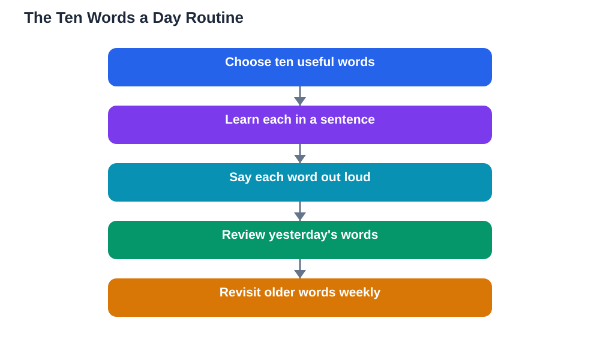

A ten words a day language habit sounds almost too small to matter, yet it is one of the most reliable ways to build vocabulary that stays. Ten words take only a few minutes to learn, so the habit survives busy days, tired evenings, and low motivation. Over weeks and months, those small daily sets add up to a vocabulary you can actually use, because each word was learned slowly enough to stick. The secret is not the number ten itself. It is the combination of a small daily target, a good way of learning each word, and a review system that brings words back before you forget them.

## Ten Words a Day Language: Why Small Beats Big

Big vocabulary plans usually fail for a simple reason: they ask for more energy than most days allow. Learning fifty words in one sitting feels productive, but most of them fade within days because they were never reviewed. Ten words, learned properly, are different. You have time to say each word aloud, see it in a sentence, and connect it to something meaningful. That deeper contact makes each word easier to remember later. A small target also protects your motivation, because finishing ten words every day feels like a win, while missing a fifty-word target feels like failure. Language learning is a long project, and a habit you keep for months will always beat a burst you abandon in a week.

## Choosing the Right Ten Words Each Day

Not all words deserve equal attention. The best ten words are the ones you are likely to use or hear soon: words for daily routines, food, family, feelings, and common actions. Words from a lesson you are studying, a conversation you had, or a story you are reading are ideal, because they already have a context in your mind. Avoid choosing ten random words from a dictionary, since words without context are hard to remember and harder to use. Mix your daily set a little: a few nouns, a couple of verbs, and one or two useful phrases. When a word keeps appearing in your reading or listening, promote it to your daily set, because a word you meet often is a word worth owning.

## Learn Each Word in a Sentence, Not Alone

A word learned alone is fragile, while a word learned in a sentence has roots. For each of your ten words, write or say one short, personal sentence that uses it. Personal sentences work best, because a sentence about your own life is easier to remember than a sentence from a textbook. Say the sentence out loud several times, paying attention to pronunciation, and picture the meaning as you say it. If the word has a tricky spelling or sound, write it down by hand once or twice, since the physical act of writing adds another memory path. This sentence method takes only a little longer than staring at a list, but it changes words from items you recognise into words you can actually use when you speak or write.

## Review: The Part That Makes Words Stick

Learning ten words is only half the habit, because review is what moves words into long-term memory. Review yesterday's words today, last week's words later in the week, and older words from time to time after that. This spacing works because each review happens just as the word starts to fade, which strengthens it more than reviewing it many times in one day. Keep your reviews quick and active: cover the meaning, try to recall it, and only then check. If you get a word wrong, it is not a failure, it is useful information telling you that word needs another review soon. A small notebook or a set of cards makes this system easy to run, and you can read more about card methods in [Flashcards That Actually Work for Languages](/blog/flashcards-that-work-language.html).

## What to Do on Busy Days and Bad Days

Every habit meets busy days, and the ten-word habit survives them because it is so small. On a rushed day, simply review ten old words instead of learning new ones, so the chain stays unbroken. On a tired day, listen to your words rather than writing them, or learn five new words and review five old ones. The goal is contact with the language, not perfection. If you miss a day entirely, do not try to learn twenty words the next day to catch up, because that doubles the load and restarts the cycle of failure. Just return to ten words the next day as if nothing happened. Habits are built by how often you return, not by never missing.

## AI Help: Muse AI

Muse AI is Meta's personal AI assistant, and it can help your daily word habit in a practical way. You can ask it to write a simple example sentence for each new word, or to quiz you by giving a word and asking you to recall its meaning. Join Muse with invite code LTGSWD — in the Muse app, go to Settings > Redeem token and enter the code.
Disclosure: LTGSWD is the author's Muse invite code.

## FAQ

### Is ten words a day really enough to make progress?

Yes, because ten well-learned words a day grow steadily over time, while larger targets often collapse after a few days. The value comes from learning each word in a sentence and reviewing it on a spaced schedule, not from the raw number. After months of steady days, you will own a vocabulary built on words you can actually recall and use.

### Should I learn new words every day, or review old ones too?

You need both, and review matters at least as much as new words. A good balance is to learn ten new words and spend a few minutes reviewing words from earlier days. Without review, new words fade quickly, so a habit that only adds words will leak faster than it fills.

### What if I keep forgetting the same word?

A word you keep forgetting needs more connections, not more staring. Try a new example sentence, link the word to a picture or a personal memory, and say it out loud in different sentences. Shorten the gap before its next review as well, so you meet it again while it is still fresh, and it will usually stick after a few such meetings.

### Can I use this habit alongside a course or textbook?

Absolutely, and it works best that way. Choose your ten words from the lesson you are studying, so the habit reinforces your course instead of competing with it. Words from your own lessons already have context, which makes them easier to learn and more useful when you speak or write.

## Conclusion

Ten words a day is a habit built on a simple truth: small steps taken every day travel further than grand plans taken once. Choose words you will actually use, learn each one inside a sentence, review on a spaced rhythm, and keep the chain going even on busy days. Over time, your ten daily words will quietly become a vocabulary you can speak, read, and enjoy using.

[Try the free AI lesson solver](/#tool)
