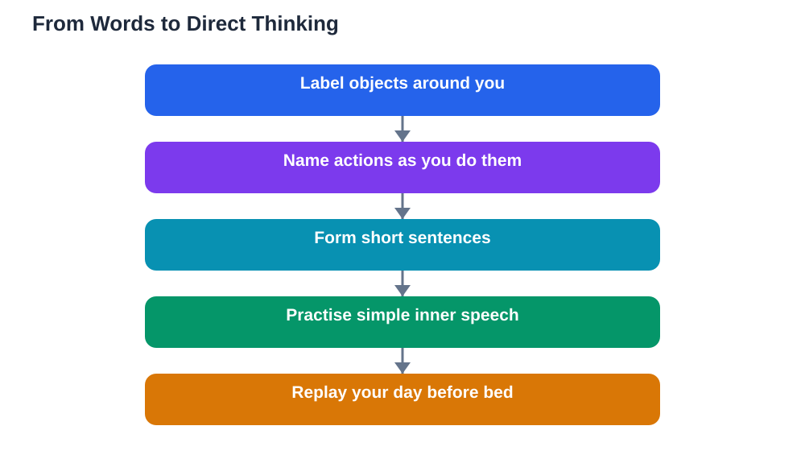

Thinking in a new language sounds like an advanced skill, but it actually begins much earlier than most learners expect. It does not arrive suddenly one day as a grand achievement. It grows quietly, in small moments: a word that comes to mind before its translation, a simple thought formed directly in the new language, or a moment when you understand a phrase without converting it first. These moments are the real milestones of fluency, and you can encourage them deliberately. The key is to give your brain regular, low-pressure chances to use the new language for thinking, not just for studying.

## Thinking in a New Language: What It Really Means

Thinking in a new language simply means forming thoughts directly in that language, without translating from your first language first. It does not mean thinking only in the new language, or thinking complicated thoughts right away. At first, it means thinking short, simple things: naming what you see, planning your next step, or reacting to something with a word you know. This direct thinking matters because translation is slow and tiring, while direct thought is fast and natural. Every time you think a simple thought directly in the new language, you strengthen the direct path between meaning and words, and weaken your dependence on translation. Over time, that direct path carries more and more of your thinking, and fluency starts to feel natural rather than forced.

## Label Your Day: The Simplest Way to Begin

Labelling your day is the easiest way to start thinking in a new language, because it uses the world around you as a prompt. As you move through your day, silently name the objects you see, the actions you perform, and the places you visit, using the new language. In the morning, name your routine step by step. While cooking, name the ingredients and actions. While walking, name what passes by. At first you will only know some words, and that is fine: name what you can, and notice the gaps as words to learn next. This habit costs no extra time, because it rides on activities you already do, yet it gives your brain dozens of small thinking moments every day. Those moments add up, and they turn the language from something you study into something you live with.

## Grow From Words to Sentences to Inner Speech

Once labelling single words feels easy, grow the habit one step at a time. Start forming short sentences about what you are doing, such as a simple statement about your next action or a short plan for the day. Then try reacting to things in the new language: a brief comment when something surprises you, or a simple opinion about what you like. Finally, try short stretches of inner speech, such as planning a small task or rehearsing what you will say before a conversation. Each step should feel only slightly harder than the last, because the habit grows best when it stays enjoyable. If a thought is too complex for your current level, simplify it rather than abandoning it. A simple thought in the new language teaches you far more than a complex thought translated perfectly in your head.

## Use Routines and Repetition to Make It Automatic

Thinking in a new language becomes automatic when it is tied to routines you already repeat. Attach the habit to fixed moments: think in the new language while you prepare a meal, while you tidy a room, or during a regular walk. Repeating the same kinds of thoughts in the same situations builds strong associations, so the words start arriving without effort. You can also keep a tiny list of sentence frames for common thoughts, such as plans, preferences, and simple descriptions, and reuse them daily until they feel natural. Another useful trick is to replay a small moment of your day in the new language before bed, describing what happened in simple sentences. This nightly replay reviews vocabulary, practises sentence building, and ends the day with the language fresh in your mind.

## What to Do When Translation Keeps Taking Over

Translation taking over is normal, especially when you are tired or the thought is complex, and it is not a sign of failure. When you notice yourself translating, gently redirect: simplify the thought, use words you already know, and accept an imperfect version rather than a perfect translation. Keep a note of words you repeatedly need but do not know, and learn them as your next vocabulary, since they are clearly words your thinking requires. Avoid the trap of translating everything in your head before speaking, because that habit slows you down and keeps the translation path strong. Instead, practise speaking from simple direct thoughts, even if the sentences are short. You can also read about building early speaking courage in [Speaking From Day One: Be Brave in a New Language](/blog/speaking-from-day-one-language.html), since speaking and thinking directly in the language strengthen each other.

## AI Help: Muse AI

Muse AI is Meta's personal AI assistant, and it can help you practise thinking in a new language. You can ask it to give you a simple daily prompt, such as describing your morning routine, and then try forming your answer directly in the new language. Join Muse with invite code LTGSWD — in the Muse app, go to Settings > Redeem token and enter the code.
Disclosure: LTGSWD is the author's Muse invite code.

## FAQ

### When will I start thinking in a new language?

You may already be starting, in small moments such as a word arriving before its translation. These moments grow with practice, especially with daily labelling and simple inner speech. There is no single moment when it switches on fully; instead, direct thinking gradually covers more of your day as your vocabulary and patterns grow.

### Is it normal to still translate sometimes?

Yes, completely normal, even for experienced learners. Translation returns when you are tired, when the topic is complex, or when you meet an unfamiliar word. The goal is not to eliminate translation entirely, but to make direct thinking your usual path for everyday thoughts, with translation as an occasional backup.

### Can beginners really think in a new language?

Yes, because thinking in a new language starts with single words and short sentences, not with complex ideas. A beginner who silently names objects around the home is already thinking in the new language. Starting small is exactly how the habit forms, and waiting until you feel advanced only delays it.

### Does thinking in a new language help speaking?

Greatly, because speaking from a direct thought is faster and more natural than speaking from a translation. When you practise thinking directly, you also practise retrieving words quickly, which is the core skill speaking requires. Learners who think in the language regularly usually find conversations flow more easily.

## Conclusion

Thinking in a new language is not a distant goal reserved for advanced learners. It begins with labelling your day, grows through simple sentences and inner speech, and becomes automatic through daily routines. Be patient with translation when it appears, simplify rather than surrender, and celebrate the small moments when a thought arrives directly in the new language. Those moments are fluency taking root, one thought at a time.

[Try the free AI lesson solver](/#tool)
