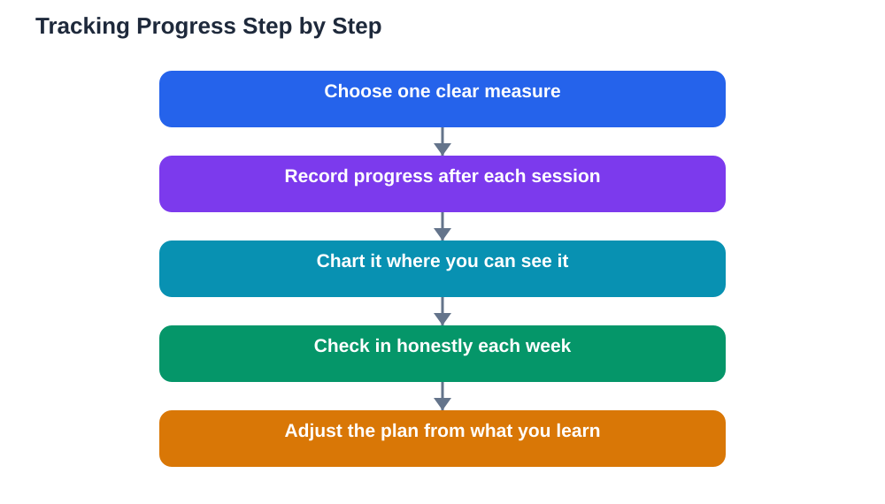

Progress is invisible unless you record it. A student can work steadily for weeks and still feel like nothing has changed, simply because each day looks like the last. Tracking progress on goals fixes that illusion by making growth visible. When you can see how far you have come, motivation grows, problems show up early, and the remaining work looks smaller than it did at the start.

Tracking does not need fancy tools or complicated systems. A notebook page, a simple chart or a list of dated ticks can do the job, as long as you update it regularly and look at it often. The best tracking method is the one you will actually keep using, so choose something quick, visible and satisfying to update. A system that takes longer to maintain than the study itself will be abandoned, while a simple system becomes part of the routine.

## Choose What to Track

Start by deciding what counts as progress for your goal. For a learning goal, track completed chapters, practice sets finished or topics you can now explain without notes. For a habit goal, track the days you kept the habit. For a project goal, track finished sections or drafts. Pick one main measure per goal, plus a short note about quality when it matters, such as which problems were hardest. Avoid tracking everything at once: a page crowded with numbers is hard to read and easy to ignore. One clear measure, updated honestly, tells you more than a dozen half-kept ones.

## Use a Simple Chart You Can See

A chart turns numbers into a picture, and pictures are motivating. A bar chart can show chapters completed week by week, a line can show practice scores rising over time, or a simple grid can show each study day coloured in. Keep the chart where you study, so you see it without opening an app or a file. Update it at the end of each session or each day, while the work is fresh, rather than trying to reconstruct a week from memory. When the chart shows a rising line or a growing row of coloured squares, the effort behind it feels real, and that feeling makes the next session easier to start.

## Streaks: Useful Fuel if Used Wisely

A streak is a run of consecutive days on which you kept a habit or completed a planned action. Streaks are motivating because nobody wants to break a long run, and they turn daily effort into a visible chain. But streaks have a trap: one missed day can feel like total failure, even though a single gap changes nothing about your learning. Treat a streak as encouragement, not as a verdict. If a streak breaks, note the reason, restart the count the next day and remember that the total days completed still stands. A student who studies on most days of a term has made real progress, whatever the longest unbroken run happens to be.

## The Honest Weekly Check-In

Numbers alone do not tell the whole story, so pair tracking with a short weekly check-in. Once a week, look at your chart and answer a few questions in writing. What moved forward this week. What stalled, and why. What did I learn about how I study best. What is the next step. This honest reflection catches problems that numbers hide, such as rushing through material without understanding it, or spending time on easy tasks while avoiding hard ones. It also captures wins that numbers miss, like finally understanding a concept that had been confusing for weeks. A few sentences of reflection turn raw tracking into genuine learning about yourself as a student.

## When Progress Looks Flat

Every goal has flat stretches where the chart barely moves. Sometimes the work is genuinely harder, sometimes life gets busy, and sometimes you are consolidating earlier learning, which matters even though it adds no new ticks. When progress looks flat, first check whether the goal or the measure needs adjusting: perhaps the steps are too large, or you are tracking the wrong thing. Then look back further than one week, because a flat week often disappears inside a rising month. Finally, change one thing, not everything: a different study time, a smaller step, or help with a stuck topic. Flat progress is a normal part of any long goal, not proof that the goal is impossible.

## AI Help: Muse AI

Muse AI is Meta's personal AI assistant, and it can help you design a simple way to track a study goal. You can ask it to suggest what to measure for a particular goal or to help you write short weekly check-in questions. Use its ideas as a template, then keep the tracking method simple enough to update every day.

Join Muse with invite code LTGSWD — in the Muse app, go to Settings > Redeem token and enter the code.

Disclosure: LTGSWD is the author's Muse invite code.

## FAQ

### How often should I update my progress tracker?

Daily is ideal for habit goals, and after each study session for learning goals. Short, frequent updates stay accurate and take only a moment. A weekly update can work for longer goals, but daily ticks build a stronger sense of momentum.

### What if my tracker shows I am behind schedule?

Use it as an early warning, not a punishment. Work out whether the goal was too large, the week was unusually busy, or a step is stuck. Then adjust: shrink the next steps, move the deadline slightly, or ask for help. Catching a delay early is exactly why tracking exists.

### Should I track results, effort, or both?

Track both, but keep them separate. Results, like problems solved or chapters finished, show what you achieved. Effort, like sessions completed, shows consistency. On a hard week, steady effort is real progress even when results look modest, and seeing both prevents a misleading picture.

### Is it better to track on paper or digitally?

Whichever you will look at and update regularly. Paper charts are visible on a desk and satisfying to fill in, while digital trackers are easy to carry and back up. Many students use paper for daily ticks and a simple digital note for weekly reflections. The method matters less than the habit of updating it.

## Conclusion

Tracking progress turns effort into evidence. Choose one clear measure, chart it where you can see it, use streaks lightly, and check in honestly each week. When you can see how far you have come, the rest of the journey looks not only possible but already well underway.

[Try the free AI lesson solver](/#tool)
