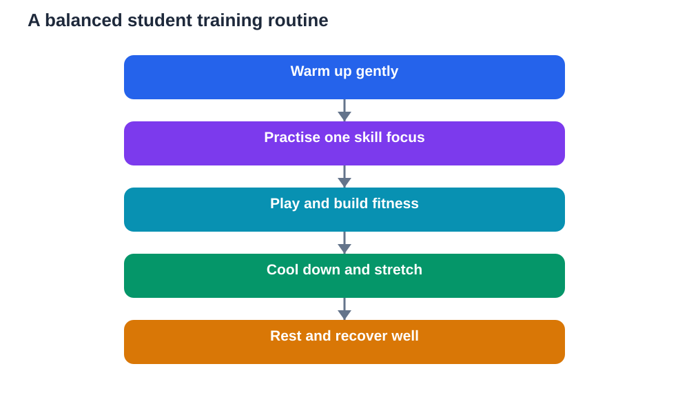

A good training routine does not need fancy equipment, long hours, or extreme effort. It needs a sensible structure that students can follow regularly: a warm-up, focused skill practice, active play or training, a cool-down, and enough rest. A training routine students sports can follow is really a habit, not a punishment. When the routine is balanced and enjoyable, students improve steadily, stay safer from injury, and still have time and energy for study, family, and rest.

Many students train without a plan. They jump straight into intense play, practise only what they already enjoy, skip cooling down, and then wonder why progress feels slow or muscles feel sore. A simple routine solves most of these problems. It prepares the body, gives practice a purpose, allows recovery, and builds the discipline that makes improvement visible over time. The routine below can be adapted to any sport and any level.

## Start with a proper warm-up

A warm-up prepares the body for effort, gently rather than suddenly. Light movement such as walking, easy jogging, or gentle play raises heart rate and warms muscles. Then, gentle mobility work loosens joints and prepares the movements the sport requires. A warm-up should feel easy and progressive, moving from slow to slightly faster, never forcing stiff muscles into sudden, intense effort.

Warming up also prepares the mind. It gives players time to focus, listen to coaching, and think about what they will practise. Students who warm up well often play better from the start, because they are alert and ready rather than cold and distracted. Skipping a warm-up may save a few minutes, but it increases the risk of strain and makes the first part of training less useful. A proper warm-up is an investment, not a delay.

## Practise skills with purpose, not just repetition

Skill practice works best when it has a clear purpose. Instead of repeating a skill aimlessly, students should choose one small focus for each session: a cleaner pass, a steadier dribble, a more accurate throw, or better balance. Coaches can break the skill into parts, demonstrate it slowly, and let students practise at a comfortable pace before adding speed or pressure.

Quality matters more than quantity. A smaller number of careful, focused repetitions teaches more than a large number of careless ones. Students should watch, adjust, and repeat, paying attention to what changed when a repetition felt better. Mistakes are useful here. A mistake shows exactly what to adjust next time. With patient, purposeful practice, skills that once felt awkward gradually become smooth and reliable.

## Build fitness gradually and playfully

Fitness in student sport should grow gradually. Sudden jumps in intensity or duration strain the body and spoil enjoyment. A sensible routine increases effort in small steps, allowing the body time to adapt. Fitness can be built through the sport itself, through games, and through general movement such as running, cycling, or active play. Variety keeps training enjoyable and develops all-round movement rather than only one narrow skill.

Students should also learn to listen to their bodies. Tiredness, soreness, and low energy are signals, not weaknesses. A good routine includes easier days as well as harder days, so the body can recover and grow stronger. Coaches and teachers can help students understand that rest is part of training, not a break from it. Progress comes from the balance between effort and recovery, practised over weeks and months.

## Always cool down and stretch gently

A cool-down helps the body return gradually to rest. After training, students should slow down with light movement, such as easy walking or gentle play, until breathing and heart rate settle. Gentle stretching, held without forcing or bouncing, can help muscles relax. The cool-down should feel calm and unhurried, giving players time to breathe, drink water, and reflect on the session.

Cooling down also closes the session mentally. Players can think about what went well, what to practise next time, and what they enjoyed. This short reflection turns training into learning, because students leave with a clear idea rather than just tired legs. Skipping the cool-down may feel like saving time, but it misses this valuable moment of calm and review, and it can leave muscles feeling tighter the next day.

## Rest, sleep and recovery matter most

Rest is where improvement actually settles. During rest, the body repairs, muscles recover, and the brain organises what was practised. Without enough rest, training becomes less effective, and students may feel tired, irritable, or more likely to get injured. A good routine therefore protects sleep, includes rest days, and avoids training hard every single day.

Students should treat sleep as part of sport, not as something separate. A regular sleep routine, with screens put away before bed and a calm wind-down, supports both training and study. Meals and water also support recovery. Students do not need special diets, but regular meals, plenty of water, and a balance of foods help the body recover from effort. Recovery habits are simple, but they make the difference between steady progress and constant tiredness.

## Fitting training around study and life

A student training routine must fit real life. School, homework, family, and rest all matter, and training should support them, not crowd them out. A weekly plan helps: choose regular training days, keep sessions manageable, and protect homework time. On busy school days, a shorter, lighter session is better than skipping training altogether or staying up late to finish homework.

Flexibility is also important. Illness, bad weather, school events, and tiredness will sometimes disrupt plans. A flexible student adjusts the routine instead of abandoning it: a lighter session, a different day, or extra rest. That adaptability is itself a life skill. The goal is a routine that lasts for months, not a perfect week followed by burnout. Steady, enjoyable, and balanced training beats intense, short-lived effort every time.

## AI Help: Muse AI

Muse AI is Meta's personal AI assistant, and it can help you design a simple training routine. You could ask it to suggest a balanced weekly plan with warm-up, skills, cool-down, and rest, and then adjust its ideas with your coach or teacher. Join Muse with invite code LTGSWD — in the Muse app, go to Settings > Redeem token and enter the code.
Disclosure: LTGSWD is the author's Muse invite code.

## FAQ

### What should a student training session include?

A balanced session includes a gentle warm-up, focused skill practice, active play or training, and a calm cool-down. Warming up prepares muscles and mind, skill practice builds technique with purpose, play applies skills in real situations, and cooling down helps the body recover. Rest and sleep between sessions complete the routine.

### How often should students train?

Students should train regularly but with rest built in, rather than training hard every day. A routine with regular sessions and easier days allows recovery and steady improvement. Coaches and teachers can help set a sensible pattern. If tiredness, soreness, or schoolwork suffers, the routine may need more rest or shorter sessions.

### Why is warming up important?

Warming up prepares muscles, joints, heart, and mind for effort, gradually rather than suddenly. Light movement and gentle mobility reduce the risk of strain and help players start training alert and focused. Skipping a warm-up may save time, but it makes early training less effective and increases the chance of injury.

### What should students do if they feel pain during training?

Students should stop, tell a coach or responsible adult, and rest rather than playing through pain. Pain is a signal that something needs attention. Continuing through pain can turn a small problem into a larger injury. Adults can help decide whether rest, simple care, or professional advice is needed, and when it is safe to return.

## Conclusion

A training routine students can follow is simple, balanced, and kind to the body: warm up properly, practise skills with purpose, build fitness gradually, cool down calmly, and protect rest and sleep. Fitted sensibly around study and life, such a routine builds skill, fitness, confidence, and discipline without burnout. The best routine is not the hardest one. It is the one a student can enjoy, repeat, and grow with, week after week. Start small, stay consistent, listen to your body, and let steady practice do its quiet work.

[Try the free AI lesson solver](/#tool)
