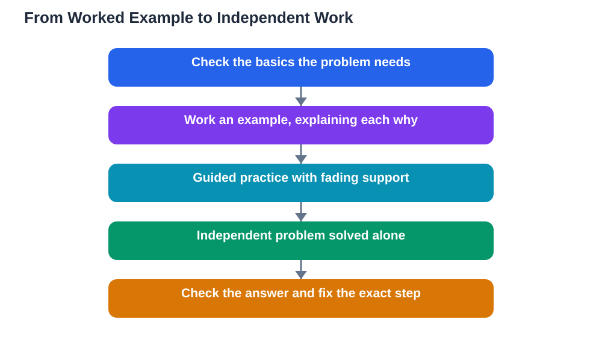

Tutoring maths step by step, not answer first, is the difference between a student who can solve one problem and a student who can solve the next ten. Maths is built in layers: each new idea rests on the ones before it, and skipping steps leaves invisible gaps that collapse later. When a tutor jumps straight to the answer, the student learns nothing except that answers exist. When a tutor walks through each step, explains why it works, and then lets the student try, the student builds a method they can reuse. This guide shows how to tutor maths in steps: worked examples first, guided practice second, and independent work last.

## Tutoring Maths Step by Step Begins With the Basics

Before tackling a hard problem, check the basics it depends on. Many maths struggles are not about the new topic at all, but about an earlier step that never became solid: a sign rule, a fraction operation, or a multiplication fact. Ask your student to work a very simple version of the problem first. If they manage it confidently, move up. If they stumble, you have found the real starting point, and fixing it now will unlock everything above it. This diagnostic step saves enormous time, because tutoring the new topic while the foundation is shaky is like building on sand. Be matter-of-fact about gaps: finding them is good news, not bad news, because a gap you can name is a gap you can fix. Always check the textbook's method too, since methods can differ and your student needs the version their class uses.

## Start With a Worked Example, Talk Through Every Step

Begin with a worked example that you solve together, talking through every step out loud. State what each step does and why it is allowed, not just what the next line looks like. For example, instead of saying "now we move this over", say "we subtract the same amount from both sides so the balance stays equal, which leaves the unknown alone on one side." This "why" language is what turns a copied procedure into understanding. Keep the example simple and familiar, so the method itself is the focus rather than hard numbers. After the example, ask your student to explain one step back to you in their own words. If they can explain why a step works, they own the method. If they can only repeat what it looks like, the method needs another example before you move on.

## Move to Guided Practice, Not Independent Work Yet

After the worked example comes guided practice, the stage most tutors skip too quickly. In guided practice, your student solves a similar problem while you watch, ask questions, and catch mistakes early. Your role here is coach, not solver: when they hesitate, ask "What is the next step in our method?" rather than telling them. When they make a mistake, stop at that step and ask them to check it, because finding their own error teaches more than being corrected. Use two or three guided problems, gradually reducing your help: heavy guidance on the first, light hints on the second, and mostly silence on the third. This fading support is the key to tutoring maths step by step, because it transfers responsibility gradually instead of dropping the student from full help to no help in a single jump. The guide on [study with examples worked examples](/blog/study-with-examples-worked-examples.html) explains why worked examples followed by practice beat either method alone.

## Then Let Them Work Independently and Check

Only after guided practice should your student work independently. Give them a fresh problem of the same type, step back, and let them solve it alone from start to finish. Resist the urge to hover or correct mid-problem: independent work needs the space to include mistakes, because correcting a finished attempt teaches self-checking. When they finish, check the answer together, and if it is wrong, find the exact step where it went wrong rather than redoing the whole problem. Ask them to explain their steps, and praise the steps that were right even when the final answer was not. Then give one more independent problem to confirm the fix. This independent stage is the proof that tutoring worked: if the student can solve a new problem alone, the method is theirs. If they cannot, return to guided practice without frustration, because that is simply information about what needs more work.

## Teach Checking Habits Alongside Solving Habits

Good maths tutoring teaches checking as part of solving, not as an afterthought. Show your student simple checks: does the answer make sense in size, does it fit the original problem when substituted back, and do the signs and units look right? Build a habit of pausing after the final step to run one quick check before declaring the problem done. Many students lose marks not because they cannot solve problems but because small slips go unnoticed, and a checking habit catches most of them. When you review a wrong answer together, model the checking process out loud: "Let us put this answer back into the original problem and see if it fits." Over time, your student will internalise this voice and start checking without prompting, which is one of the most valuable outcomes tutoring can produce.

## Keep Sessions Patient, Positive, and Textbook-Grounded

Maths anxiety is real, and a tutor's tone can either ease it or deepen it. Keep sessions patient and positive: normalise mistakes, celebrate correct steps, and never say a problem is easy when your student finds it hard. End each session with a small success, even if it is just a simpler problem solved correctly, so the student leaves feeling capable. Ground everything in the textbook: verify methods and answers against it, and remind your student to do the same. If you use the free lesson solver tool for a textbook photo, treat its step-by-step explanation as a study aid to understand and verify, not as an answer to copy. The tool supports textbook photos in English, Urdu, and Sindhi as a multilingual feature, needs your own free Google AI Studio API key, and like all AI tools, it can make mistakes, so the textbook remains the final authority. For more on honest homework help, see [check homework answers the right way](/blog/check-homework-answers-the-right-way.html).

## AI Help: Muse AI

Muse AI is Meta's personal AI assistant, and it can help you prepare maths tutoring sessions. You can ask it to break a maths topic into a sequence of small steps, or to suggest a simple worked example you can walk through with your student before guided practice.

Join Muse with invite code LTGSWD — in the Muse app, go to Settings > Redeem token and enter the code.

Disclosure: LTGSWD is the author's Muse invite code.

## FAQ

### What if my student keeps making the same mistake?

That usually signals a missing earlier step rather than carelessness. Go back to a simpler version of the problem and find the exact step where understanding breaks down, then rebuild from there with a fresh worked example. Repeated identical mistakes are information, not defiance, and patience at this point pays off more than repetition of the same explanation.

### How many problems should we do in one session?

Quality beats quantity. Three to five problems done thoroughly, with worked example, guided practice, and independent work, teach far more than twenty rushed ones. End the session while the student is succeeding, and leave a couple of independent problems for them to try alone before the next session.

### Should I tutor maths I am not confident in myself?

You can, if you prepare first. Work through the textbook examples yourself, understand each step's reason, and be honest with your student when you are unsure. Working out a problem together, with the textbook open, is excellent tutoring, and it models the honest, careful approach to maths that students need.

### Is it okay to use a calculator or AI tool while tutoring?

Yes, as a checking and explaining aid, not as a replacement for thinking. A calculator can verify arithmetic, and an AI tool can show steps to discuss, but the student should still work problems by hand and understand each step. Always verify AI explanations against the textbook, since AI can make mistakes.

## Conclusion

Tutoring maths step by step, not answer first, means checking the basics, talking through a worked example, guiding practice with fading support, and only then letting the student work independently. Teach checking habits alongside solving habits, keep the tone patient and positive, and ground every method in the textbook. This slower, structured approach builds students who can solve the next problem alone, which is the true goal of tutoring. For step-by-step help with your own maths textbook problems, [Try the free AI lesson solver](/#tool).
