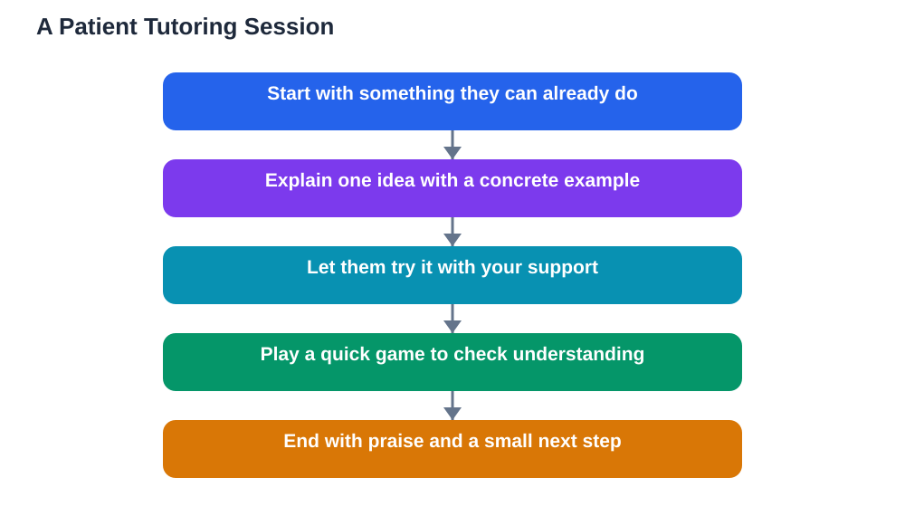

Tutoring younger students is a rewarding way to help others while strengthening your own understanding, but it works differently from helping a classmate. Younger learners think more concretely, tire faster, and depend heavily on encouragement. A method that works with a friend your own age, such as a long verbal explanation, will often lose a younger student in the first minute. This guide explains how to tutor younger students well: short sessions, simple language, plenty of praise, and lots of hands-on practice, so your time together builds confidence as well as knowledge.

## Tutoring Younger Students Starts With Patience

Patience is the foundation of tutoring younger students. A younger learner may need to hear an idea three times, in three different ways, before it clicks, and that is completely normal. Their brains are still building the connections that make ideas stick, and rushing them only creates anxiety that blocks learning further. When progress feels slow, remind yourself that repetition is not failure, it is how young minds learn. Speak calmly, smile, and treat every retry as a normal part of the process. Avoid sighing, checking the time, or saying "we did this already", because younger students read your mood instantly and will stop trying if they feel they are disappointing you. Your patience is what makes the session feel safe, and safety is what allows a younger student to risk a wrong answer and learn from it.

## Use Simple Language and Concrete Examples

Younger students understand concrete things far better than abstract definitions, so translate every idea into something they can see, touch, or picture. Instead of defining a concept in formal words, show it: use objects on the table, draw a picture, act it out, or connect it to something from their daily life. Keep your sentences short and your vocabulary simple, introducing one new word at a time and checking that it is understood before moving on. If you catch yourself using a long explanation, stop and ask a question instead, because a question reveals what the student actually pictures in their head. When they answer, you can correct the picture gently rather than adding more words to it. Simple language is not talking down to a younger student, it is meeting them where their understanding currently lives.

## Keep Sessions Short and Active

A younger student's attention span is shorter than yours, so plan short, active sessions rather than long, still ones. Twenty to thirty minutes of focused work is plenty for most younger learners, and within that time, change activity every few minutes: explain briefly, then let them try, then play a quick game with the idea, then draw it. Movement helps too: let them stand, point, sort cards, or build something related to the topic. If their eyes wander or they start fidgeting, that is information, not misbehaviour. Switch activity, take a short break, or turn the next part into a game. Ending a session while the student still feels successful is far better than pushing on until they are tired and frustrated, because the feeling they leave with shapes whether they want to learn again tomorrow.

## Praise Effort, Not Just Correct Answers

When tutoring younger students, praise is a teaching tool, not just kindness. Praise effort and strategy rather than only correct answers: "You kept trying even when it was hard" or "You remembered the first step by yourself" teaches a younger student that persistence matters. Praise that only rewards being right can backfire, because the student may start avoiding hard problems to protect the praise. Be specific with praise, naming exactly what they did well, so they know what to repeat. Also praise small steps: a younger student who gets one part right out of three has still made real progress, and naming that progress keeps them going. Avoid empty praise for everything, because children quickly learn to ignore it. Honest, specific praise for real effort is one of the most powerful things a tutor can offer.

## Check Understanding Gently and Often

Younger students will often nod and say they understand when they do not, because they want to please you. So check understanding gently and often, using methods that do not feel like a test. Ask them to teach the idea back to you, to show you with an example, or to solve a very similar problem while you watch. Games work well as checks: a quick quiz where they earn points, a sorting task, or a "spot the mistake" challenge where you deliberately make an error for them to find. These checks tell you what to practise next without making the student feel examined. If a check reveals a gap, go back and rebuild that part patiently, with a new example. Remember that a younger student's wrong answer is useful information about how they are thinking, so ask "how did you get that?" with genuine curiosity before correcting them.

## Plan Together and Keep Parents or Teachers Informed

Good tutoring is planned, even informally. Before you start, find out what the younger student is learning in class, what they find hard, and what their teacher has asked them to practise, so your sessions support their lessons rather than confusing them with different methods. Agree a simple routine: a regular day, a clear start and end, and a short note after each session about what you covered and what still needs work. Share that note with a parent or teacher when appropriate, because adults can reinforce the same ideas between sessions and can tell you if your approach conflicts with classroom methods. If you are tutoring as part of a school or community arrangement, follow its rules about supervision and communication. A tutor who communicates well with adults is one that families trust and invite back.

## AI Help: Muse AI

Muse AI is Meta's personal AI assistant, and it can help you prepare for tutoring younger students. You can ask it to suggest simple, concrete examples for a topic, or to turn a lesson into a short game or quiz that keeps a younger learner engaged.

Join Muse with invite code LTGSWD — in the Muse app, go to Settings > Redeem token and enter the code.

Disclosure: LTGSWD is the author's Muse invite code.

## FAQ

### How long should a tutoring session with a younger student last?

About twenty to thirty minutes is right for most younger learners, with a break or activity change every few minutes. Shorter sessions that end on a success beat longer ones that end in tiredness. If the student is engaged and asking for more, you can extend slightly, but watch for the first signs of fatigue.

### What if the younger student refuses to cooperate?

Do not force it. Switch to a game, a drawing, or a topic they enjoy, and try the hard topic again later in a different form. Sometimes refusal means the work feels too hard or too boring, so a simpler version or a fun format can reopen the door. If refusal is regular, talk to a parent or teacher about what might be behind it.

### Should I use rewards when tutoring younger students?

Small, occasional rewards such as praise, a fun game at the end, or a sticker can motivate, but they should never become the only reason to learn. Keep rewards light and unpredictable, and always pair them with praise for effort. The real reward you are building is the student's own feeling of success.

### How do I handle a younger student who cries or gets upset?

Stay calm, be kind, and pause the work. Let them know it is okay to find things hard, and that you are not disappointed. Offer a drink, a break, or an easier task, and return to the hard topic only when they are ready. If upset happens often, mention it to a parent or teacher, because there may be a wider difficulty that needs adult support.

## Conclusion

Tutoring younger students well comes down to patience, simple language, short active sessions, specific praise for effort, and gentle, frequent checks of understanding. Plan your sessions around what the student is learning in class, keep adults informed, and always end while the student still feels successful. Done this way, tutoring helps the younger student grow in confidence and knowledge, and it teaches you patience and clarity that will serve you in every subject. For help understanding your own textbook topics before you teach them, [Try the free AI lesson solver](/#tool).
