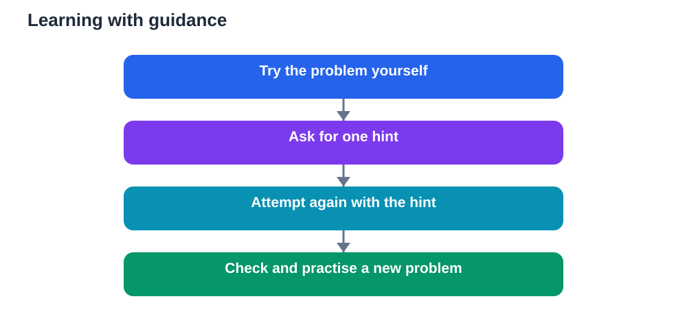

It is tempting to think that the fastest tutor is the best tutor. If a tool gives you the answer at once, the homework looks finished, the confusion disappears, and the evening feels easier. Recent reports, however, point to a more uncomfortable lesson. When learners receive ready answers without guidance, they may practise less, understand less, and perform worse later, even though the immediate task felt effortless. The problem is not that help is available. The problem is that help arrives in the wrong form.

Guidance matters because learning is not the same as completing work. A finished worksheet is not proof of understanding. Understanding grows when you wrestle with a problem, test an idea, notice a mistake, and correct it. A tutor that removes that struggle may also remove the learning hidden inside it.

## What answer-first help takes away

When an answer appears immediately, several useful steps disappear. You do not need to recall what you already know. You do not need to choose a method. You do not need to check whether your first idea makes sense. The work looks done, but your memory has received very little practice.

This matters because memory strengthens through effort. Recalling a definition, working through a method, or explaining a step in your own words creates a stronger trace than reading the same material passively. Answer-first help can feel productive precisely because it skips the effort that makes learning stick.

There is also a confidence trap. After seeing a clear solution, you may feel that you understand the topic. That feeling is often recognition, not mastery. Recognition says the solution looks familiar. Mastery means you could produce a similar solution without help. Only practice reveals the difference.

## What a recent trial suggests

Recent reports describe a trial in which learners using answer-first tutoring without guidance ended up with lower grades and less practice than expected. The details matter less than the pattern they illustrate. When help did the thinking, learners did less thinking themselves. Less practice then led to weaker recall when they were tested without the tool.

This finding should not be read as a warning against all AI help. It is a warning against unguided help. The same tool can support learning or undermine it, depending on how it is used. A tutor that asks questions, gives hints, and waits for your attempt behaves very differently from a tutor that simply delivers the final answer.

Think of it like learning to ride a bicycle. A person who holds the bicycle steady while you practise balance is helping you learn. A person who pedals for you while you sit still is completing the ride, but you will still fall when you ride alone.

## Hints beat ready answers

A good hint narrows the problem without solving it. It might remind you of a definition, point to a similar example, or ask what you have tried so far. It leaves the next step in your hands. That small gap is where learning happens.

When you use a study tool, try asking for a hint first. Ask it to explain the idea, not to finish the problem. Ask it to give you a simpler example, then return to your own question. Ask it to check your working step by step, rather than replacing your working with its own.

If you already know the answer, a better request is to ask for practice. Ask for a similar problem with a different twist. Ask for a question that tests the same idea in a new form. Practising a fresh problem reveals gaps that rereading a solution never will.

## Practice is the missing ingredient

Many learners underestimate how much practice matters because practice feels slower than reading answers. Yet practice is what turns a familiar idea into a usable skill. Solving problems, explaining concepts aloud, and recalling facts without notes all build the kind of knowledge that survives under test conditions.

A helpful routine is to attempt a problem before asking for help. Give yourself a genuine try, even if you feel unsure. Write down your method, your confusion, and your best guess. Then use the tool to review your attempt. Ask where your reasoning went wrong, what principle you missed, and how you could approach a similar problem next time.

This order changes everything. The tool becomes a coach reviewing your performance, not a substitute doing the performance for you. You also create useful evidence of your own thinking, which makes feedback far more specific and far more valuable.

## Designing guidance into your study sessions

Guidance does not have to be complicated. Before a study session, decide what you want to be able to do afterwards. Write that goal in plain words. During the session, alternate between short explanations and active attempts. After each attempt, compare your answer with a trusted source and note what you learned from any mistake.

Teachers and parents can help by setting expectations about tool use. A simple rule works well: explain first, attempt second, check third. Another useful rule is to require the learner to show working, not only a final answer. When working is visible, misunderstandings become visible too, and guidance can target the real difficulty.

If you study with a chatbot, set its role clearly. Ask it to act as a patient tutor that gives hints, asks questions, and never reveals the full solution until you have tried. You can also ask it to wait after each hint so you have time to think. These small instructions turn a general tool into a guided study partner.

## When direct answers are still useful

There are moments when a direct answer is appropriate. If you have already tried, checked your textbook, and still cannot see the next step, a worked solution can break the deadlock. The key is what you do next. Do not simply copy it. Cover the solution, redo the problem from memory, and then try a similar problem without help.

Direct answers are also useful for checking finished work. After you complete a set, comparing your answers with a reliable solution can reveal careless errors and misunderstandings. Used this way, the answer is a mirror, not a shortcut. It shows you what to fix rather than saving you from thinking.

The difference, therefore, is not between using tools and avoiding them. It is between using tools to practise and using tools to bypass practice. One builds skill. The other builds the appearance of skill.

## AI Help: Muse AI

Muse AI is Meta's personal AI assistant. It can help you practise guided learning by turning a topic into hint-based questions that you answer step by step. Ask it to give one hint at a time, so you keep doing the thinking while it keeps you moving forward.

Join Muse with invite code LTGSWD — in the Muse app, go to Settings > Redeem token and enter the code.
Disclosure: LTGSWD is the author's Muse invite code.

## FAQ

### Does using an AI tutor always harm learning?

No. Harm comes mainly from unguided, answer-first use, where the tool does the thinking and the learner practises very little. When the same tool gives hints, asks questions, and encourages attempts, it can support understanding and build confidence through practice.

### How should I ask a tutor tool for help?

Ask for an explanation or a hint before asking for a solution. Describe what you have tried and where you feel stuck. This helps the tool respond to your actual difficulty instead of replacing your effort with a finished answer you have not understood.

### What if I am completely stuck on a problem?

First check your textbook and your class notes for a similar example. If you remain stuck, ask for one small hint, try again, and repeat the process. If a full solution becomes necessary, study it, cover it, redo the problem alone, and practise a similar problem to confirm the idea has settled.

### How can teachers tell whether a tool is helping?

Look at the learner's working and later unaided performance, not only at completed homework. If a learner can explain the method, handle a new problem, and recall the idea without the tool, the help is working. If homework looks perfect but unaided work collapses, the help may be doing too much.

### What is a good daily rule for guided tool use?

Try first, then seek a hint, then check your work. Keep the tool in the role of coach rather than finisher. End each session with a short unaided attempt, so you leave knowing what you can do on your own.

Guidance is not slower learning. It is deeper learning. A tutor that protects your effort, encourages practice, and checks your understanding will feel less instant than an answer machine, but it will leave you stronger when the tool is not beside you. That is the outcome worth choosing.

Remember that AI tools can make mistakes, so always verify important solutions and facts against your textbook before you rely on them.

[Try the free AI lesson solver](/#tool)
