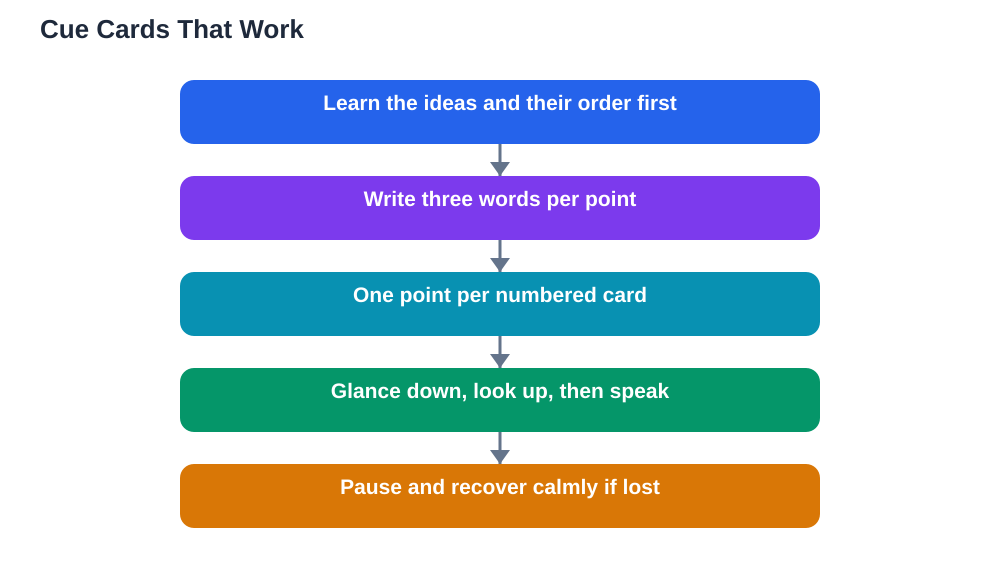

Using notes when presenting is a smart, normal habit, but it only helps when your notes are cues, not a script. Many students write out every word they plan to say, then read it aloud, which sounds flat, hides their personality, and breaks eye contact with the audience. Others avoid notes entirely, then freeze when they forget a point. The middle path works best: short cue cards that remind you what comes next, while your own words carry the explanation. This guide shows you how to build those cards, how to glance at them without reading them, and how to recover gracefully when you lose your place.

## Using Notes When Presenting Without Reading Them

The key idea is that notes should trigger your memory, not replace your thinking. A cue card works when a quick glance reminds you of the next idea, and you then explain that idea in your own words. A script fails because reading aloud uses a different part of your attention from speaking naturally, and the audience can hear the difference immediately. To keep notes in the cue role, write them after you already understand your talk, not before. First learn the ideas and their order, then reduce each idea to a few words that will jog your memory. If you find yourself writing full sentences on your cards, that is a sign you do not yet trust your understanding of that section, and a little more preparation will fix it better than longer notes will.

## Cue Cards With Three Words Per Point

The three-words-per-point rule is a simple discipline that keeps cards useful. For each main point, write no more than three words: a keyword for the idea, plus one or two words that remind you of the example or the order. A card for a talk about healthy habits might carry just a few such cues, one set per point, each on its own line. Number your cards clearly, and put one point per card, so you can find your place at a glance. Use large, clear handwriting or print, because tiny text forces you to stare at the card to read it. Leave space between points on each card, and highlight the first word of each point so your eye lands on it quickly. Practise with these cards, and you will find that three words are usually enough to unlock a whole paragraph of explanation from your own understanding.

## How to Glance, Not Read

Glancing is a physical skill you can practise. Hold your cards low, near waist level, so that looking down at them is a small movement, not a bow of the head. When you need a cue, look down, read the next few words silently, look back up at the audience, and then speak. The order matters: read first, then speak, never both at once. If you speak while looking down, your voice drops towards the floor and the audience stops feeling addressed. Build pauses into your talk at the end of each point, and use those pauses to glance at your next cue. To the audience, a pause looks thoughtful, and to you, it is a safe moment to check your place. During rehearsal, practise this glance-and-speak rhythm deliberately until it feels natural, and notice how much more eye contact you gain compared with reading.

## Recovering When You Lose Your Place

Losing your place happens to every speaker, and a good notes system makes recovery quick. First, do not panic or apologise. Pause, glance at your cards, and find the point you were on. Numbered cards help here, because you can flip to the right card without shuffling through a pile. If you cannot find your place, move to the next point you remember and carry on; the audience does not know your planned order. If a card falls or the order gets mixed up, take a breath, reorder calmly, and continue. It helps to mark your most important points clearly, so you can always jump to a safe landmark in your talk. Remember that a short pause and a glance at your notes looks professional, while a long, flustered apology draws attention to a slip the audience might otherwise never have noticed.

## AI Help: Muse AI

Muse AI is Meta's personal AI assistant, and it can help you prepare better cue cards for your next talk. You can ask it to help you shorten a paragraph into a few cue words, or to suggest a simple order for your main points. It gives general planning help, not verified answers, so always check your content against your textbook before presenting.

Join Muse with invite code LTGSWD — in the Muse app, go to Settings > Redeem token and enter the code.

Disclosure: LTGSWD is the author's Muse invite code.

## FAQ

### Are cue cards better than a full script?

Yes, for most talks. Cue cards keep you speaking naturally and looking at the audience, while a full script tempts you to read aloud, which sounds flat and breaks connection with listeners.

### How many cue cards should I use?

Use one card per main point, plus one for your opening and one for your closing. Too many cards become hard to manage, while too few force you to cram too much onto each one.

### What if I write too much on my cards and end up reading?

Rewrite the cards with the three-words-per-point rule, and rehearse with the new cards. If a section needs more detail, that usually means you need more preparation on that idea, not longer notes.

### Should I hold my cards or put them on a desk?

Holding them is usually better, because it keeps them close and lets you move naturally. Keep them low and steady, and avoid waving them around or shuffling them nervously.

### What do I do if I drop my cards?

Stay calm, pick them up, and check the numbers to restore the order. A brief pause while you do this looks completely normal, and the audience will barely remember it. For rehearsal techniques that make notes feel familiar, see [Rehearsing a Presentation: How Pros Practise](/blog/rehearsing-a-presentation.html).

## Conclusion

Notes should be a safety net, not a script. Cue cards with three words per point, a glance-and-speak rhythm, and a calm recovery plan will let you speak naturally while never fearing a blank moment. Build your next set of cards this way, rehearse with them, and notice how much freer your presenting feels. Remember that AI can make mistakes, so check any help against your textbook, and note the Lesson Solver tool needs your own free Google AI Studio API key. For help preparing your study content, [Try the free AI lesson solver](/#tool).
