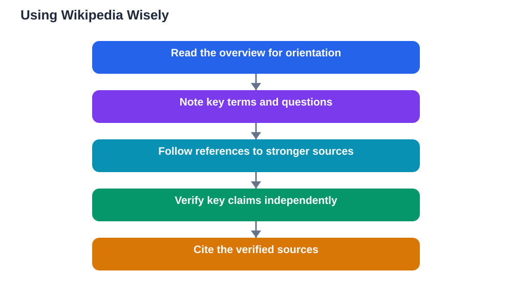

Using Wikipedia wisely for school work starts with understanding what it is good for and what it is not. Wikipedia is a large, freely written encyclopedia that can give you a fast overview of almost any topic, explain key terms, and point you toward further reading. That makes it a genuinely useful starting point, especially when you are new to a topic and need orientation. It is a weaker finishing point, because its articles are written and edited by many volunteers, vary in quality, and can change at any time. The wise approach is therefore simple: use Wikipedia to orient yourself and find leads, then verify important claims against stronger sources and build your project on those. Used that way, it helps your research instead of weakening it.

## Using Wikipedia Wisely: Start With the Overview

When you meet a new topic, a Wikipedia article can quickly show you its shape: what the topic covers, which terms matter, how its parts fit together, and what questions people debate about it. Read the introduction and the headings first to get that shape, and note the key terms you will need for better searching elsewhere. This orientation stage is where Wikipedia shines, because a few minutes of reading can save hours of confused searching. Treat what you read here as a map, not as evidence: it tells you where to look next, but your project should not rest on the map alone. Keep your research question beside you as you read, and note which sections of the article connect to it and which parts are background you can set aside for now.

## Follow the References to Stronger Sources

The most valuable part of a Wikipedia article for a student is often at the bottom: its list of references. Those references point to books, articles, reports, and original documents that the article drew on, and they are your bridge from an overview to real research sources. Click through to references that look relevant and reliable, judge them with the same checks you would apply to any source, and add the strong ones to your own source list. Also notice the links inside the article text, which lead to related topics and definitions that can sharpen your understanding and your search words. A student who follows references well often ends up with a better source list than a student who searched blindly, because the article has already gathered a first set of leads. For general source-checking habits, see [Checking Sources for School Work](/blog/checking-sources-school-work.html).

## Verify Key Claims Before You Use Them

Every claim that matters to your argument deserves verification against a source stronger than an encyclopedia overview. This is especially important for dates, definitions, numbers, and claims about causes or effects, because these are the details readers check and the details where errors do the most damage. To verify, find the claim's reference in the article and read that source itself where possible, or find an independent reliable source that confirms the same point. If you cannot verify a claim from a stronger source, either leave it out or present it cautiously as something one source reports, rather than as settled fact. This habit protects your project in two ways: it catches errors before they reach your reader, and it deepens your understanding, because checking a claim usually teaches you more about it than copying it would.

## Know the Warning Signs in an Article

Not every Wikipedia article is equally strong, and learning to spot weaker ones is part of using the site wisely. Warning signs include notices at the top of an article saying it needs more references or that its neutrality is disputed, sections with few or no references, and claims phrased in dramatic or one-sided language. Articles on fast-changing or hotly debated topics also change more often and deserve extra checking. None of these signs means you must abandon the article entirely; they mean you should lean on it less and verify more. Compare what the article says with at least one independent reliable source, especially for any point your project depends on. If two sources agree, your confidence grows; if they disagree, you have found something worth investigating properly rather than copying silently.

## Cite Stronger Sources, Not the Overview

When you write your project, cite the stronger sources you verified, not the encyclopedia overview you started from. This is not about snobbery; it is about evidence. A reader who follows your references should reach the books, articles, and documents that actually support your claims, not a summary page that may have changed since you read it. That said, there is no need to hide that you used Wikipedia to get oriented; orientation is a normal part of research, and many students start there. The distinction is between starting point and evidence: start wherever orientation is easiest, but build your argument on sources you judged reliable and verified yourself. If you use the Lesson Solver tool for textbook exercises, apply the same rule: verify its solutions against your textbook, remember that AI can make mistakes, and note that the tool needs your own free Google AI Studio API key. The tool supports textbook photos in English, Urdu, and Sindhi as a multilingual feature, which can help you work with material in the language you read most comfortably.

## AI Help: Muse AI

Muse AI is Meta's personal AI assistant, and it can help you use reference material wisely. You can ask it to explain a new topic in simple terms or to suggest search phrases for finding stronger sources to verify a claim.
Join Muse with invite code LTGSWD — in the Muse app, go to Settings > Redeem token and enter the code.
Disclosure: LTGSWD is the author's Muse invite code.

## FAQ

### Is it acceptable to use Wikipedia for school work?

Yes, as a starting point for orientation and for finding references to stronger sources. It is not a strong final source for important claims, because its articles vary in quality and can change. Use it to understand a topic's shape and to find leads, then verify key claims against reliable sources and cite those.

### Should I cite Wikipedia in my bibliography?

Generally, cite the stronger sources you verified rather than the overview article itself, because your bibliography should lead readers to the evidence that supports your claims. If your teacher's guidance differs, follow that guidance. Either way, keep your bibliography honest about what you actually relied on for each point.

### How can I tell if a Wikipedia article is weak?

Look for notices about missing references or disputed content, sections with few references, dramatic or one-sided language, and topics that change rapidly. These signs mean you should verify more carefully and lean on independent reliable sources for anything your project depends on.

### What should I do if Wikipedia and another source disagree?

Treat the disagreement as something to investigate, not a tie to break by guessing. Check each source's evidence and references, look for a third reliable source, and report the disagreement honestly in your project if it matters to your question. Explaining a disagreement shows careful research.

## Conclusion

Wikipedia is a helpful servant and a poor master for school work. Use it to orient yourself, follow its references to stronger sources, verify every claim that matters, watch for warning signs, and cite the verified sources in your final piece. That approach gives you the speed of a good overview without the risk of building your project on shaky ground, and it is a habit that will serve every research project you tackle.

[Try the free AI lesson solver](/#tool)
