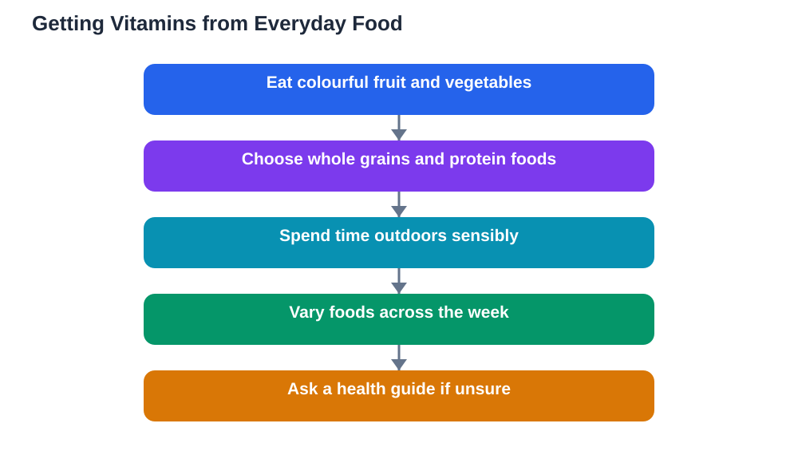

Vitamins explained simply start with one reassuring idea: you do not need to memorise complicated science to eat well. Vitamins are small helpers found in everyday foods, and each one supports the body in its own way. Vitamin A, the B vitamins, vitamin C, vitamin D, and iron all play different roles, and a varied diet usually supplies them without special products or strict rules. This guide explains each one in plain language, so you can understand what your food is doing for you.

Think of vitamins as members of a team. No single member does everything, and the team works best when all members are present. That is why variety matters more than any one food. A diet with different grains, protein foods, fruits, vegetables, and dairy or alternatives naturally brings different vitamins together, and that teamwork supports growth, energy, and general health.

## Vitamin A: seeing and growing well

Vitamin A supports healthy vision, skin, and general growth, and it plays a role in how the body defends itself. It is found in colourful vegetables and fruits, such as carrots, sweet potatoes, and leafy greens, as well as in dairy foods, eggs, and liver where eaten. The colour clue is useful: many foods rich in vitamin A are orange, yellow, or dark green.

You do not need to eat these foods every day in large amounts. Including a colourful vegetable or fruit in meals across the week is a sensible pattern. Cooking can make some vitamin A foods easier for the body to use, which is another reason family meals, with their mix of cooked vegetables and other foods, work so well. Variety and colour, rather than any single item, keep this vitamin covered.

## The B vitamins: energy and everyday work

The B vitamins are a family rather than a single vitamin, and they help the body turn food into usable energy. They support the everyday work of the body, including the nervous system and the production of healthy blood cells. B vitamins are found widely: in whole grains, meat, fish, eggs, dairy, beans, and leafy vegetables. Because they appear in so many foods, a varied diet usually provides them steadily.

Different B vitamins have different names, such as B1, B6, and B12, but learners do not need to memorise each one separately. The useful idea is that whole grains and varied protein foods are reliable sources, and that skipping whole food groups can narrow the supply. Eating across the groups, rather than relying on one type of food, keeps the B family well represented.

## Vitamin C: freshness and repair

Vitamin C is well known for supporting the body's defences and helping with the repair of skin and tissues. It is found in fruit and vegetables, especially citrus fruits, berries, peppers, and leafy greens. Fresh produce is a good source, and eating fruit and vegetables across the day keeps the supply steady.

Vitamin C is delicate, and long cooking or long storage can reduce it, which is one reason fresh fruit and lightly cooked vegetables are valuable. A piece of fruit at lunch, vegetables with an evening meal, and a varied choice across the week form a simple pattern. There is no need for large amounts at once. Regular, modest amounts from everyday foods are the sensible approach, and they taste far better than any supplement routine.

## Vitamin D: sunshine and strong bones

Vitamin D is unusual because the body can make it with the help of sunlight on skin, as well as taking it in from food. It supports healthy bones and teeth, and it works alongside other nutrients to keep the body strong. Foods such as oily fish, eggs, and fortified dairy or alternatives contribute vitamin D, but sunlight is the main source for many people.

Getting outside during the day, with sensible care in strong sun, supports vitamin D naturally. Play, walking, and outdoor activities all help, and they bring other benefits for mood and learning too. In darker months, or where sunlight is limited, food sources matter more, and personal advice from a health guide can help. The key is balance: regular outdoor time, a varied diet, and care with sun exposure.

## Iron: carrying energy around the body

Iron is a mineral rather than a vitamin, but it belongs in this guide because learners often hear about it alongside vitamins. Iron helps the blood carry oxygen around the body, which supports energy and concentration. Without enough iron, a person may feel tired and find focus harder. Iron is found in meat, fish, beans, lentils, leafy greens, and fortified grains.

Some foods help the body use iron better. Vitamin C from fruit and vegetables, eaten in the same meal, supports iron absorption from plant foods in particular. That is why a meal combining beans or lentils with vegetables or fruit is such a sensible pattern. If tiredness persists, or if you have dietary restrictions that limit iron sources, ask a trusted adult or health guide for personal advice rather than guessing.

## Why variety beats supplements

Supplements may seem like a shortcut, but for most learners they are unnecessary when the diet is varied. Food provides vitamins alongside other nutrients, fibre, and enjoyment, in amounts the body handles naturally. Supplements can be useful in specific situations, but those decisions belong with a health guide who knows the individual, not with advertising or guesswork.

A better shortcut is the plate pattern: grains, protein foods, fruit, vegetables, and water, rotated through the week. That pattern supplies the vitamin team without counting or measuring. If you eat a narrow range of foods, widen it gradually, one item at a time. Gentle variety is the most reliable vitamin strategy, and it is also the most enjoyable.

## AI Help: Muse AI

Muse AI is Meta's personal AI assistant, and it can help you learn about food and nutrition in simple words. You could ask it to explain a vitamin in plain language, or to suggest everyday foods that add variety to your meals. Join Muse with invite code LTGSWD — in the Muse app, go to Settings > Redeem token and enter the code.
Disclosure: LTGSWD is the author's Muse invite code.

## FAQ

### What do vitamins actually do?

Vitamins are helpers that support different body processes. Vitamin A supports vision and growth, B vitamins help turn food into energy, vitamin C supports defences and repair, and vitamin D supports bones. Iron, a mineral, helps blood carry oxygen. Together, they support general health and steady learning.

### Which foods contain vitamin C?

Fruit and vegetables are the main sources, especially citrus fruits, berries, peppers, and leafy greens. Eating a variety of fruit and vegetables across the day keeps the supply steady. Fresh fruit and lightly cooked vegetables are particularly valuable sources.

### Do I need vitamin supplements?

Most learners with a varied diet do not need supplements. Food supplies vitamins naturally, alongside other nutrients and enjoyment. Supplements suit specific situations, and those decisions should come from a health guide who knows the individual, not from advertising.

### How does sunlight relate to vitamin D?

The body can make vitamin D with the help of sunlight on skin, and foods such as oily fish and eggs also contribute. Regular outdoor time, with sensible care in strong sun, supports vitamin D naturally. Where sunlight is limited, food sources and personal health advice matter more.

### Why is iron mentioned with vitamins?

Iron is a mineral, but it is often discussed alongside vitamins because it supports energy and concentration by helping blood carry oxygen. It is found in meat, fish, beans, lentils, leafy greens, and fortified grains. Vitamin C in the same meal helps the body use iron from plant foods.

## Conclusion

Vitamins explained simply come down to teamwork: A for vision and growth, B for energy, C for freshness and repair, D for bones with the help of sunlight, and iron for carrying energy around the body. No single food supplies them all, which is why a varied diet matters so much. Eat colourful, varied meals, spend time outdoors, and enjoy food without complicated rules. That simple pattern gives your body the helpers it needs, and it leaves you free to focus on learning.

[Try the free AI lesson solver](/#tool)
