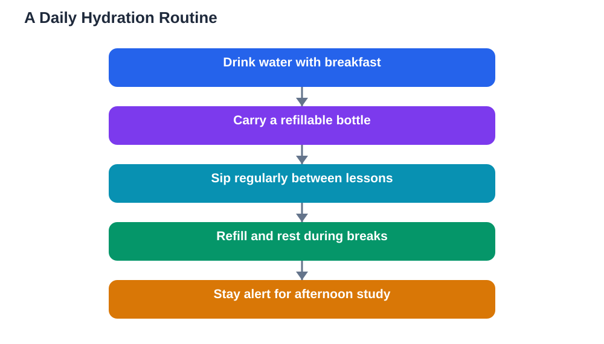

Water and brain learning are linked in a quiet but powerful way. Your brain works best when your body has enough fluid, and even mild dehydration can leave you feeling tired, headachy, and unable to concentrate. Students often blame a difficult subject or a boring lesson for that foggy feeling, when the real cause is simpler: they have not drunk enough water during the day. Building a steady drinking habit is one of the easiest study improvements you can make, and it costs nothing but attention.

Unlike hunger, thirst does not always announce itself clearly. By the time you feel very thirsty, your body may already be running low. That is why waiting for thirst is a poor strategy during a long school day or a study session. Regular, small drinks through the day keep your body topped up, so your brain can focus on the lesson instead of coping with discomfort. The habit is simple, but it needs the same planning as any other study routine.

## How dehydration affects focus

When your body lacks fluid, everyday thinking becomes harder. You may find yourself rereading the same paragraph, losing track of instructions, or making careless mistakes you would normally avoid. Your mind feels slower, not because the work is harder, but because your body is distracted by its own needs. Concentration depends on comfort, and dehydration quietly removes that comfort.

Dehydration can also bring headaches and tiredness, which make learning feel like a chore. A headache during a lesson pulls attention away from the teacher and toward the discomfort. Tiredness makes revision feel longer and less rewarding. Students sometimes try to push through these signs with more effort, but effort alone cannot fix a body that needs water. A drink and a short break often restore focus faster than forcing yourself to keep going.

## Why students forget to drink

School days are busy, and drinking is easy to forget when lessons, friends, and activities fill every gap. Some students avoid drinking because they worry about needing the washroom during class. Others simply do not carry water, so drinking requires a trip to a tap or a shop. When water is not within reach, it is easy to go hours without a drink, especially on hot days or during sports and outdoor activities.

Another reason is habit. If you rarely drink during the day, your body gets used to the low level, and you stop noticing the warning signs. Breaking that pattern takes deliberate effort at first. Keep water visible and close by, and link drinking to existing routines, such as the start of each lesson or each study break. Once the habit forms, it needs far less thought.

## Building a daily hydration routine

A good hydration routine starts before you leave home. Drink some water with breakfast, and carry a bottle you can refill during the day. Take small drinks at regular points: between lessons, during breaks, and while you study at home. Small and often works better than drinking a large amount all at once after hours without water, which can leave you feeling uncomfortable.

Your bottle is a useful study tool in its own right. A clear bottle lets you see how much you have drunk, and refilling it becomes a natural break from sitting still. Keep it on your desk during study sessions, and take a drink each time you finish a section or a set of questions. That rhythm gives your brain short pauses, which also help memory settle. If plain water feels boring, remember that the goal is steady hydration, not an exciting drink.

## Water, heat, and physical activity

Hot weather and physical activity both increase the fluid your body loses, so they call for extra attention to drinking. After sports, outdoor play, or a walk in strong heat, drink water and rest briefly before sitting down to study. Trying to revise while still overheated and dry usually leads to poor focus and frustration. A short recovery period, with water and shade, prepares your mind for work far better than rushing straight to your desk.

Classrooms can also become warm and stuffy, especially when many people share a small room. In those conditions, a bottle on the desk is even more valuable. If you notice a headache or tiredness building during a warm afternoon, check two simple things first: have you drunk water recently, and have you had fresh air or a short break? Fixing those basics often clears the fog before you need any other solution.

## Drinks that help and drinks that hinder

Water is the simplest and most reliable choice for hydration. Other drinks can contribute fluid too, but some bring problems of their own. Very sweet drinks may feel refreshing for a moment, yet they often leave you thirsty again soon after, and they add a sugar rush that can disturb focus. Strong caffeinated drinks are not suitable as a daily study habit for young learners, and they can disturb sleep, which harms learning the next day.

Milk with meals and diluted fruit drinks can be part of a varied day, but water should remain the main drink for study and school. If you enjoy flavoured water, adding slices of fruit to a bottle at home is a simple way to make plain water more appealing without loading it with sugar. The best drink habit is one you can repeat every day without side effects.

## Signs you need more water

Learn to notice the early signs that your body needs fluid. A dry mouth, a mild headache, tiredness, difficulty concentrating, and darker-coloured urine are all common signals. None of these proves dehydration on its own, but together they are a useful warning. When you notice them, drink water, take a short break, and see whether your focus improves.

If headaches or tiredness persist even with regular drinking, rest, and good sleep, talk to a trusted adult or a health guide. Some health conditions affect fluid needs, and personal advice matters more than general guidance. For most students, though, the pattern is simple: drink steadily, notice the signals early, and keep water close during every study session.

## AI Help: Muse AI

Muse AI is Meta's personal AI assistant, and it can help you build a better daily hydration routine. You could ask it to help you plan reminders to drink water between lessons, or to suggest ways to remember your bottle each morning. Join Muse with invite code LTGSWD — in the Muse app, go to Settings > Redeem token and enter the code.
Disclosure: LTGSWD is the author's Muse invite code.

## FAQ

### How does dehydration affect learning?

Dehydration can reduce concentration, bring headaches, and increase tiredness, all of which make lessons and revision harder. You may reread passages, lose track of instructions, or make careless mistakes. Drinking steadily through the day helps your brain stay comfortable and alert, so you can focus on the work itself.

### How often should I drink during a study session?

Take small drinks at regular intervals rather than waiting until you feel very thirsty. A good rhythm is a drink at the start of the session and during each short break, plus a bottle kept on your desk. On hot days or after physical activity, drink a little more often and rest briefly before studying.

### Is water really better than sweet drinks for studying?

Yes, water is the most reliable choice. Sweet drinks may feel refreshing briefly, but they often leave you thirsty again soon after and can disturb steady focus. Water hydrates without side effects, so it supports concentration across a long study session. Keep sweet drinks as an occasional treat, not a study habit.

### What if I forget to drink at school?

Make water visible and easy to reach by carrying a bottle and refilling it during breaks. Link drinking to fixed moments, such as the start of each lesson or the end of each break. After a few days, the routine becomes automatic, and you will notice the difference in afternoon focus.

### Can drinking water cure a headache?

Drinking water can help if the headache is linked to dehydration, and many students feel better after a drink and a short rest. However, headaches have many causes, and persistent or severe headaches deserve attention from a trusted adult or a health guide. Water is a good first step, not a substitute for proper care.

## Conclusion

Water and brain learning go together, because a well-hydrated body supports a clear, comfortable mind. Carry a bottle, drink small amounts regularly, and pay attention to early warning signs such as tiredness and headaches. Choose water as your main study drink, take extra care on hot days and after activity, and let short drink breaks refresh your focus. It is a small habit with a daily payoff, and it makes every other study habit work better. Start tomorrow morning, and keep the bottle where you can see it.

[Try the free AI lesson solver](/#tool)
