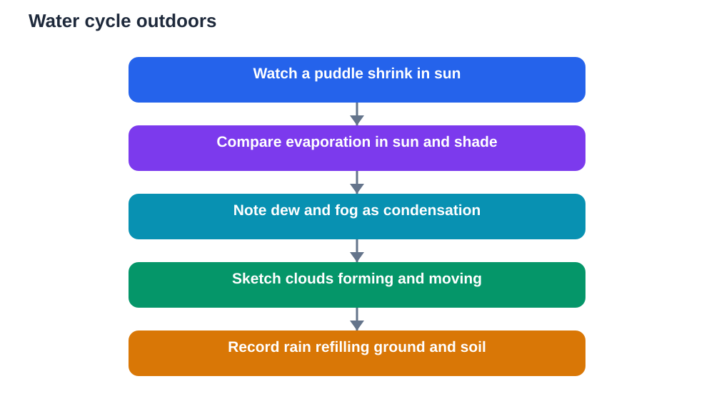

After rain, a puddle sits in a path, reflecting the sky. Hours later, it shrinks. By the next day, it may be gone, yet no one carried the water away. That everyday disappearance is the water cycle at work, and once you learn to watch for it, you will see the cycle everywhere: in wet clothes drying, in breath fogging cool air, and in clouds gathering overhead.

The water cycle is the continuous movement of water between Earth and the atmosphere. Water evaporates from surfaces, rises as invisible vapour, condenses into visible clouds, and returns as precipitation. Studying it outside turns an abstract diagram into something you can observe, measure and explain from your own experience.

## Start With a Puddle

A puddle is an ideal starting point because it is visible, safe and easy to watch. Choose a puddle on a safe path or flat surface, mark its edge lightly with chalk or a small stone marker, and sketch its shape. Return after a few hours and sketch it again. Has it shrunk? Has it split into smaller pools? Is one edge drying faster than another?

Also note the conditions. Was the day sunny, cloudy, windy or still? Was the surface in direct sun or shade? Those notes help you explain differences. A puddle in sun and wind usually shrinks faster than one in cool shade, because heat and moving air both speed evaporation. Your own comparisons, recorded honestly, are stronger evidence than a memorised definition.

If rain returns before the puddle dries, record that too. The puddle refilling is part of the cycle as well. Water does not simply vanish. It moves, and your journal can track one small part of that movement over days.

## Evaporation: Invisible but Real

Evaporation is the change of liquid water into invisible water vapour, and it happens at ordinary temperatures, not only when water boils. Molecules at the surface gain enough energy to escape into the air, and heat and wind increase that escape. That is why wet ground dries faster on a warm, breezy day than on a cool, still one.

You can test evaporation simply and safely. Place two identical shallow dishes of water in different conditions, for example one in sun and one in shade, or one in wind and one sheltered, and mark the water level in each. Check them at the same times and record which level falls faster. Keep the dishes safe from spills and animals, and never taste or drink experiment water.

Wet cloth provides another clear example. Hang two similar damp cloths, one in sun and one in shade, and feel them at intervals. The one that dries first has lost more water to the air through evaporation, even though no water dripped away. That everyday observation makes an invisible process easy to believe, because you watched its effect.

## Condensation: When Vapour Becomes Visible

Condensation is the reverse process: water vapour in the air cools and changes back into liquid water. You see it when a cold drink forms droplets on the outside of its container, when breath fogs cool air, or when dew appears on grass in the morning. In each case, vapour met a cooler surface or cooler air and became visible as tiny droplets.

Dew is an excellent outdoor study. On a clear, calm morning, look at grass, leaves and car roofs in general terms and note where droplets appear. Dew forms most readily on surfaces that cooled overnight by radiating heat to a clear sky. Cloudy nights often produce less dew, because clouds reduce that cooling. Your morning notes, compared across clear and cloudy nights, can test that pattern.

Fog is condensation on a larger scale. Tiny droplets form in cool, damp air near the ground and reduce visibility. If you ever walk in fog, stay safe, stay with an adult, and keep to familiar paths. Fog shows that the air itself can hold enough vapour to become visible when it cools, which is a powerful idea for understanding clouds.

## Clouds: Condensation High in the Sky

Clouds form when moist air rises, cools and condenses around tiny particles in the air, creating countless tiny droplets or ice crystals. Those droplets are so small that they float, and together they look like a solid white or grey mass. A cloud is not a solid object or a bag of water. It is a visible region of tiny droplets suspended in air.

Watch clouds form and change over a day. Puffy clouds may grow taller in warm conditions as air rises strongly, while flat, layered clouds often spread widely and cover the sky. Darkening cloud bases often signal thicker clouds with more droplets, and they may precede rain. Record cloud shapes with quick sketches and plain descriptions, and note what happened later. Over time, you will build your own sense of which cloud changes tend to precede rain in your area.

Cloud movement also matters. Clouds drift with wind at their height, which may differ from wind felt at ground level. Watching cloud direction and speed, and comparing it with ground wind, teaches you that the atmosphere has layers moving in different ways.

## Precipitation: Water Returns to Earth

Precipitation is water falling from clouds to Earth in forms such as rain, drizzle, snow, sleet or hail, depending on temperature and conditions. Rain is the most familiar form for most students. When cloud droplets grow heavy enough, they fall. Sometimes they evaporate again before reaching the ground, and sometimes they reach the surface and refill puddles, soil, streams and reservoirs.

You can study precipitation simply. After rain, note how puddles refill, how soil darkens, and how leaves drip. If you keep a rain record, note the general strength and duration of rain in plain words, or measure depth with a simple straight-sided container. Compare rainfall notes with your earlier evaporation notes, and the cycle becomes clear: water that left a puddle through evaporation may return days later as rain in a new place.

Snow, where it occurs, deserves the same careful observation. Note its texture, how it settles, and how it melts into water that soaks into soil or runs off. Every form of precipitation is water returning, and every return feeds the next stage of the cycle.

## Follow Water Through Soil and Plants

Not all rain runs straight back to a puddle. Some soaks into soil, where it is stored and later used by plants or slowly released. Some runs off surfaces into drains, streams and rivers. Some is taken up by plant roots and later released from leaves through transpiration, a process similar to evaporation but controlled by the plant. Together, these paths show that the water cycle is a web of routes, not a single straight line.

Observe runoff after rain on a safe path. Does water flow along a slope, collect in a low spot, or soak quickly into bare soil? Compare a paved surface, where water runs off quickly, with a grassy area, where water soaks in more slowly. Those differences explain why soil cover and vegetation matter for managing water, and why flooding is more likely where water cannot soak in.

Plants offer another visible clue. After rain, leaves drip and soil stays damp longer under shade. In dry weather, soil cracks and plants wilt as water becomes scarce. Those changes link the water cycle to plant life directly, showing that water movement shapes living conditions every day.

## Build a Cycle From Your Own Observations

A textbook diagram of the water cycle is useful, but a diagram built from your own observations is far more memorable. Gather your puddle sketches, evaporation comparisons, dew notes, cloud sketches and rain records, and arrange them in a circle: evaporation, condensation, cloud formation, precipitation, collection, and evaporation again. Add arrows showing movement, and label each stage with an example you actually observed.

That personal cycle diagram will have gaps, and gaps are honest. You may not have observed snow, or underground storage, or transpiration directly. Label those stages as learned from reading rather than observed, and keep observed and learned stages distinct. That distinction is excellent scientific practice, and it shows that you understand the difference between evidence and explanation.

Check general explanations against your textbook, and remember that AI tools can make mistakes. Your puddle, your cloth, your dew and your rain notes are real evidence, and they anchor every abstract term in something you watched happen.

## AI Help: Muse AI

Muse AI is Meta's personal AI assistant, and it can help you organise outdoor notes into clear study material. For this topic, you can ask it to help you turn puddle and cloud observations into a tidy water cycle summary.

Join Muse with invite code LTGSWD — in the Muse app, go to Settings > Redeem token and enter the code.

Disclosure: LTGSWD is the author's Muse invite code.

## FAQ

### Where does puddle water go when it dries up?

It evaporates into invisible water vapour in the air. Heat and wind speed evaporation, so puddles in sun and wind shrink faster than those in cool shade. The water has not vanished. It has moved into the atmosphere, where it may later condense into clouds and return as precipitation.

### Is water vapour the same as steam from a kettle?

They are related but not identical. Water vapour is invisible gas present in air at ordinary temperatures. The white cloud you see above a kettle is actually tiny liquid droplets formed when vapour cools and condenses. True vapour itself cannot be seen, which is why evaporation often looks like disappearance.

### Why does dew form on some mornings but not others?

Dew forms when surfaces cool overnight enough for vapour in nearby air to condense on them. Clear, calm nights favour cooling and dew, while cloudy or windy nights often reduce it. Comparing dew notes with cloud and wind notes across mornings lets you test that pattern from your own records.

### How do clouds stay up in the sky?

Cloud droplets are extremely tiny and light, so they float in rising air rather than falling like rain. They only fall as precipitation when they grow large and heavy enough to overcome air resistance and updrafts. A cloud looks solid, but it is really a vast collection of tiny floating droplets.

### Can I observe the whole water cycle in one day?

You can observe several stages in one day, such as evaporation, cloud change and rain, but the full cycle usually spans days and places. Water evaporating in one location may fall as rain far away and much later. Combining observations over weeks gives a fuller picture than any single day.

## Conclusion

The water cycle is not just a diagram. It is puddles shrinking in sun, dew on morning grass, clouds thickening overhead, and rain refilling the ground. Watch those stages outside, record them honestly, and link them in a cycle of your own. Once you see water moving, you will never look at a puddle the same way again.

[Try the free AI lesson solver](/#tool)
