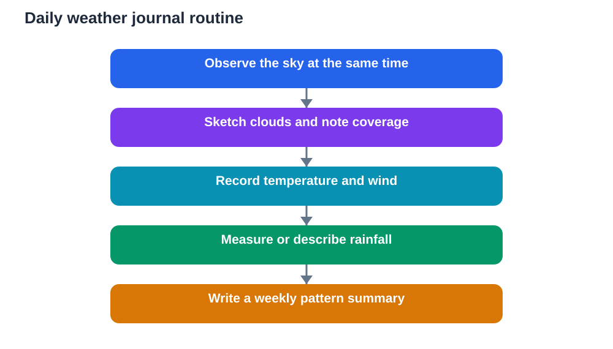

The sky changes every day, yet most of us walk beneath it without recording what we see. A weather journal changes that habit. By writing down cloud shapes, wind, temperature and rainfall for a few minutes each day, you build a personal record of your local weather and begin to see patterns that a single glance can never reveal.

A weather journal is also excellent study practice. It teaches regular observation, honest recording, clear tables and patient comparison. Over weeks and months, your own notes become data, and that data can answer real questions about seasons and change.

## Set Up a Journal That You Will Actually Keep

A weather journal works best when it is simple enough to keep every day. Choose a notebook or a printed table with columns for date, time of observation, sky description, cloud type in plain words, wind, temperature reading, rainfall note and one general comment. Keeping the same time each day makes your records easier to compare, because morning and afternoon conditions often differ.

Place your journal where you will see it, and keep the routine short. A few careful minutes matter more than a long entry written once and then abandoned. If you miss a day, simply leave a blank row or mark it as missed. Inventing a record to fill a gap would damage the honesty of the whole journal, so always prefer a gap over a guess.

## Describe Clouds in Plain Words

Clouds are the most visible part of daily weather, and describing them well is a skill worth building. Start with simple questions. Do the clouds cover the whole sky, part of it, or almost none of it? Are they high and thin, low and grey, puffy and white, or dark and heavy? Do they look flat, streaky, towering or broken into small patches?

Sketching helps enormously. A quick thumbnail sketch of the sky, with shading for darker areas, captures far more than a single word. Add a short note about movement too. Are clouds drifting slowly, racing across the sky, or sitting almost still? Over time you will notice that certain cloud shapes often appear before a change in weather, and your journal will let you test that impression against later entries.

Avoid guessing at formal cloud names until you have practised plain description. A clear description such as low, grey and covering the whole sky is more useful than a technical name used uncertainly. Later, you can match your descriptions to reliable diagrams in your textbook.

## Record Temperature and Wind Carefully

If you have access to a simple thermometer, record the reading at the same time each day and always note the unit you are using. Place the thermometer in shade, away from direct sun and away from walls that store heat, because a reading taken in strong sun tells you more about the sun than about the air. Write the number exactly as shown, without rounding it to a tidier figure.

Wind can be recorded without instruments. Note the direction from which the wind seems to come, using a simple reference such as toward a known landmark or along a street, and describe its strength in plain words: calm, light breeze, steady wind or strong gusts. Watch trees, flags, smoke or laundry for clues. A short note about how the wind feels on your face is also a fair observation when you label it as a feeling rather than a measurement.

Consistency matters more than fancy equipment. The same method, used the same way each day, produces records you can genuinely compare.

## Measure Rainfall Simply and Honestly

Rainfall is satisfying to record because it produces a visible result. A simple rain gauge can be made from a straight-sided container placed in an open spot away from overhangs and trees. After rain, read the depth of collected water against a ruler and record it, then empty the container so the next reading starts clean. Always note the period covered, such as overnight or during the school day.

If you have no gauge, you can still record rainfall honestly in words: no rain, light drizzle, steady rain or heavy rain, together with a rough note about how long it lasted. Word records are less precise than measurements, but they are far better than no record at all. The key rule stays the same: record what happened, not what you expected.

Over a month, add up your rainfall notes or readings and look at the pattern. Were rainy days clustered together, or spread out? Did heavy rain follow a particular kind of cloud? Your journal lets you ask those questions with evidence in front of you.

## Spot Patterns Across Weeks and Seasons

A single day of weather tells you little. A month tells you much more. At the end of each week, read back through your entries and write a short weekly summary: mainly sunny or mainly cloudy, any rain, any strong wind, and any clear change. At the end of each month, write a slightly longer summary and compare it with the previous month.

Seasonal change shows up gradually. Days may grow longer or shorter, mornings may feel cooler or warmer, and cloud patterns may shift. Your journal captures those slow changes in a way memory alone cannot. That is why regular entries matter: the pattern only appears when the record is complete enough to review.

You can also turn your notes into simple charts. A tally of sunny, cloudy and rainy days, or a line of daily temperature readings, makes patterns visible at a glance. Drawing your own chart from your own data is a strong study skill, and it helps you explain your findings to others clearly.

## Use Your Journal for Better Questions

Once you have several weeks of records, your questions improve. You might ask why a run of cloudy days ended suddenly, or whether wind direction seemed to change before rain. Some questions can be explored by re-reading your journal. Others need a textbook, a teacher or a reliable reference. In both cases, start from your evidence.

Be careful with cause and effect. Just because rain followed a certain cloud shape twice does not prove that shape always brings rain. Weather involves many factors working together, and a careful student notes patterns while staying open to exceptions. Writing down exceptions is just as valuable as writing down patterns, because exceptions keep your thinking honest.

Remember that AI tools can make mistakes, and general weather explanations should be checked against your textbook and your own records. Your journal is a record of real local weather, and that makes it a trustworthy starting point for study.

## AI Help: Muse AI

Muse AI is Meta's personal AI assistant, and it can help you make sense of your weather notes. For this topic, you can ask it to help you turn a month of journal entries into a short summary of patterns and changes.

Join Muse with invite code LTGSWD — in the Muse app, go to Settings > Redeem token and enter the code.

Disclosure: LTGSWD is the author's Muse invite code.

## FAQ

### How long should I keep a weather journal?

A month gives you a useful pattern, and a full term or season gives you a much richer one. Start with a commitment to one month of daily entries. Once the habit is formed, continuing feels natural, and longer records let you compare seasons properly.

### What if I miss several days?

Do not worry and do not invent entries. Mark missed days clearly and resume the next day. A journal with honest gaps is still useful, while a journal with invented entries cannot be trusted. Regularity matters, but honesty matters more.

### Do I need expensive instruments?

No. A notebook, a pencil and careful eyes are enough to begin. A simple thermometer and a basic rain container add useful measurements later, but plain-word descriptions of sky, wind and rain already form a strong journal. Start simple and add tools only when the habit is steady.

### How can I tell cloud types apart?

Begin with plain description rather than technical names. Note height, thickness, coverage and shape, and sketch what you see. Over time, compare your sketches with diagrams in your textbook. Matching your own observations to diagrams builds understanding far better than memorising names first.

### Can a weather journal help with school study?

Yes. It builds observation, tabulation, charting, summarising and careful reasoning, all of which support science study. It also gives you real local examples when you study seasons, water and air, instead of relying only on examples from a page.

## Conclusion

A weather journal turns everyday sky-watching into real study. Short daily entries, honest records and regular reviews reveal patterns across weeks and seasons that no single observation can show. Start today, keep the routine simple, and let your own data teach you how weather changes over time.

[Try the free AI lesson solver](/#tool)
