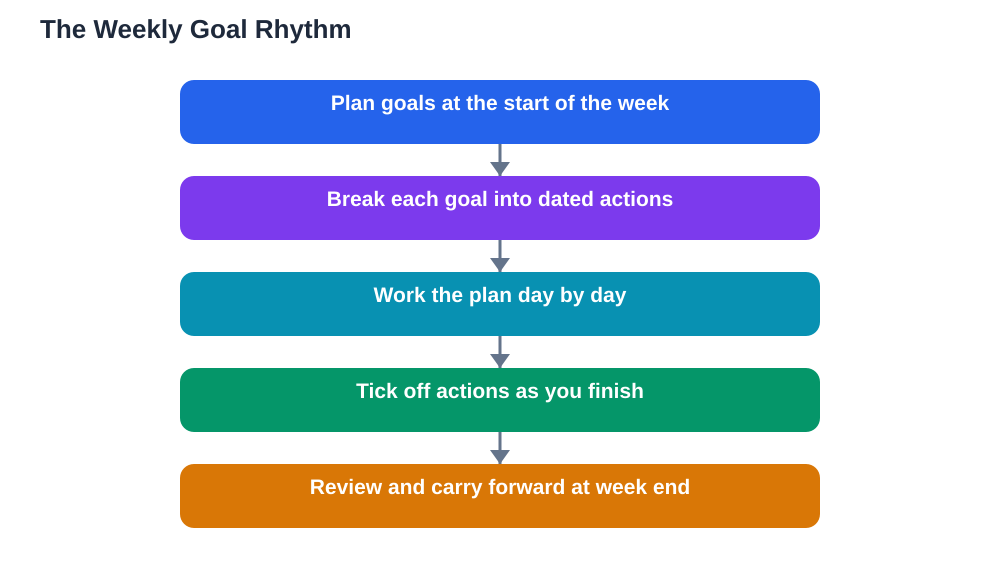

Long-term goals are easy to forget and daily to-do lists are easy to lose sight of. Weekly goals sit in the sweet spot between the two: close enough to feel urgent, long enough to allow real progress. A weekly rhythm gives every week the same simple shape, a planning moment, steady work through the week and a short review at the end. Once that rhythm is in place, goal-setting stops being a special event and becomes an ordinary habit.

The rhythm has two anchor moments. The first is a planning session, when you choose a small number of goals for the week ahead and turn each one into concrete actions. The second is a review session, when you look honestly at what happened, celebrate what got done and carry forward anything unfinished with a fresh plan. Everything between those anchors is simply doing the work, one session at a time. Students who keep both anchors rarely drift for long, because the review always brings the goal back into view within days, not weeks.

## Plan at the Start of the Week

Choose a regular planning time and protect it, even if it lasts only a short while. Start by looking at the week ahead: lessons, assignments, deadlines and busy days. Then choose two or three goals that fit that real week, not an ideal week. A week with heavy assignments calls for smaller goals; a quieter week can hold a bigger one. For each goal, write the exact actions and the days you will do them, so the plan answers the question of what to do on any given evening. Keep the plan visible, in a planner or notebook you open daily, because a plan hidden in a drawer helps no one.

## Choose the Right Number of Weekly Goals

Two or three goals per week is a good range for most students. One goal can feel too narrow if the week has room for more, while five or more goals usually means none of them gets proper attention. Mix goal types across the week: a learning goal, such as finishing a chapter or mastering a set of problems; a revision goal, such as reviewing notes from earlier topics; and a habit goal, such as keeping a tidy study space or reading every evening. This mix keeps the week balanced, so a difficult subject does not swallow all your energy, and progress in one area encourages effort in another.

## Work the Plan Through the Week

A weekly plan only works if it survives contact with real life. Do the hardest goal action early in the week when energy is usually higher, and keep lighter actions for busier days. If a session is missed, move it to the next free slot rather than abandoning it or doubling the following session. Keep a simple daily tick mark for each action completed, because visible ticks make progress satisfying and make gaps obvious before they grow. If midweek you realise a goal was badly sized, adjust it there and then: shrink the scope or swap an action, and note the change. A plan that bends slightly will outlast a rigid plan that snaps at the first disruption.

## Review at the End of the Week

The review session is where weekly goals earn their power. Look at each goal and sort it honestly into done, partly done or not started. For partly done goals, ask what helped and what blocked progress, and write the answer in a sentence. Carry unfinished work forward deliberately, either as a goal for next week or as a smaller step, instead of letting it silently pile up. Also notice what went well, even if it seems small: a steady run of sessions, a topic that finally clicked, a plan that survived a busy day. Ending the week with this honest look turns experience into better planning, because next week's goals are set with fresh knowledge of what you can actually do.

## Keeping the Rhythm Through Busy and Quiet Weeks

Not every week looks the same, and the rhythm should flex rather than break. In a very busy week, set one small goal and protect the review session, because reviewing keeps the habit alive even when progress is modest. In a quiet week, you can set a slightly larger goal or use the extra time to catch up on revision. During holidays or breaks, keep a lighter version of the rhythm, with one or two goals and a short review, so returning to full study feels like resuming, not restarting. The secret is never letting two weeks pass without a plan and a review, because long gaps are where goals quietly die.

## AI Help: Muse AI

Muse AI is Meta's personal AI assistant, and it can help you draft a weekly plan from your goals and timetable. You can ask it to suggest how to spread actions across the week or to help you write short review questions for the end of the week. Treat its draft as a starting point, then adjust it to match your real lessons and free time.

Join Muse with invite code LTGSWD — in the Muse app, go to Settings > Redeem token and enter the code.

Disclosure: LTGSWD is the author's Muse invite code.

## FAQ

### When is the best time to plan weekly goals?

Pick a time you can keep every week, such as the start of the week before lessons begin or a quiet evening. Consistency matters more than the exact day, because a regular slot turns planning into a habit. If your chosen time keeps getting crowded out, move it to a calmer slot rather than skipping planning altogether.

### What if I finish all my weekly goals early?

That is a good sign, not a problem. You can add a bonus goal, bring forward part of next week's work, or spend the extra time on revision. Avoid filling every spare moment with new goals, though; rest and free time protect your energy for the following week.

### What if I finish none of my weekly goals?

Treat it as useful information, not as a verdict on your ability. Ask whether the goals were too large, the week was unusually busy, or the plan lacked specific actions. Then set smaller, clearer goals for the next week and protect one planning session. One empty week is a signal to adjust, not a reason to quit the rhythm.

### Can weekly goals work alongside long-term goals?

Yes, and that is exactly their strength. Long-term goals set the direction, while weekly goals supply the next steps. Each week, choose weekly goals that move the long-term goal forward by a small amount, and use the weekly review to check that you are still heading in the right direction.

## Conclusion

A weekly rhythm turns goal-setting from a one-time burst into a steady practice: plan, work, review, repeat. Start this week with two or three realistic goals, keep both anchor moments, and let each review make the next plan a little wiser. Over a term, those ordinary weeks add up to extraordinary progress.

[Try the free AI lesson solver](/#tool)
