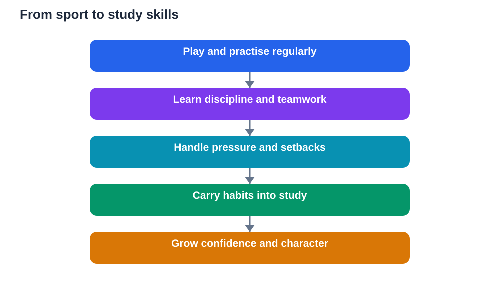

Games teach lessons that are hard to learn from a textbook alone, because the lesson arrives through experience rather than explanation. A student who has trained for weeks, lost a close match, and returned to practise the next day understands perseverance in a way that reading about it cannot fully convey. This is what sports teach students: discipline, teamwork, and the ability to handle pressure, all practised in real situations where effort, attitude, and cooperation have visible results. These lessons do not stay on the playing field. They travel into homework, revision, friendships, and later working life, shaping how a young person approaches difficulty.

Classroom learning is essential, and sport does not replace it. It completes it. In class, a student learns ideas and methods. In sport, a student learns how to keep going when the idea is difficult, how to work with people who think differently, and how to recover when a plan fails. The two kinds of learning support each other. A student who learns patience on the field often brings the same patience to a hard problem set. A student who learns to listen to teammates often listens better in group study too.

## What sports teach students about discipline

Discipline in sport is not a speech about working hard. It is a routine repeated until it becomes normal. A player turns up for practice, warms up properly, follows the coach's instructions, and keeps practising a skill that is not yet smooth. Nobody claps for every repetition, and progress is often slow. That slow progress is the lesson. Students learn that improvement comes from steady effort over time, not from one burst of enthusiasm.

The same discipline applies directly to study. A learner who can practise a skill daily, even when it feels boring, can also revise a little each day instead of leaving everything to the last moment. Both habits depend on the same idea: small, regular actions build large results. Sport makes this idea visible, because the player can feel a skill improving week by week. Study then feels less mysterious, because the student already knows how steady work feels.

## Learning teamwork through shared goals

Team games teach a simple truth: no single player wins alone. A team succeeds when each person understands their role, trusts others to do theirs, and supports the group when things go wrong. A strong player who ignores teammates weakens the team. A quieter player who passes well, defends carefully, or encourages others can change the whole game. Students learn to value contributions that do not always attract attention.

This lesson is useful far beyond sport. In group projects, in families, and in future workplaces, success usually depends on people combining different strengths. Sport gives students early practice in that reality. They learn to share credit when the team wins, to accept their share of responsibility when it loses, and to keep communicating even when they feel frustrated. Those habits make them easier to work with and more reliable in any group.

## Handling pressure and losing well

Few classroom moments reproduce the pressure of a close game, a missed chance, or a final moment when everyone is watching. Sport teaches students to breathe, focus on the next action, and keep going after a mistake instead of giving up. A player who misses a shot must still defend, pass, and stay in the game. That ability to reset quickly is one of the most valuable skills a student can develop.

Losing well is an equally important lesson. Losing teaches honesty: the result shows what needs work, without flattery or excuses. A student who can lose gracefully, congratulate opponents, and ask what to practise next has learned emotional maturity. That maturity helps in study too. A poor test result stops feeling like a personal failure and starts feeling like useful feedback. The student asks what went wrong, what to change, and how to prepare better next time.

## How sport builds focus and time management

Playing sport well requires attention. A player must watch the game, notice teammates, anticipate opponents, and make decisions quickly. That kind of focus is active, not passive. It trains the mind to stay present instead of drifting. Students who play regularly often find that this trained attention helps them concentrate during lessons and revision, because they have practised returning their focus to the task in front of them.

Sport also teaches time management in a practical way. A student who plays sport must fit practice, homework, rest, and family time into the same day. This forces choices and planning. The student learns to start homework earlier, to use short gaps wisely, and to protect sleep. These are not abstract study tips. They are daily decisions, practised under real constraints, and they build a sense of responsibility for one's own schedule.

## Confidence grows from effort, not praise

Sport builds confidence in a healthy way, because confidence on the field is earned. A student who could not complete a skill at the start of a season and can complete it later knows exactly why: practice, patience, and coaching. That kind of confidence is sturdy. It does not depend on someone else's praise, and it does not disappear after one bad day, because it rests on real experience.

This matters for learning too. A student who has earned confidence in sport understands that ability can grow. When a school subject feels hard, that student is less likely to conclude that they are simply not clever enough. Instead, they remember a time when a skill felt impossible and then improved. That memory is powerful. It encourages the student to practise, ask for help, and keep going, which is how academic confidence is built as well.

## Respect, rules and character on and off the field

Every game has rules, and every game has an official or a coach who enforces them. Sport teaches students that rules are not obstacles to enjoyment. They are what make fair play possible. A student who respects rules, accepts decisions they disagree with, and plays honestly learns integrity in action, not just as a word in a lesson.

Character also shows in small moments: helping an opponent up, admitting a mistake, encouraging a teammate who is struggling, or training hard even when nobody is watching. These moments reveal who a student is becoming. Over time, sport shapes habits of honesty, respect, and self-control that guide behaviour in class, at home, and in the wider community. A good sportsperson is not only skilled. A good sportsperson is trustworthy, fair, and kind under pressure.

## AI Help: Muse AI

Muse AI is Meta's personal AI assistant, and it can help you reflect on what sport has taught you. You could ask it to help you turn a sporting lesson, such as discipline or teamwork, into a simple weekly study habit. Join Muse with invite code LTGSWD — in the Muse app, go to Settings > Redeem token and enter the code.
Disclosure: LTGSWD is the author's Muse invite code.

## FAQ

### Can sport really help with schoolwork?

Yes, because many skills transfer directly. Discipline, focus, time management, and resilience are practised in sport and then used in study. A student who plans practice around homework, keeps going after setbacks, and concentrates during games often brings the same habits to lessons. Sport does not replace revision, but it strengthens the habits that make revision work.

### What if a student is not naturally athletic?

Sport still has value, because the lessons do not depend on being the best player. Effort, teamwork, fair play, and persistence can be practised at any level. Recreational games, school teams, and informal play all teach these lessons. The goal is participation and growth, not perfection. Every student can improve at something, and every student can contribute to a team.

### How do students learn discipline from sport?

Discipline comes from routine: turning up regularly, warming up, practising skills, following instructions, and resting properly. At first, this may feel like hard work. Over time, it becomes a habit. Students begin to understand that progress follows steady effort, and they carry that understanding into homework and revision, where daily practice matters just as much.

### Is losing in sport actually useful for students?

Losing can be very useful when it is handled well. It gives honest feedback about what needs practice, and it teaches emotional control. Students learn to accept results, respect opponents, and focus on improvement rather than blame. These lessons help with poor test results too, turning disappointment into a plan instead of a reason to give up.

## Conclusion

Sport teaches what classrooms alone cannot fully teach: discipline through routine, teamwork through shared goals, resilience through losing, and character through fair play. These lessons are learned by doing, by failing, by trying again, and by supporting others along the way. When students carry those habits into their studies, learning becomes steadier, kinder, and more confident. The playing field is, in this sense, another classroom, one where effort and attitude are tested every day. Verify what you learn against your textbook where study is involved, and remember that AI tools can make mistakes, so use them as helpers, not as final judges.

[Try the free AI lesson solver](/#tool)
