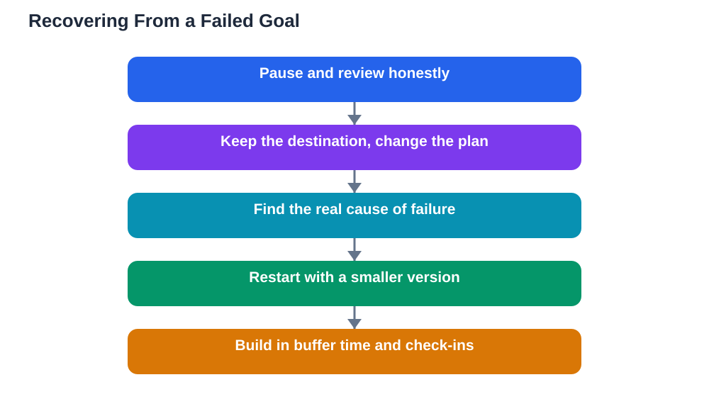

Almost every student has watched a goal fail. The plan was good, the intention was real, and still the deadline passed with the work unfinished. That moment stings, and the easiest response is to quit quietly and avoid thinking about it. But a failed goal is rarely a verdict on your ability. More often it is information about a plan that did not fit reality, and recovery means reading that information honestly and starting again with a better plan.

Recovery starts with a pause, not a rush. Before setting a new goal or blaming yourself, take a short, honest look at what happened. Did the goal demand more time than your week actually held. Did a particular step prove harder than expected. Did life get in the way for a stretch. Did the goal stop feeling important. These are different problems with different fixes, and treating them all as laziness helps no one. An honest review separates what you can control from what you cannot, and that separation is what makes the next attempt stronger than the last.

## Separate the Goal From the Plan

The most important recovery skill is learning to keep the destination while changing the route. If the goal itself still matters, such as understanding a topic or finishing a piece of work, then only the plan has failed, not the ambition. Ask whether the destination is still worth reaching, and if it is, protect it while redesigning everything else: the size of the steps, the timetable, the methods, the support you ask for. Many students throw away good destinations along with bad plans, and then wonder why they feel directionless. Adjust the plan, keep the destination, and the failed attempt becomes a rehearsal rather than a defeat.

## Diagnose What Actually Went Wrong

A useful diagnosis looks at four common causes. First, size: the goal may have been too large for the time available, so the fix is smaller steps and a longer runway. Second, clarity: the next action may have been vague, so the fix is writing steps that can be started immediately. Third, obstacles: a stuck topic, missing materials or a disrupted week may have broken the rhythm, so the fix is targeted help or a rebuilt schedule. Fourth, motivation: the goal may have lost its meaning, so the fix is reconnecting it to a reason you care about or replacing it honestly. Most failures involve more than one cause, so note each one before redesigning, and fix the biggest cause first rather than changing everything at once.

## Restart Small and Rebuild Confidence

After a failure, confidence is fragile, and a grand relaunch often backfires. Restart with a deliberately small version of the goal, one you can complete within a short time, and let that win rebuild trust in your own plans. If a term-long goal failed, restart with a two-week version covering one part of it. If a daily habit collapsed, restart with a few days a week instead of every day. Early wins after a setback matter more than ambitious promises, because they prove the new plan fits your real life. Once the small version is working, extend it gradually, checking at each stage that the plan still holds.

## Handle the Feelings Honestly

Disappointment, embarrassment and frustration are normal after a failed goal, and ignoring them usually makes them stronger. Acknowledge them plainly: the goal mattered, the result hurt, and the feeling will pass as new progress appears. Avoid two traps. The first is harsh self-judgement, which turns one failure into a story about your character and makes the next attempt feel pointless. The second is avoidance, where you stop thinking about the goal entirely and lose the lessons it contained. Talking with a trusted person about what happened can help, especially if you describe the plan and the obstacles factually rather than only the feeling. Feelings deserve attention, but they should inform the next plan, not cancel it.

## Build a Plan That Expects Setbacks

The strongest recovery is a plan built to survive trouble. Include buffer time for busy weeks, so one disruption does not destroy the schedule. Build in a weekly check-in, so small slips are caught before they become failures. Choose steps small enough to restart after a missed day without a mountain of catch-up work. And decide in advance what you will do when a session is missed: move it, shrink it, or swap it, but never let a single missed day become a reason to stop. Plans that expect setbacks treat them as normal weather on the journey, not as proof the journey is impossible.

## AI Help: Muse AI

Muse AI is Meta's personal AI assistant, and it can help you recover from a failed goal by suggesting a smaller restart plan. You can describe what went wrong and ask it to help you break the goal into gentler steps or draft a simple weekly check-in. Use its ideas as a starting point, then shape the new plan around your own timetable and obstacles.

Join Muse with invite code LTGSWD — in the Muse app, go to Settings > Redeem token and enter the code.

Disclosure: LTGSWD is the author's Muse invite code.

## FAQ

### Does a failed goal mean I am bad at goal-setting?

No. It usually means one plan did not fit one period of your life. Goal-setting is a skill learned through attempts, including failed ones. Each failure that is reviewed honestly teaches you something about sizing, timing or support that makes the next plan better.

### Should I retry the same goal or choose a new one?

Retry the same destination if it still matters to you, but with a redesigned plan. If the destination itself no longer matters, replace it honestly with a goal you do care about. Keeping a goal you no longer value only guarantees another failure.

### How long should I wait before restarting?

A short pause for honest review is enough, often a day or two. Waiting too long lets avoidance grow and the lessons fade. Restart small as soon as you have a revised plan, even if the first step is modest. Momentum returns through action, not through waiting.

### What if I keep failing at the same kind of goal?

Look for a pattern in your reviews. Repeated failures at the same kind of goal usually point to one repeated cause, such as steps that are too large, a study time that never works, or a topic that needs outside help. Fix that one cause directly, and consider asking someone knowledgeable for guidance on that specific difficulty.

## Conclusion

A failed goal is not a full stop; it is a comma in a longer story. Separate the destination from the plan, diagnose honestly, restart small, and build a plan that expects setbacks. Students who recover well do not fail less than others; they simply refuse to let one failed plan cancel a destination that still matters.

[Try the free AI lesson solver](/#tool)
