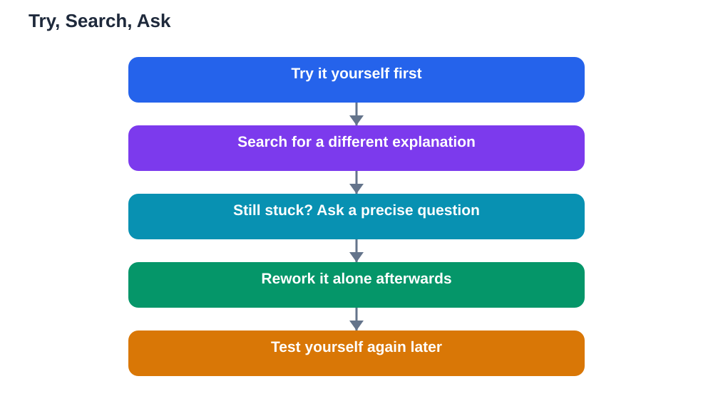

Learning alone does not mean learning without help. Every independent learner, including experienced adults, reaches points where they need another person, a better explanation, or a fresh perspective. The skill is knowing when to keep struggling and when to ask. Ask too early, and you never build the persistence that deep learning requires. Ask too late, and you waste hours stuck on something a short explanation could unlock. This guide gives you a simple rule for that decision, and shows how to ask in ways that actually help you learn.

## When to Ask for Help Learning: The Three-Step Rule

A practical rule is try, search, ask. First, try on your own: work through the problem, re-read the explanation, and attempt the idea in your own words. This first try matters, because it shows you exactly where you are stuck, and that knowledge makes any later help far more useful. Second, search for a different explanation: check your textbook again, try a worked example, or watch a trusted video on the topic. A new angle often unlocks what the first explanation did not. Third, if you are still stuck after an honest try and a genuine search, ask. Asking at this point is not giving up; it is the efficient next step, and you arrive with a precise question instead of a vague "I don't get it." A good guide is time: if you have spent a focused session trying and searching without progress, that is a strong signal to ask. Struggling productively builds learning, but struggling without progress for hours mostly builds frustration.

## How to Ask a Question That Gets a Useful Answer

The quality of help you receive depends heavily on the quality of your question. "I don't understand this chapter" is hard to answer, because the helper does not know where your understanding breaks down. A strong question names the topic, shows what you tried, and points to the exact sticking point: "I tried these two problems, and I get stuck at this step because I don't see why the sign changes here." That kind of question lets the helper explain exactly what you need, and it often helps you understand the problem better just by formulating it. Bring your work when you ask: your notes, your attempts, and your journal entries about the confusion. Helpers can spot errors and misunderstandings far faster when they see your thinking. If you ask online or through a forum, the same rules apply: show your attempt, name the step, and ask a specific question. Vague questions get vague answers, while precise questions get precise help.

## Who to Ask, and When Each Helper Fits

Different helpers suit different problems. A teacher is best for misunderstandings about core ideas and for checking whether your approach is right, especially when a topic keeps confusing you across several sessions. A classmate is excellent for comparing approaches and for explaining ideas in peer language, and explaining to each other often helps both students. A tutor can help when a topic needs sustained, personal attention over several sessions. Books, videos, and AI study tools suit quick checks and alternative explanations. If you use the Lesson Solver tool for textbook exercises, remember to verify its solutions against your textbook, keep in mind that AI can make mistakes, and note that the tool needs your own free Google AI Studio API key. The tool supports textbook photos in English, Urdu, and Sindhi, which is handy if you study in more than one language. Choosing the right helper saves time: a quick question does not need a tutor, and a deep misunderstanding will not be fixed by a single video.

## Asking for Help Without Losing Independence

Some students worry that asking for help means they are not really learning alone. That worry is misplaced. Independence is not doing everything unaided; it is managing your own learning, which includes knowing when to use help well. The key is what happens after you receive help. Do not just copy the answer. Rework the problem yourself, without looking at the help, until you can do it alone. Write down what the helper explained, in your own words, so the help becomes your knowledge rather than a borrowed answer. Then test yourself on a similar problem later, to confirm the help actually stuck. This follow-up turns help into learning. Students who ask well and follow up become more independent over time, not less, because each round of good help removes a real gap. For a routine that captures confusions to ask about, see [A Learning Journal: Five Lines a Day](/blog/learning-journal-habit.html).

## When Help Itself Needs Checking

Not all help is good help, and wise learners check what they receive. If an explanation contradicts your textbook, trust the textbook and ask a teacher about the difference. If a solution skips steps or seems too easy, work through it yourself to confirm it. If someone simply gives you an answer without explaining it, you have received a finished product, not learning, and you still need to understand the steps. Be especially careful with answers from the internet or AI tools: they can be confident and wrong at the same time. Always verify important answers against a reliable source, and be honest about help you used when it matters, such as in assignments where your own work is expected. Good help explains, shows working, and leaves you able to do the next similar problem alone. If help does not do that, it is worth seeking a second explanation rather than settling.

## AI Help: Muse AI

Muse AI is Meta's personal AI assistant, and it can help you decide when to ask for help by explaining a confusing idea in a different way before you approach a teacher. You can ask it to walk through a problem step by step, or to help you phrase a precise question about exactly where you are stuck. Join Muse with invite code LTGSWD — in the Muse app, go to Settings > Redeem token and enter the code.
Disclosure: LTGSWD is the author's Muse invite code.

## FAQ

### How long should I struggle before asking for help?

Give yourself one focused session of honest trying and searching first: attempt the problem, try a different explanation, and identify the exact step where you get stuck. If you are still stuck after that, asking is the efficient next step. Struggling without progress for many hours rarely teaches more than asking a precise question does.

### Is asking for help a sign that I am not good at studying alone?

No. Managing your own learning includes knowing when to use help, and every strong independent learner asks for help regularly. What matters is what you do afterwards: rework the problem yourself, write the explanation in your own words, and test yourself later so the help becomes your own knowledge.

### What should I do if I feel embarrassed asking for help?

Remember that teachers and classmates expect questions, and a precise question shows you have already worked hard on the problem. Starting with what you tried, such as "I attempted this and got stuck at this step," makes asking feel easier and gets you a better answer. Most learners respect someone who asks a thoughtful question.

### Should I ask a teacher or a classmate first?

For a quick check or a different viewpoint, a classmate is often fastest, and explaining to each other helps both of you. For a core misunderstanding that has lasted several sessions, or for checking whether your whole approach is right, a teacher is the better choice. Use the helper who fits the depth of the problem.

## Conclusion

Knowing when to ask for help is a core skill of learning alone, not a weakness in it. Try first, search for a different explanation, and then ask with a precise question that shows what you tried and where you are stuck. Choose the helper who fits the problem, follow up by reworking the problem yourself, and always check help against a reliable source. Used this way, asking for help does not replace your independence. It strengthens it, one well-answered question at a time.

[Try the free AI lesson solver](/#tool)
