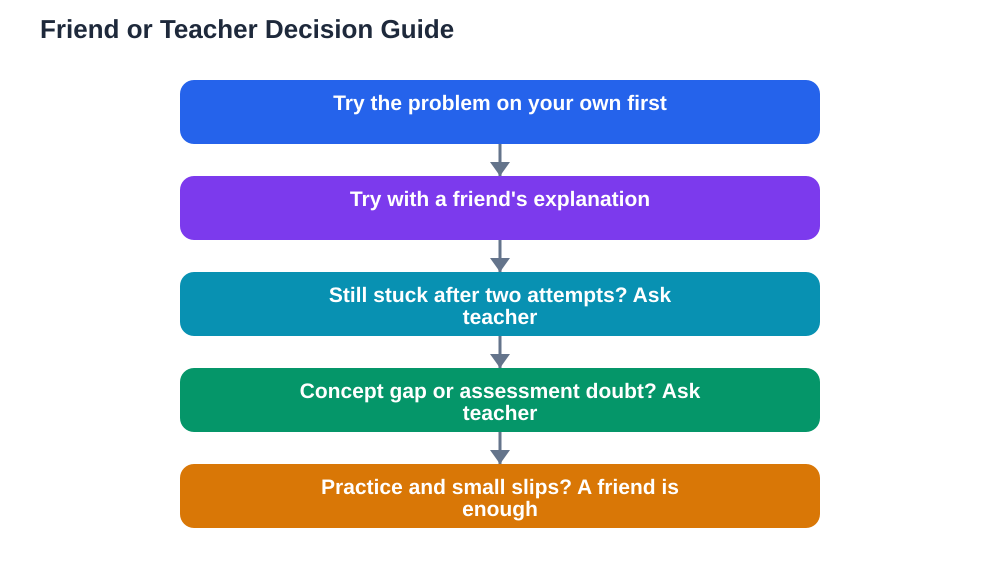

When to ask teacher help instead of a friend is a decision every student faces, and getting it right saves a lot of wasted time. Friends are wonderful for quick explanations, practice, and encouragement, but there are moments when only a teacher can give you what you need: an authoritative explanation, the method your class actually uses, or clarity about what an assessment expects. Asking a teacher is not a sign of failure, and asking a friend is not a sign of laziness. Each has its place. This guide gives you simple rules for deciding which one to turn to, so you get unstuck faster and learn more deeply.

## When to Ask Teacher Help: The Stuck-Twice Rule

A practical rule for when to ask teacher help is the stuck-twice rule: try on your own, try with a friend's help, and if you are still stuck, ask the teacher. The first attempt matters because it shows you exactly where the difficulty lies. The friend attempt matters because explaining your confusion to someone else often clarifies it, and a friend's different explanation may be the one that clicks. But if two genuine attempts have not moved you forward, further guessing usually wastes time and can even cement a wrong idea. At that point, a teacher's explanation is the efficient choice, not a last resort. Teachers expect this: part of their job is helping students over exactly these sticking points, and they would far rather explain a concept now than mark a wrong answer later.

## Concept Gaps Belong to the Teacher

When the problem is a concept gap, a missing or shaky understanding of the underlying idea, a teacher is usually the right person to ask. Friends can share how they understand a concept, but their understanding may itself be incomplete or use a different method from your class. A teacher can explain the concept from the ground up, connect it to what you already know, and confirm that your understanding matches what the class teaches. Warning signs of a concept gap include feeling lost from the first step rather than one step, getting the same type of problem wrong repeatedly, or being unable to explain why a method works even when you can follow it. In these cases, go to the teacher with a specific description of what confuses you, such as "I do not understand why this step is allowed", because a precise question gets a precise answer. The guide on [when to ask for help studying](/blog/when-to-ask-for-help-studying.html) offers more on recognising when you need help at all.

## Assessment Doubts Need an Authoritative Answer

Any doubt about what an assessment expects should go to the teacher, not a friend. Friends can guess, but only the teacher knows how work will be judged, what format answers should take, and which methods are acceptable. Questions like "How much working should I show?", "Is this method acceptable?", or "What does this instruction mean?" are teacher questions, full stop. Guessing wrong on these can cost marks even when your understanding is sound, so asking is simply smart. The same applies to doubts about homework instructions: if the task itself is unclear, asking the teacher for clarification beats asking a friend to interpret it. When you ask, be specific about the instruction or question that confuses you, and note the answer down, because other students often share the same doubt and your question may help the whole class when the teacher clarifies it for everyone.

## When a Friend's Help Is Enough

Friends are the right choice for a large share of study problems. If you understand the concept but made a small slip, a friend can spot it quickly. If you need practice, a friend can quiz you or work problems alongside you. If you want a second explanation of something you mostly understand, a friend's different words may be exactly what clicks. Friends are also best for motivation and accountability: studying together, checking each other's work, and keeping each other on track. A good test is whether the problem is about practice and polish or about missing understanding. Practice and polish belong with friends; missing understanding, especially after two attempts, belongs with the teacher. Using friends well also means being a good friend in return: help others when you can, because teaching them deepens your own learning, as explained in the guide on [learning by teaching](/blog/learning-by-teaching.html).

## How to Ask a Teacher So You Get a Useful Answer

Asking a teacher well is a skill that makes the answer far more useful. First, show what you have tried: "I tried this method and got stuck at this step" tells the teacher far more than "I do not get it." Second, ask a specific question rather than a general one: "Why do we do this step?" beats "Can you explain the whole chapter?" Third, listen and take notes, and repeat the explanation back in your own words to check you understood it. Fourth, if the answer still does not click, say so honestly rather than nodding along; teachers would rather explain differently than leave you confused. Finally, thank them. Teachers remember students who ask thoughtful questions, and a good question often improves the lesson for everyone. If you feel nervous asking in front of the class, ask after the lesson or during a quiet moment: the quality of the question matters, not the audience.

## Overcoming the Fear of Asking

Many students avoid asking teachers because they fear looking foolish, bothering the teacher, or admitting they are behind. These fears are normal, but they are also misleading. Teachers consider questions a normal and welcome part of learning, and a student who asks is seen as engaged, not weak. Remember that in any class, several other students almost certainly share your confusion and are relieved when someone asks. Start small if it helps: ask one precise question about one step, and notice how ordinary the experience feels. Over time, asking becomes a habit, and students with the habit of asking good questions learn faster than students who silently struggle. If a teacher ever responds unkindly, that reflects on them, not on you, and you can still seek help from another teacher, a tutor, or a trusted adult. Never let one bad experience close the door on asking for help.

## AI Help: Muse AI

Muse AI is Meta's personal AI assistant, and it can help you prepare before asking a teacher. You can ask it to help you phrase a precise question about the step where you are stuck, or to summarise what you have tried so far into a clear note you can show your teacher.

Join Muse with invite code LTGSWD — in the Muse app, go to Settings > Redeem token and enter the code.

Disclosure: LTGSWD is the author's Muse invite code.

## FAQ

### Is asking a teacher a sign I am not smart enough?

No. Asking a teacher is a sign you are taking your learning seriously. The smartest students ask the most questions, because they care about understanding rather than appearing to understand. Teachers respect good questions and expect them from engaged students.

### Should I ask a friend first every time?

Usually yes, because a friend's explanation often resolves small issues quickly and saves the teacher's time for harder problems. But if you already know the issue is a concept gap or an assessment doubt, going straight to the teacher is sensible. The stuck-twice rule is a guide, not a rigid law.

### What if my teacher is busy or hard to approach?

Try asking after the lesson, during a designated help time, or in a short written note with your specific question. If one teacher is genuinely unavailable, another teacher, a tutor, or a trusted adult can help. The key is to keep seeking an authoritative answer rather than giving up.

### Can I use an AI study tool instead of asking a teacher?

AI tools can help you practise and explore explanations, and the free lesson solver can walk through textbook problems step by step. But AI can make mistakes, and it cannot tell you what your class expects, so for concept gaps and assessment doubts, a teacher remains the right choice. Always verify AI explanations against your textbook, and remember the lesson solver tool needs your own free Google AI Studio API key.

## Conclusion

When to ask teacher help comes down to a few clear rules: try yourself, try with a friend, and if you are still stuck, ask the teacher. Concept gaps and assessment doubts belong to teachers from the start, while practice, small slips, and motivation belong happily with friends. Ask specific questions, show what you tried, and never let fear keep you silent, because a good question is one of the fastest routes to understanding. For step-by-step help with textbook problems while you prepare your questions, [Try the free AI lesson solver](/#tool).
