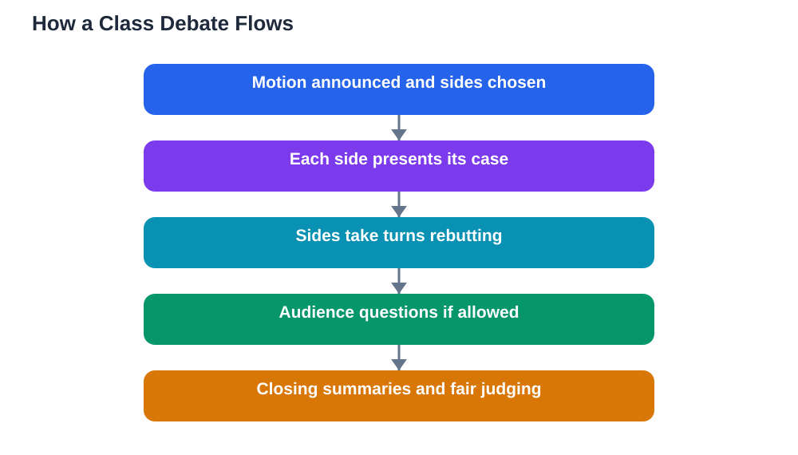

A whole class debate is one of the most exciting activities in school, and one of the most demanding. Unlike a casual discussion, a debate has sides, turns, rules, and a clear question to argue about. When it works, students learn to build arguments, listen to opponents, and think on their feet. When it goes wrong, it becomes a shouting match where the loudest voice wins and nobody learns anything.

The difference lies in structure and respect. A good debate treats the other side as a partner in finding the truth, not an enemy to defeat. This guide explains how debates work, how to prepare, how to take turns fairly, and how to deliver rebuttals that are sharp without being personal.

## How a Class Debate Is Structured

Most class debates follow a simple shape. The class is given a motion, which is a statement to argue for or against, such as "Homework should be replaced by revision time." One side argues in favour, the other against, and each side takes turns presenting arguments, responding to the other side, and summarising at the end. A teacher or a student chair usually manages the order and timing.

Knowing the structure in advance removes most of the anxiety. Before the debate, find out how many speakers each side has, how long each turn lasts, and whether the audience can ask questions. When you know when you speak and for how long, you can prepare properly instead of worrying about the unknown.

## Preparing Your Side's Case

Preparation wins debates more than quick thinking does. Start by understanding the motion precisely. What do its key words mean, and what would count as winning the argument? A team that defines the terms clearly at the start often controls the whole debate, because the other side must then argue on that ground.

Next, gather two or three strong arguments, each backed by a reason or an example. One deep, well-supported argument beats five shallow ones. Also prepare for the other side: what are their likely strongest points, and how would you answer them? Teams that prepare rebuttals in advance sound far more confident than teams that improvise everything under pressure.

## Taking Turns Fairly

Turn-taking is the backbone of a fair debate. Each speaker gets their allotted time without interruption, and the other side listens fully before responding. Interrupting a speaker, even to correct an error, breaks the structure and usually weakens your own side's standing with the audience.

If you are chairing or managing turns, enforce time limits kindly but firmly. A simple "Thank you, your time is up, let us hear the next speaker" keeps things moving without embarrassment. Speakers should practise finishing within their time, which means preparing a short closing line for each speech rather than trailing off when the clock runs out.

## Building a Strong Argument

A strong debate argument has three parts: a clear claim, a reason that supports it, and an example or explanation that makes the reason concrete. For instance: "Revision time would help learning more than homework (claim), because students could get immediate help when stuck (reason), as happens in class when a teacher answers a question on the spot (example)." This claim-reason-example pattern keeps arguments tight and persuasive.

Avoid arguments that rely on exaggeration or personal attacks. Claims like "Everyone knows this is true" are not arguments at all, and audiences notice. Stick to reasons that can be examined and examples that genuinely support your point. A debate is won by the quality of reasoning, not by the volume of delivery.

## Delivering a Respectful Rebuttal

A rebuttal is your response to the other side's argument, and it is where debates are often won or lost. A good rebuttal starts by fairly restating the argument you are answering, then shows a weakness in its reasoning or evidence. Phrases like "The other side argued that..., but this overlooks..." keep the rebuttal focused on ideas.

Respectful rebuttals never target the speaker. Avoid comments about a speaker's intelligence, confidence, or character, however tempting they feel in the heat of the moment. Personal remarks damage your side's credibility with the audience and the teacher, even if they draw a laugh. The sharpest rebuttals are calm, specific, and aimed entirely at the argument.

## Listening to the Other Side

Listening is a debate skill, not just a courtesy. While the other side speaks, note their main arguments and any weak spots in their reasoning. These notes become your rebuttal material. A debater who listens well can answer the actual arguments made, while a debater who planned rebuttals in advance and stopped listening often answers points nobody raised.

Listening also protects you from repeating an argument the other side already answered. Nothing weakens a speech faster than presenting a point as new when the audience heard it dismantled five minutes earlier. Good notes prevent that embarrassment and keep your speeches relevant to where the debate actually stands.

## Closing and Judging Fairly

The closing speeches should summarise, not introduce new arguments. Each side restates its strongest points, explains why they outweigh the other side's case, and ends with a clear final line. A strong closing feels like a conclusion, not a scramble for last-minute points.

If the class votes or judges the debate, judge the arguments, not the speakers. The side with clearer reasoning and better evidence deserves the win, even if their delivery was quieter. Learning to judge fairly is itself a valuable skill, because it trains you to separate style from substance, a habit that matters far beyond the classroom.

## FAQ

### What if I am assigned a side I disagree with?

Arguing a side you disagree with is excellent practice. It forces you to understand a view deeply enough to defend it, which is a powerful learning exercise. Treat it as a thinking challenge rather than a personal statement, and judge the experience by how well you argued, not by whether you agreed.

### How do I handle stage fright before speaking?

Prepare thoroughly, practise your opening lines aloud, and remember that the audience is mostly focused on the arguments, not on judging you. Taking a slow breath before you begin and speaking slightly more slowly than feels natural both help steady your nerves.

### What if the other side interrupts me?

Stay calm and let the chair handle it. If there is no chair, pause and say politely, "Could I finish this point, please?" Keeping your composure while interrupted usually earns the audience's respect and reflects badly on the interrupter, not on you.

### Can the audience participate in a class debate?

That depends on the format your teacher chooses. Some debates include audience questions between rounds, while others keep the audience as judges only. Ask your teacher before the debate so you know whether to prepare questions or simply listen and judge.

## Conclusion

Whole class debates reward preparation, fair turns, clear arguments, and respectful rebuttals. Prepare your case with reasons and examples, listen closely to the other side, rebut ideas rather than people, and close by summarising your strongest points. Debated this way, everyone learns, whatever the result. And when you prepare on your own, remember that AI tools can make mistakes, so verify solutions against your textbook.

[Try the free AI lesson solver](/#tool)
