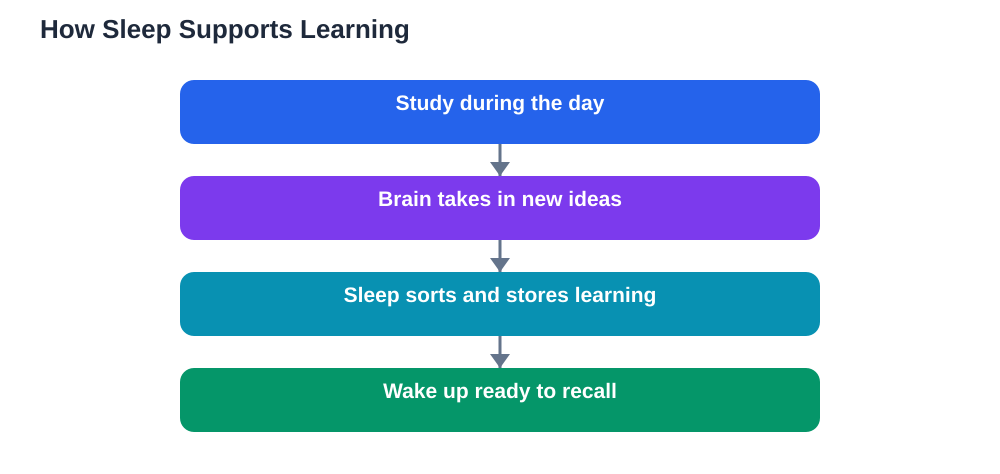

Sleep is often the first thing students give up when study pressure grows, yet it is one of the most powerful study tools available. Understanding why sleep matters students should care about changes how you plan your evenings. A rested brain learns faster, remembers longer, and handles difficult work with more patience than a tired one. This article explains what sleep does for learning, the signs that you are running short, and how to protect your rest without giving up your study goals.

## Why Sleep Matters for Students More Than Extra Study

Many learners believe that one more hour of reading beats one more hour of sleep. In practice, the opposite is often true. When you study, your brain takes in new information, but that information is still fragile. Sleep is when the brain sorts, strengthens, and stores what you learned during the day. Think of study as writing notes and sleep as filing them safely away. Without that filing step, much of the effort leaks away by morning, and you may find yourself re-reading the same page again and again.

This is why sleep is best understood as brain maintenance rather than wasted time. During rest, the brain clears away the mental clutter of the day, restores attention, and prepares fresh capacity for tomorrow. A student who sleeps well often needs less time to understand a new lesson, because the brain arrives ready rather than exhausted. Cutting sleep to study more usually creates a false economy: you gain an evening of reading and lose the next day of clear thinking.

## What Sleep Does for the Learning Brain

While you sleep, your brain is far from idle. It replays patterns from the day, connecting new ideas to things you already know. That is how a concept that felt shaky in the evening can feel clearer the next morning. Sleep also helps with problem solving, because a rested brain is better at spotting patterns and trying a fresh approach instead of repeating the same stuck method.

Sleep supports attention too. A well-rested learner can follow a long explanation, hold several steps of a problem in mind, and resist distractions. A tired learner, by contrast, reads the same sentence several times, loses track mid-problem, and makes small careless slips. Teachers often notice this difference quickly: the same student can look like two different learners depending on the night before.

## Signs Your Brain Needs More Rest

Tiredness does not always announce itself with yawning. Watch for subtler signs. You may reread paragraphs without absorbing them, forget instructions moments after hearing them, or feel unusually irritated by small problems. You may start tasks but drift to your phone within minutes, or sit down to study and feel your mind go blank. Headaches, heavy eyes, and a strong craving for sweet snacks late at night can also be signals that your brain is asking for rest.

Another telling sign is the weekend catch-up pattern. If you feel almost unable to function on school mornings but far more alert after long weekend sleep, your weekday routine is probably running a sleep debt. The goal is not to sleep until midday on weekends, which disrupts your rhythm, but to bring your nightly routine closer to what your body clearly needs.

## Sleep, Focus and Classroom Attention

Classroom learning depends on sustained attention, and attention depends on sleep. A lesson builds step by step: miss one step and the next ones become harder. A tired student misses more steps, not because of ability but because the brain keeps dropping the thread. Over weeks, these small gaps accumulate into larger confusion, which then feels like the subject itself is too hard.

Good sleep also protects your mood in class. A rested student can handle a difficult question or a low mark without spiralling. A tired student is more likely to snap at a classmate, give up early, or decide the subject is not for them. Protecting sleep is therefore also protecting your confidence and your relationships at school.

## Building Sleep Into a Study Plan

Treat sleep as a fixed appointment in your study plan, not as whatever time is left over. Choose a regular bedtime and work backwards: plan your study blocks, breaks, meals, and wind-down time so that bedtime is realistic. If the plan only works by skipping sleep, the plan is too full and needs trimming, not your rest.

Start small if your current routine is chaotic. Move bedtime earlier gradually, keep wake time steady, and dim the lights in the final part of the evening. Prepare tomorrow's bag and notes before you wind down, so your mind is not rehearsing unfinished tasks in bed. Keep a notebook beside your bed: writing down a worry or a tomorrow-task often releases it from your mind. When you use a study tool for homework help, remember to verify solutions against your textbook, since AI can make mistakes, and never let a tool keep you up far past your bedtime.

## FAQ

### Why do students feel sleepy even after studying all evening?

Because mental effort drains attention, and a tired brain signals for rest just as tired muscles do. Studying late without breaks also pushes bedtime later, so the brain never gets its recovery window. Short breaks, an earlier finish, and a steady sleep routine usually restore alertness better than pushing through exhaustion.

### Does sleeping after studying really help memory?

Yes, sleep is when the brain consolidates new learning, moving fragile new memories into more durable storage. That is why reviewing a topic, then sleeping, often beats cramming the same topic again late at night. A short review before bed followed by proper sleep is a smarter strategy than an all-night session.

### What if I cannot fall asleep because I am thinking about schoolwork?

Write the worry down before bed, along with the next small step you will take tomorrow. This tells your brain the problem is parked, not forgotten. A calm wind-down routine, dim light, and no screens in the last part of the evening also help the mind slow down.

### Is catching up on sleep at weekends enough?

Weekend lie-ins can ease the worst tiredness, but they do not fully repair a week of short nights, and they shift your body clock so Monday feels harder. Steady nightly sleep beats a weekday deficit plus a weekend binge. Aim for consistency across the whole week.

## Conclusion

Sleep is not the enemy of good grades; it is one of their quiet foundations. When you protect your rest, your study time works harder, your memory holds longer, and your mood stays steadier. Start tonight by setting a bedtime you can actually keep, and let your brain do its filing work while you rest.

[Try the free AI lesson solver](/#tool)
